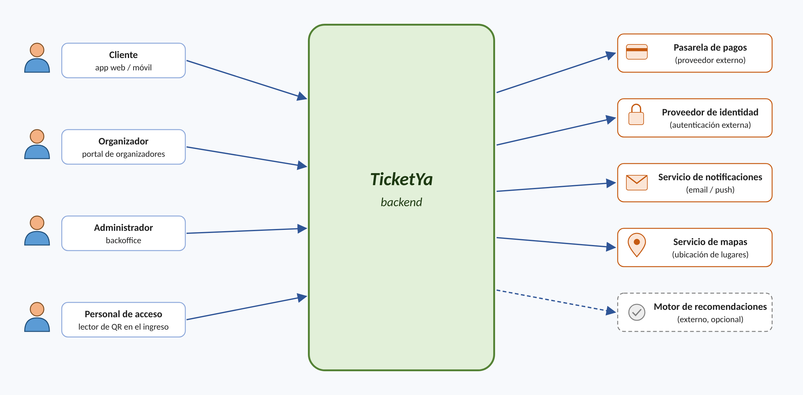

# TicketYa

> Arquitectura Web (TUDAI) — Díaz Pace/Yañez (2026)

## Trabajo Práctico Grupal: TicketYa

*TicketYa* es un startup que busca construir una plataforma de venta de entradas (ticketera virtual) para todo tipo de eventos: recitales, festivales, obras de teatro, partidos y conferencias. La misión es que cualquier organizador, desde un club de barrio hasta una gran productora, pueda publicar sus eventos y vender entradas en forma simple, segura y a bajo costo, y que el público pueda encontrar y comprar entradas desde su celular sin filas ni sobresaltos.

La plataforma trabaja con tres tipos de usuarios: **administradores** (gestión completa, mantenimiento y tareas operativas), **organizadores** (diseñan y publican eventos) y **clientes** (buscan eventos y compran entradas). Además, en el ingreso a cada evento, el **personal de acceso** escanea el código QR de las entradas para validarlas.

El mayor desafío del negocio aparece en los eventos masivos: cuando se abre la venta de un recital convocante, decenas de miles de personas intentan comprar en los mismos minutos. En esas condiciones el sistema debe seguir funcionando, ser justo con quienes llegaron primero y, sobre todo, garantizar que **una misma entrada nunca se venda dos veces**. Con el tiempo, se pretende también personalizar la oferta de eventos según los gustos e historial de cada cliente. Un diagrama de contexto del sistema es el siguiente:

El trabajo debe centrarse en el **backend**, que orquesta todas las interacciones, si bien deben contemplarse en el diseño los sistemas adicionales (aplicaciones de clientes y organizadores, backoffice administrativo, lectores de acceso, pasarela de pagos, notificaciones, etc.).

## Funcionalidad

1. Cada **evento** tiene: ID, nombre, descripción, tipo (recital, teatro, deporte, conferencia, etc.), organizador, participantes (artistas, equipos, disertantes), fecha y hora, lugar, y estado (borrador, publicado, agotado, cancelado, finalizado).
2. Cada **lugar** (estadio, teatro, sala) tiene: ID, nombre, dirección, ubicación (latitud/longitud) y un conjunto de **sectores**. Un sector puede ser **numerado** (filas y asientos identificados) o **no numerado** (zona con una capacidad máxima, p. ej. “Campo”). Para cada evento, el organizador define el precio de cada sector.
3. Los organizadores crean sus eventos en estado borrador, configuran sectores y precios, y luego los publican. Los administradores pueden suspender o cancelar cualquier evento.
4. Un cliente elige un evento, un sector y, si es numerado, asientos específicos. El sistema **reserva temporalmente** esos lugares (por ej. por 10 minutos) mientras el cliente paga. Si el pago es aprobado, se emiten las entradas con un **código QR único**; si el pago es rechazado o la reserva vence, los lugares se liberan. Se debe registrar el detalle de la compra y el medio de pago, y limitar la cantidad de entradas por cliente para un mismo evento.
5. **Una entrada nunca puede venderse dos veces**, aun cuando muchos clientes intenten comprar el mismo asiento (o el último lugar de una zona) al mismo tiempo, o cuando un cliente reintente el pago por un problema de conexión.
6. Para eventos marcados como de **alta demanda**, al abrirse la venta los clientes ingresan a una **fila virtual**: el sistema les informa su posición y los habilita a comprar en orden, por tandas.
7. Un cliente puede **solicitar la devolución** de una entrada hasta 72 horas antes del evento. Un administrador aprueba o rechaza la solicitud; si la aprueba, el asiento o lugar en la zona se libera y se solicita el reintegro del dinero a la pasarela de pagos. Si un evento se **cancela**, todas sus entradas vendidas pasan a reintegro y se notifica a los compradores.
8. En el ingreso al evento, el personal de acceso escanea el QR. El sistema valida que la entrada exista, corresponda a ese evento y no haya sido usada, y la marca como utilizada (un QR no puede ingresar dos veces).
9. El sistema debe permitir **búsquedas por múltiples criterios**: tipo de evento, organizador, participante, ciudad y rango de fechas, con ordenamiento por fecha, precio o relevancia.
10. El sistema debe registrar las **preferencias** de los clientes (tipos de evento, artistas favoritos, ciudad) y **sugerir eventos** en función de su historial (similar a “quienes compraron entradas para este evento también compraron para…”).
11. Enviar **notificaciones** (email o push) al confirmar una compra, ante la cancelación o cambio de un evento, y cuando un artista favorito de un cliente publica un evento en su ciudad.
12. Los organizadores deben poder consultar **reportes** de sus eventos: entradas vendidas y devueltas por sector, porcentaje de ocupación y recaudación.

## Consideraciones de arquitectura y no funcionales

- Utilizar **arquitectura de microservicios**, implementando cada microservicio con **Spring Boot** como un proyecto independiente, que pueda construirse y ejecutarse por separado.
- **Punto de entrada único**: los clientes externos acceden al sistema a través de un API Gateway.
- **Comunicación**: utilizar APIs REST, mayormente síncronas, aunque podría utilizarse comunicación asíncrona (fire-and-forget o mensajería) donde se justifique, por ejemplo para notificaciones o para la fila virtual.
- **Persistencia**: cada microservicio debe tener preferentemente su propia base de datos (puede ser la misma tecnología, pero esquemas separados). Al menos un microservicio debe utilizar una **base de datos NoSQL** (por ej. MongoDB para el catálogo de eventos o las preferencias de los clientes), justificando la elección. Se valorará el uso de otras tecnologías según el tipo de datos (por ej. Redis para reservas temporales o la fila virtual).
- **Concurrencia e idempotencia**: el mecanismo que impide la doble venta debe funcionar aun con **varias instancias** del mismo microservicio ejecutándose a la vez. Debe explicarse y probarse el mecanismo elegido (bloqueos, control de versiones, restricciones de unicidad, claves de idempotencia, etc.).
- **Consistencia entre servicios**: una compra involucra a más de un microservicio (disponibilidad de lugares, pagos, emisión de entradas). Dado que no existe una única transacción de base de datos que los abarque, se debe definir cómo se mantiene la consistencia y cómo se deshacen los pasos ya realizados si uno falla (por ej., vía compensaciones).
- **Resiliencia**: implementar reintentos, timeouts y fallback ante fallos de servicios externos (pasarela de pagos, servicio de notificaciones).
- **Cache**: definir qué datos se cachean (por ej. catálogo y detalle de eventos, resultados de búsqueda), dónde, con qué tiempo de vida (TTL) y cómo se invalidan, y justificar qué datos **no** deben cachearse (p. ej. la disponibilidad de asientos).
- **Trazabilidad**: cada solicitud HTTP debe quedar registrada en un log con el endpoint, el usuario, el código de respuesta y el tiempo de procesamiento. Cada operación crítica (compra, devolución, cancelación, ingreso al evento) debe quedar registrada en un log centralizado, con un identificador que permita seguir una misma operación a través de los distintos microservicios.
- **Seguridad**: autenticación y autorización con JWT (usuarios y roles: cliente, organizador, administrador y personal de acceso).
- **Despliegue**: cada microservicio (y cada base de datos, el gateway, etc.) debe poder desplegarse en su **propio contenedor Docker**, y todo el sistema debe poder levantarse con un único `docker-compose.yml`.
- **Rendimiento**: el sistema debe soportar la apertura de venta de un evento masivo. Se debe realizar al menos una prueba de carga sobre el flujo de compra (por ej. con JMeter) y reportar sus resultados.
