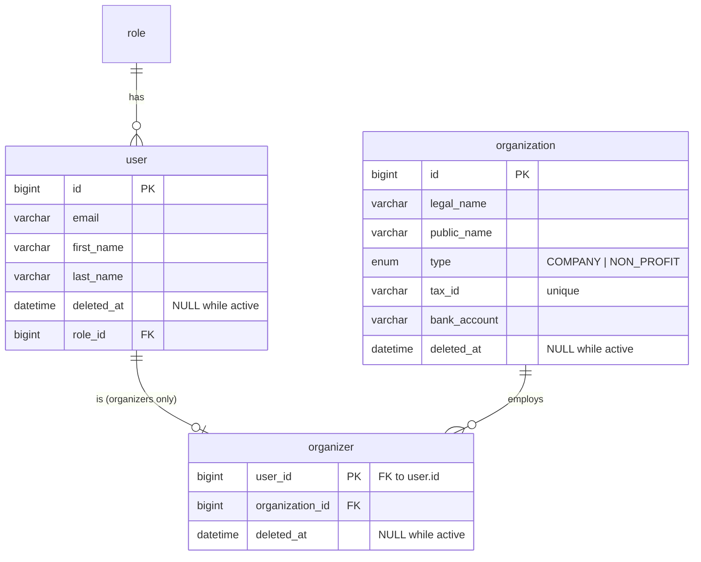

# auth-service: organizaciones y organizadores

> Épica 3 (#3): base para crear eventos. El event-service necesita saber a nombre de qué organización se crea un evento y quién lo crea. Esos datos son del auth-service (ver `microservices.md`).

## Diagrama



En `organization` y en `organizer`, la única columna nullable es `deleted_at`.

## Decisiones del modelo

| Tabla | Qué representa |
|---|---|
| `organization` | La empresa u organización sin fines de lucro que organiza los eventos |
| `organizer` | Un `user` que una organización designa para organizar sus eventos |

- **`organizer` comparte el id de `user`.** `user_id` es a la vez PK y FK 1 a 1 hacia `user.id`. En JPA se mapea con `@OneToOne` + `@MapsId`. Un organizador es un usuario con datos propios, así que no necesita un id aparte: `GET /api/organizers/{userId}` usa el mismo id que el usuario.
- **Un organizador trabaja para una sola organización** (`organization_id`, N a 1). Una organización puede tener varios organizadores.
- **Baja lógica, no borrado.** Nada se borra (supuesto del DER). `organizer.deleted_at` es la fecha en que dejó de ser organizador (la `fecha_baja` del diseño), y `organization.deleted_at` la fecha en que se dio de baja la organización. Los eventos del event-service guardan el id del organizador que los creó y esa referencia no tiene FK, así que si se borrara la fila quedarían apuntando a la nada (ver RFC-004).
- **`tax_id` es único.** Es el CUIT, y no puede haber dos organizaciones con el mismo.
- **La relación es unidireccional.** `Organizer` conoce su `User` y su `Organization`, pero `User` no conoce su `Organizer`. Así la entidad `User` queda igual para los usuarios que no son organizadores.

### Relación con el event-service

`event.organization_id` y `event.created_by` apuntan a `organization.id` y a `organizer.user_id`, pero **no son FK**: están en otra base. JPA no puede mapear un `@ManyToOne` entre bases distintas. Se guardan como `Long`, y el event-service los valida contra estos endpoints al crear un evento. Es la decisión del equipo sobre [`RFC-004`](../rfc/RFC-004-cross-service-relations.md): referencia por id.

## Endpoints

Los consume el event-service con `AuthClient`. Swagger: `/swagger-ui.html` en el servicio (`:8081`).

| Método | Ruta | Qué hace | OK |
|---|---|---|---|
| `GET` | `/api/organizations/{id}` | Una organización **activa** | 200 |
| `GET` | `/api/organizers/{userId}` | Un organizador **activo** con el id de su organización | 200 |
| `GET` | `/api/users/{id}/permissions` | Rol y permisos de un usuario **activo**. **Solo el admin** (`USER_MANAGE`): los servicios ya no lo usan para autorizar | 200 |
| `POST` | `/api/organizations/{id}/organizers` | **Solo el admin.** Hace organizador de la organización a un **cliente**: su rol pasa a `ORGANIZER` desde su próximo token. 409 si ya organiza o no es cliente | 201 |
| `DELETE` | `/api/organizations/{id}/organizers/{userId}` | **Solo el admin.** Deja de organizar para esa organización y vuelve a ser cliente. Sus eventos siguen siendo de la organización | 204 |
| `POST` | `/api/auth/google` | Canjea el ID token de Google por el JWT de TicketYa. Login y registro son lo mismo (ver *Login con Google*) | 200 |
| `POST` | `/api/auth/dev-login` | JWT de un usuario **activo**, sin Google. **Solo con el perfil `dev`**: fuera de él da 404 (ver [ADR-002](../adr/ADR-002-dev-login.md)) | 200 |
| `GET` | `/.well-known/jwks.json` | Clave pública para verificar los JWT. La usa el api-gateway, directo contra el servicio | 200 |
| `GET` | `/internal/users/{id}` | Email y nombre de un usuario **activo**. Lo usa el notification-service para el mail de una compra (US-NOT-01). Solo entre servicios: no pasa por el gateway y pide `X-Internal-Secret` | 200 |

```http
GET /api/organizations/1
→ { "id": 1, "legalName": "Producciones del Sur S.A.",
    "publicName": "Del Sur Producciones", "type": "COMPANY" }

GET /api/organizers/2
→ { "userId": 2, "firstName": "María", "lastName": "Gómez", "organizationId": 1 }

GET /api/users/2/permissions
→ { "userId": 2, "role": "ORGANIZER",
    "permissions": ["EVENT_MANAGE", "EVENT_SEARCH", "REFUND_REQUEST", "REPORT_VIEW", "TICKET_PURCHASE"] }

GET /internal/users/1   X-Internal-Secret: …
→ { "userId": 1, "email": "client@ticketya.com", "firstName": "Juan", "lastName": "Pérez" }

POST /api/auth/google   { "idToken": "eyJhbGciOiJSUzI1NiIsImtpZCI6..." }
→ { "accessToken": "eyJhbGciOiJSUzI1NiJ9...", "tokenType": "Bearer", "expiresIn": 1800, "newUser": true }

POST /api/auth/dev-login   { "userId": 2 }
→ { "accessToken": "eyJhbGciOiJSUzI1NiJ9...", "tokenType": "Bearer", "expiresIn": 1800 }
```

## Reglas

- **Qué es una organización activa:** `organization.deleted_at` en `NULL`. Si tiene fecha, la respuesta es `404 organization_not_found`, igual que si no existiera.
- **Qué es un organizador activo:** `organizer.deleted_at`, `user.deleted_at` y el `deleted_at` de su organización en `NULL`. Si alguno tiene fecha, la respuesta es `404 organizer_not_found`, igual que si no existiera, para que nadie dado de baja pueda crear eventos.
- **Datos que no salen del servicio.** `OrganizationResponse` no incluye `tax_id` ni `bank_account`. Ningún otro servicio los necesita para mostrar o validar un evento, y son datos fiscales y bancarios.
- **La respuesta del organizador trae `organizationId`.** El event-service lo usa para comprobar que el organizador pertenece a la organización del evento.

## Errores

Todos usan el `ErrorDto` común (ver [`error-handling.md`](error-handling.md)). Si el event-service recibe un 4xx de estos endpoints, el `GlobalExceptionHandler` se lo reenvía tal cual al cliente.

| Código | Status | Cuándo |
|---|---|---|
| `organization_not_found` | 404 | No existe la organización, o está dada de baja |
| `organizer_not_found` | 404 | El usuario no es organizador, o está dado de baja él, su usuario o su organización |
| `user_not_found` | 404 | No existe el usuario, o está dado de baja (`GET /api/users/{id}/permissions`, `GET /internal/users/{id}`) |
| `unauthorized` | 401 | `/internal/**` sin `X-Internal-Secret` o con uno incorrecto |
| `invalid_credentials` | 401 | Login con Google: el ID token es inválido, está vencido, es de otra app o su email no está verificado |
| `user_disabled` | 403 | Login con Google: la cuenta está dada de baja |
| `data_conflict` | 409 | Login con Google: el email ya está vinculado a otra cuenta de Google |
| `service_unavailable` | 503 | Login con Google: falta `GOOGLE_CLIENT_ID`, o no se pudieron obtener las claves públicas de Google |

## Código

| Capa | Clases |
|---|---|
| `entity` | `Organization`, `OrganizationType`, `Organizer` |
| `repository` | `OrganizationRepository`, `OrganizerRepository`, `UserRepository` |
| `dto` | `OrganizationResponse`, `OrganizerResponse`, `UserPermissionsResponse` |
| `service` | `OrganizationService`, `OrganizerService`, `UserService` |
| `controller` | `OrganizationController`, `OrganizerController`, `UserController` |

- **Datos de prueba.** `AuthSeeder` carga dos organizaciones, con los organizadores que asume `EventSeeder`:
  - la `1` (*Del Sur Producciones*), con `organizer@ticketya.com` (user `2`, que crea sus eventos) y `organizer.delsur@ticketya.com` (user `6`, sin eventos propios: sirve para probar que solo el creador puede suspender o cancelar);
  - la `2` (*Cultura Serrana*), con `organizer.serrana@ticketya.com` (user `5`).

  El user `2` no organiza para la `2`, así que crear un evento de la org `2` con `X-User-Id: 2` sigue dando `organizer_not_in_organization`.
- **El organizador se busca en una sola query.** `OrganizerRepository.findWithUserAndOrganizationByUserId` usa `@EntityGraph` para traer también el `user` y la `organization`, que son lazy. Sin eso, armar la respuesta haría una query más por cada relación, y fuera de la transacción tiraría `LazyInitializationException`.

## Login con Google

`POST /api/auth/google` recibe el ID token que Google le da al front y devuelve el JWT de TicketYa (diseño en el [RFC-001](../rfc/RFC-001-auth-modality.md)). Login y registro son la misma operación.

1. `GoogleIdTokenVerifier` verifica el ID token contra las claves públicas de Google: la firma, `iss` (`accounts.google.com`), `aud` (nuestro client id), el vencimiento y que el email esté verificado.
2. `AuthService.loginWithGoogle` busca la cuenta:

| Caso | Qué pasa | `newUser` |
|---|---|---|
| Ya entró antes con esa cuenta de Google (`idp_subject` = `sub`) | Recibe su token | `false` |
| Un admin había cargado su email y todavía no estaba vinculado | Se vincula (`idp_subject` = `sub`) y **conserva su rol** | `false` |
| No hay cuenta | Se crea como **cliente**, con el nombre y apellido de Google | `true` |
| La cuenta está dada de baja | `403 user_disabled` | — |
| El email está vinculado a **otra** cuenta de Google | `409 data_conflict`: no se re-vincula, lo resuelve un admin | — |

- **El email se compara sin mayúsculas:** Google lo devuelve en minúsculas, y un usuario cargado a mano puede tenerlas.
- **`newUser: true`** le avisa al front que puede mostrar el cuestionario de preferencias.
- **Configuración:** `GOOGLE_CLIENT_ID`, el client id de OAuth del proyecto de Google Cloud (no es secreto). Sin la variable, el servicio arranca, loguea un `WARN` y el endpoint responde `503`. `dev-login` sigue andando.

### El primer admin

Quien entra con Google por primera vez es cliente, y solo un admin puede hacerlo organizador. El primer admin sale del seeder: **`BOOTSTRAP_ADMIN_EMAIL`** le pone al admin del seeder (id `3`) un Gmail real. Al entrar con esa cuenta, el login lo vincula por email (segundo caso de la tabla) y queda como admin.

- **Sin la variable,** el admin queda con `admin@ticketya.com` y solo se usa con `dev-login`.
- **Si la variable se configura después,** alcanza con reiniciar el auth-service: con `ddl-auto: create`, el seeder vuelve a cargar todo.

### Página de login para probar

Mientras no haya front, **`http://localhost:8081/login`** muestra el botón de Google. Al entrar, canjea el ID token con `POST /api/auth/google` y muestra el JWT de TicketYa para copiarlo en Postman o Swagger, junto con lo que dice el token (rol, permisos, organización).

- **Solo con el perfil `dev`,** como `dev-login`. Fuera de él da 404.
- **Directo contra el auth-service** (8081), no por el gateway: Google solo acepta los orígenes que tiene autorizados.
- **Sin `GOOGLE_CLIENT_ID`** la página explica qué falta y no muestra el botón.

**Crear el client id de Google** (una sola vez):

1. En [Google Cloud Console](https://console.cloud.google.com/), crear un proyecto.
2. En *Google Auth Platform*, configurar la pantalla de consentimiento: tipo **Externo**, y en *Público* sumar como usuarios de prueba los Gmail del equipo.
3. En *Clientes*, crear un cliente OAuth de tipo **Aplicación web**, con orígenes de JavaScript autorizados `http://localhost` y `http://localhost:8081`. No necesita URI de redirección.
4. Copiar el client id (`…apps.googleusercontent.com`) en `GOOGLE_CLIENT_ID` y reiniciar el auth-service con el perfil `dev`.

## Firma del JWT

El auth-service emite el JWT de TicketYa con `JwtTokenProvider`, firmado con RS256. Lo usan el login con Google y `dev-login`. `AuthService.issueTokenFor` arma el token: el organizador lleva su `organizationId` y el personal de acceso todavía no, hasta que exista `AccessStaff` (#19).

| Claim | Valor |
|---|---|
| `iss` / `aud` | `ticketya-auth` / `ticketya-api` |
| `sub` | Id del usuario |
| `iat` / `exp` | Emisión y vencimiento, 30 min después |
| `jti` | UUID distinto en cada token |
| `role`, `permissions` | Rol y permisos del usuario |
| `organizationId` | Solo si el usuario es organizador, y tanto él como su organización están activos. Los servicios confían en este dato en vez de preguntarle al auth-service |

**La clave privada nunca va en el repo** (`*.pem` está en `.gitignore`). Se pasa la ruta por `JWT_PRIVATE_KEY_LOCATION`:

```bash
openssl genpkey -algorithm RSA -pkeyopt rsa_keygen_bits:2048 -out private.pem
JWT_PRIVATE_KEY_LOCATION=/ruta/a/private.pem
```

Sin la variable, el servicio genera una clave efímera y loguea un `WARN`. Sirve para desarrollo, pero los tokens dejan de valer al reiniciar. Si la ruta no existe o el archivo no es una clave PKCS#8, el servicio no arranca.

**La clave pública se publica en `GET /.well-known/jwks.json`** (formato JWKS, RFC 7517), sin ninguna parte privada. Ahí la busca el api-gateway para verificar la firma de cada token. Cada token lleva en su header un `kid`, el thumbprint de la clave (RFC 7638). Si el auth-service se reinicia con otra clave, el `kid` cambia y el gateway sabe que tiene que volver a pedir el JWKS.

```http
GET /.well-known/jwks.json
→ { "keys": [ { "kty": "RSA", "kid": "pV3q...", "n": "0vx7...", "e": "AQAB" } ] }
```

## Pendiente

| Tema | Detalle |
|---|---|
| ABM | No hay endpoints para crear, modificar ni dar de baja organizaciones u organizadores |
| Autorización | La Entrega 1 no tiene autenticación: el usuario llega en `X-User-Id` y sus permisos se piden a `/api/users/{id}/permissions` (ver [`permissions.md`](permissions.md)). Con la Épica 9, el usuario y sus permisos salen del JWT |
