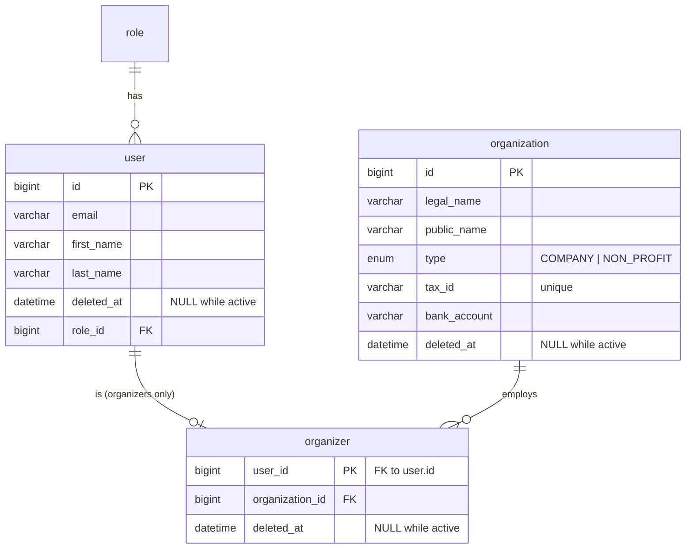

# auth-service: organizaciones y organizadores

> Épica 3 (#3): base para crear eventos. El event-service necesita saber a nombre de qué organización se crea un evento y quién lo crea. Esos datos son del auth-service (ver `microservices.md`).

## Diagrama



En `organization` y en `organizer`, la única columna nullable es `deleted_at`.

## Decisiones del modelo

| Tabla | Qué representa |
|---|---|
| `organization` | La empresa u organización sin fines de lucro que organiza los eventos |
| `organizer` | Un `user` que una organización designa para organizar sus eventos |

- **`organizer` comparte el id de `user`.** `user_id` es a la vez PK y FK 1 a 1 hacia `user.id`. En JPA se mapea con `@OneToOne` + `@MapsId`. Un organizador es un usuario con datos propios, así que no necesita un id aparte: `GET /api/organizers/{userId}` usa el mismo id que el usuario.
- **Un organizador trabaja para una sola organización** (`organization_id`, N a 1). Una organización puede tener varios organizadores.
- **Baja lógica, no borrado.** Nada se borra (supuesto del DER). `organizer.deleted_at` es la fecha en que dejó de ser organizador (la `fecha_baja` del diseño), y `organization.deleted_at` la fecha en que se dio de baja la organización. Los eventos del event-service guardan el id del organizador que los creó y esa referencia no tiene FK, así que si se borrara la fila quedarían apuntando a la nada (ver RFC-004).
- **`tax_id` es único.** Es el CUIT, y no puede haber dos organizaciones con el mismo.
- **La relación es unidireccional.** `Organizer` conoce su `User` y su `Organization`, pero `User` no conoce su `Organizer`. Así la entidad `User` queda igual para los usuarios que no son organizadores.

### Relación con el event-service

`event.organization_id` y `event.created_by` apuntan a `organization.id` y a `organizer.user_id`, pero **no son FK**: están en otra base. JPA no puede mapear un `@ManyToOne` entre bases distintas. Se guardan como `Long`, y el event-service los valida contra estos endpoints al crear un evento. Es la decisión del equipo sobre [`RFC-004`](../rfc/RFC-004-cross-service-relations.md): referencia por id.

## Endpoints

Los consume el event-service con `AuthClient`. Swagger: `/swagger-ui.html` en el servicio (`:8081`).

| Método | Ruta | Qué hace | OK |
|---|---|---|---|
| `GET` | `/api/organizations/{id}` | Una organización **activa** | 200 |
| `GET` | `/api/organizers/{userId}` | Un organizador **activo** con el id de su organización | 200 |
| `GET` | `/api/users/{id}/permissions` | Rol y permisos de un usuario **activo**. Lo usa `PermissionInterceptor` (ver [`permissions.md`](permissions.md)) | 200 |

```http
GET /api/organizations/1
→ { "id": 1, "legalName": "Producciones del Sur S.A.",
    "publicName": "Del Sur Producciones", "type": "COMPANY" }

GET /api/organizers/2
→ { "userId": 2, "firstName": "María", "lastName": "Gómez", "organizationId": 1 }

GET /api/users/2/permissions
→ { "userId": 2, "role": "ORGANIZER",
    "permissions": ["EVENT_MANAGE", "EVENT_SEARCH", "REFUND_REQUEST", "REPORT_VIEW", "TICKET_PURCHASE"] }
```

## Reglas

- **Qué es una organización activa:** `organization.deleted_at` en `NULL`. Si tiene fecha, la respuesta es `404 organization_not_found`, igual que si no existiera.
- **Qué es un organizador activo:** `organizer.deleted_at`, `user.deleted_at` y el `deleted_at` de su organización en `NULL`. Si alguno tiene fecha, la respuesta es `404 organizer_not_found`, igual que si no existiera, para que nadie dado de baja pueda crear eventos.
- **Datos que no salen del servicio.** `OrganizationResponse` no incluye `tax_id` ni `bank_account`. Ningún otro servicio los necesita para mostrar o validar un evento, y son datos fiscales y bancarios.
- **La respuesta del organizador trae `organizationId`.** El event-service lo usa para comprobar que el organizador pertenece a la organización del evento.

## Errores

Todos usan el `ErrorDto` común (ver [`error-handling.md`](error-handling.md)). Si el event-service recibe un 4xx de estos endpoints, el `GlobalExceptionHandler` se lo reenvía tal cual al cliente.

| Código | Status | Cuándo |
|---|---|---|
| `organization_not_found` | 404 | No existe la organización, o está dada de baja |
| `organizer_not_found` | 404 | El usuario no es organizador, o está dado de baja él, su usuario o su organización |
| `user_not_found` | 404 | No existe el usuario, o está dado de baja (`GET /api/users/{id}/permissions`) |

## Código

| Capa | Clases |
|---|---|
| `entity` | `Organization`, `OrganizationType`, `Organizer` |
| `repository` | `OrganizationRepository`, `OrganizerRepository`, `UserRepository` |
| `dto` | `OrganizationResponse`, `OrganizerResponse`, `UserPermissionsResponse` |
| `service` | `OrganizationService`, `OrganizerService`, `UserService` |
| `controller` | `OrganizationController`, `OrganizerController`, `UserController` |

- **Datos de prueba.** `AuthSeeder` carga dos organizaciones, con los organizadores que asume `EventSeeder`:
  - la `1` (*Del Sur Producciones*), con `organizer@ticketya.com` (user `2`, que crea sus eventos) y `organizer.delsur@ticketya.com` (user `6`, sin eventos propios: sirve para probar que solo el creador puede suspender o cancelar);
  - la `2` (*Cultura Serrana*), con `organizer.serrana@ticketya.com` (user `5`).

  El user `2` no organiza para la `2`, así que crear un evento de la org `2` con `X-User-Id: 2` sigue dando `organizer_not_in_organization`.
- **El organizador se busca en una sola query.** `OrganizerRepository.findWithUserAndOrganizationByUserId` usa `@EntityGraph` para traer también el `user` y la `organization`, que son lazy. Sin eso, armar la respuesta haría una query más por cada relación, y fuera de la transacción tiraría `LazyInitializationException`.

## Pendiente

| Tema | Detalle |
|---|---|
| ABM | No hay endpoints para crear, modificar ni dar de baja organizaciones u organizadores |
| Autorización | La Entrega 1 no tiene autenticación: el usuario llega en `X-User-Id` y sus permisos se piden a `/api/users/{id}/permissions` (ver [`permissions.md`](permissions.md)). Con la Épica 9, el usuario y sus permisos salen del JWT |
