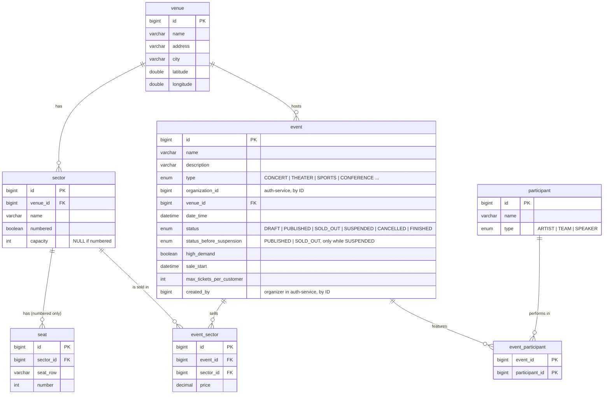

# event-service: decisiones del modelo

> Épica 2 (#20). Tablas 🟣 *Catalog: events and venues* de `ticketya_schema_en.drawio`.

## Diagrama



Restricciones únicas:

| Tabla | Columnas | Por qué |
|---|---|---|
| `sector` | `(venue_id, name)` | No puede haber dos "Campo" en el mismo lugar |
| `seat` | `(sector_id, seat_row, number)` | Un asiento por posición |
| `participant` | `(name, type)` | Un participante duplicado parte sus favoritos en dos IDs; se incluye `type` por homónimos entre un equipo y un artista |
| `event_sector` | `(event_id, sector_id)` | Un precio por sector y evento |

`venue.name` y `event.name` no son únicos: hay "Teatro Municipal" en muchas ciudades y una gira repite el nombre en cada fecha.

`seat.row` se guarda en la columna `seat_row` porque `ROW` es palabra reservada en MySQL 8; en Java el campo se llama `row`. `event_participant` es una tabla intermedia sin datos propios, así que se mapea con `@ManyToMany` en `Event` (como `role_permission` en el auth-service) y no tiene entidad.

## Lugar, sectores y precios

| Tabla | Qué representa |
|---|---|
| `venue` | El espacio físico (estadio, teatro, sala). Es fijo: no depende de ningún evento |
| `sector` | La división física de un `venue`. Puede ser numerado (con `seat`) o no numerado (con `capacity`) |
| `seat` | Un asiento de un sector numerado, identificado por `row` y `number` |
| `event_sector` | **Qué sectores del `venue` se venden en un `event` y a qué `price`** |

Los sectores pertenecen al **lugar** (`sector.venue_id`), no al evento. `event_sector` no define la estructura del lugar: es la relación muchos a muchos entre `event` y `sector` con su `price`, porque el enunciado pide que *"para cada evento, el organizador define el precio de cada sector"*. Ese precio no puede ir en `sector` (cambia en cada evento) ni en `event` (un evento tiene varios sectores).

Además:
- Un `sector` sin fila en `event_sector` **no se vende** en ese evento (por ejemplo, un escenario que tapa parte de la platea).
- `ticket.event_sector_id` (ticket-service) apunta a esta tabla, y de ahí salen los reportes de vendidas y devueltas por sector.

## Capacidades: se calculan, no se guardan

| Capacidad | Cómo se calcula | Para qué se usa |
|---|---|---|
| **Del `venue`** | Σ `capacity` de sus sectores no numerados + cantidad de `seat` de sus sectores numerados | Dato informativo del lugar |
| **Del `event`** | Lo mismo, pero **solo con los sectores que tienen fila en `event_sector`** | Porcentaje de ocupación de los reportes y pase a `SOLD_OUT` |

La capacidad del evento es la cantidad máxima de entradas que se pueden vender para ese evento. Puede ser menor que la del lugar si el evento no habilita todos los sectores.

Ninguna de las dos es una columna: son datos derivados. Si se guardaran, cada alta o baja de un `sector` o `seat` obligaría a actualizarlas, y si alguien se olvida quedan dos números distintos sin saber cuál es el correcto. Se calculan con una query o un método de la entidad; si alguna vez pesa, se cachea (los lugares casi no cambian).

**No se modela** la capacidad habilitada por el municipio, que sí sería un dato propio del lugar (hay estadios habilitados para menos gente que butacas). El enunciado no la pide; si se agrega, va como `venue.licensed_capacity` y funciona como tope de la suma de los sectores.

## Sin herencia en `sector`

Se evaluó separar `sector` en `numbered_sector` y `general_admission_sector`, y se descartó.

| | Con herencia (tablas separadas) | Una sola tabla (elegida) |
|---|---|---|
| Diferencia entre tipos | Un solo campo: `capacity` (el numerado no tiene campos propios, sus `seat` cuelgan de él) | `numbered` (boolean) + `capacity` nullable |
| Que un sector sea de un solo tipo | Necesita un trigger o validar en código | Un `CHECK`, que MySQL 8.0.16+ aplica |
| Consultas | Join extra en cada lectura de sectores | Directas |
| Única ganancia | `seat` apuntaría a `numbered_sector`, y la base impediría asientos en un sector no numerado | Se valida en el service al crear asientos |

Regla de la tabla:

```sql
CHECK ((numbered AND capacity IS NULL) OR (NOT numbered AND capacity IS NOT NULL))
```

Dos tablas más y joins para diferenciar un único campo no se justifican. Si en el código hace falta polimorfismo, se puede usar `@Inheritance(strategy = SINGLE_TABLE)` de JPA, que en la base sigue siendo una sola tabla; hoy no hace falta.

Si el event-service pasa a MongoDB, la cuestión desaparece: el `venue` es un documento con sus sectores embebidos, y cada uno tiene `capacity` o `seats` según su tipo.

## Lo que no vive acá

La **disponibilidad** no es parte del catálogo: vive en el **ticket-service**, porque necesita consistencia fuerte y no puede cachearse. El event-service solo dice qué se vende y a qué precio.

| Tipo de sector | Dónde está la disponibilidad |
|---|---|
| Numerado | `event_seat`, un registro por asiento y evento |
| No numerado | `event_sector_stock`, un contador por sector y evento |

Por eso `event_sector` no tiene un campo de ocupados: el diagrama original lo tenía (`occupied`) y se movió al ticket-service. Ver `ticket-service.md`.

## Datos de prueba

`EventSeeder` carga los datos al arrancar, si la base está vacía. Como `ddl-auto` es `create`, eso pasa en cada arranque.

- **Las fechas son relativas al día de arranque** (*hoy + 33 días*, etc.), así los eventos futuros nunca quedan en el pasado.
- **El orden de los inserts es un contrato.** El `TicketSeeder` del ticket-service usa por id los eventos 1 y 2, los `event_sector` 1 a 4 y los asientos 1 a 154 (ver *Datos de prueba* en `ticket-service.md`). Lo nuevo va siempre al final y nunca en el medio. `EventSeederTest` lo verifica.

### Lugares

| Lugar | Ciudad | Sectores |
|---|---|---|
| Estadio del Sur | Buenos Aires | Campo (5.000), Platea numerada (80 asientos: 1–80) |
| Teatro de la Sierra | Tandil | Platea (50 asientos: 81–130), Pullman (24 asientos: 131–154) |
| Arena Córdoba | Córdoba | Campo (8.000), Platea Baja numerada (45 asientos) |
| Estadio del Litoral | Rosario | Popular (12.000), Platea numerada (40 asientos) |
| Sala del Puerto | Mar del Plata | Sala (300) |

### Eventos

Organización `1` (*Del Sur Producciones*, organizador `2`), salvo los dos últimos, que son de la `2` (*Cultura Serrana*, organizador `5`).

| Id | Evento | Tipo | Ciudad | Estado | Fecha | Para probar |
|---|---|---|---|---|---|---|
| 1 | Los Serranos en vivo | `CONCERT` | Buenos Aires | `PUBLISHED` | +33 días | Alta demanda con la venta ya abierta. Lo usa el ticket-service |
| 2 | La casa de las sierras | `THEATER` | Tandil | `PUBLISHED` | +26 días | Más de 72 h por delante: la devolución pendiente del ticket-service sigue valiendo |
| 3 | Arquitectura de microservicios | `CONFERENCE` | Tandil | `DRAFT` | +126 días | Borrador con sector y precio: se puede publicar |
| 4 | Festival de Verano | `FESTIVAL` | Córdoba | `PUBLISHED` | +60 días | Alta demanda con la venta todavía cerrada (abre en +20 días). Tres artistas |
| 5 | Central vs. Unión | `SPORTS` | Rosario | `PUBLISHED` | +15 días | Dos participantes `TEAM` |
| 6 | Jazz en el puerto | `CONCERT` | Mar del Plata | `SOLD_OUT` | +10 días | Agotado |
| 7 | Los Serranos en Rosario | `CONCERT` | Rosario | `SUSPENDED` | +40 días | Suspendido |
| 8 | Recital acústico | `CONCERT` | Córdoba | `CANCELLED` | +20 días | Cancelado |
| 9 | Jornada de arquitectura de software | `CONFERENCE` | Mar del Plata | `FINISHED` | −30 días | El único en el pasado. Dos disertantes |
| 10 | Muestra de fin de año | `THEATER` | Tandil | `DRAFT` | +50 días | Borrador sin sectores ni participantes: no se puede publicar |
| 11 | Peña folklórica serrana | `CONCERT` | Tandil | `PUBLISHED` | +18 días | Organización `2` |
| 12 | Cultura y territorio | `CONFERENCE` | Tandil | `DRAFT` | +70 días | Organización `2` |

**Para el ABM de participantes:** *Sofía Lanza* (`SPEAKER`) no está en ningún evento y se puede borrar. El Festival (evento 4) es el evento de referencia con todos los campos completos, y `EventSeederTest` verifica que siga así.

**Para la búsqueda (consigna 9):**
- *Los Serranos* toca en tres eventos (1, 4 y 7).
- Hay eventos en cinco ciudades y de los cinco tipos.
- Los precios van de 3.000 a 70.000.

### Lo que no es consistente con los otros servicios

- **Inventario:** el ticket-service solo tiene inventario de los eventos 1 y 2. Los demás eventos publicados (4, 5 y 11) no se pueden comprar hasta que exista la creación del inventario al publicar.
- **Estados sin historia:** `SOLD_OUT`, `CANCELLED` y `FINISHED` no tienen entradas vendidas ni reintegros detrás. Sirven para la búsqueda y las transiciones de estado, no para probar devoluciones.
