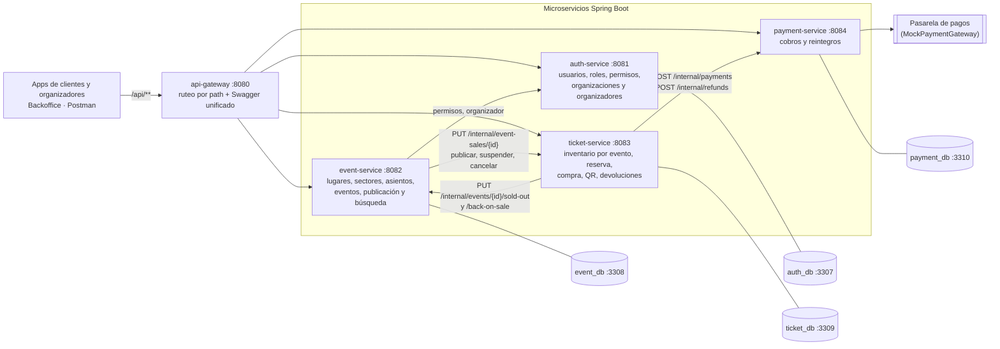

# Definición de microservicios

> Issue #13 — Épica 1. Basado en el enunciado y en el modelo de datos (`ticketya_esquema.drawio`).

## ¿Los colores del diagrama son microservicios?

**Casi, pero no 1 a 1.** Los colores agrupan **áreas de negocio** (la leyenda del diagrama lo dice: "Autenticación y permisos", "Venta y acceso", etc.). Son un muy buen punto de partida, pero hay dos colores que conviene partir:

| Color | Área | Qué se hace |
|---|---|---|
| 🟠 Naranja | Venta y acceso | Junta `pago` con `orden`, `entrada` y `evento_asiento`. El pago habla con un sistema externo y necesita resiliencia propia, así que se saca a su propio servicio |
| 🔴 Rojo | Postventa y notificaciones | Mezcla tres cosas distintas: `devolucion` cambia el estado de la entrada y libera el asiento (venta), `reintegro` le pide la plata a la pasarela (pagos) y `notificacion` es envío asíncrono (su propio servicio) |

## Propuesta: gateway + 7 microservicios

| Microservicio | Entrega | Tablas (color) | Responsabilidad | ¿Por qué es un microservicio aparte? |
|---|---|---|---|---|
| **api-gateway** | 1 | — | Punto de entrada único, ruteo, Swagger unificado; después, validación de JWT | Lo pide el enunciado |
| **auth-service** | 1 | 🔵 `user`, `role`, `permission`, `role_permission`<br>🟢 `organizacion`, `organizador`, `personal_acceso`, `asignacion_acceso` | Quién es el usuario, qué rol tiene, a qué organización pertenece y a qué eventos está asignado | Es identidad y autorización: "¿este usuario puede operar sobre este evento?". Se escribe poco y se consulta en cada request; más adelante viaja dentro del JWT. Lo verde es pertenencia del usuario, no catálogo |
| **event-service** | 1 | 🟣 `evento`, `participante`, `evento_participante`, `evento_sector`, `lugar`, `sector`, `asiento` | Catálogo: lugares y sectores, eventos, precios, publicación y búsqueda | Se lee muchísimo y se escribe poco, así que se puede cachear y escalar aparte. Es el candidato natural a MongoDB, como sugiere el enunciado |
| **ticket-service** | 1 | 🟠 `orden`, `entrada`, `evento_asiento`, `event_sector_stock`<br>🔴 `devolucion` | Reserva temporal, compra, emisión de QR, no doble venta, devoluciones, validación de ingreso y reportes | Es el núcleo transaccional. Necesita **consistencia fuerte** (bloqueo optimista en `evento_asiento`, `UPDATE` atómico en `event_sector_stock`) y no puede cachearse, lo opuesto al catálogo. Por eso `evento_asiento` está en naranja y no en violeta. Ver `ticket-service.md` |
| **payment-service** | 1 | 🟠 `pago`<br>🔴 `reintegro` | Cobros y reintegros contra la pasarela externa (mock en Entrega 1) | Aísla la dependencia externa: reintentos, timeouts, circuit breaker e idempotencia con `id_pasarela`. Es un participante claro de la **saga** de compra (si falla la emisión, compensa con un reintegro) |
| **queue-service** | 2 | 🟠 `fila_virtual` | Fila virtual de eventos de alta demanda: posición y habilitación por tandas | Su función es **absorber** decenas de miles de usuarios para proteger al ticket-service. Si viviera adentro de ese servicio, se caerían juntos. Va con Redis |
| **notification-service** | 2 | 🔴 `notificacion` | Email y push por compra, cancelación, cambios y artistas favoritos | Asíncrono (fire-and-forget o mensajería): si el proveedor de email falla, una compra no debe fallar |
| **recommendation-service** | 2 | ⚪ `preferencia_tipo_evento`, `participante_favorito` | Preferencias del cliente y sugerencias ("quienes compraron esto también…") | Datos flexibles por usuario, el otro candidato a MongoDB. Lo de "quienes compraron" se arma con eventos de compra que manda el ticket-service |

## Diagrama de módulos (Entrega 1)

Los clientes externos solo hablan con el gateway. Las rutas `/internal/**` son entre servicios y el gateway no las reenvía. Cada servicio tiene su propia base MySQL y las referencias entre bases van por ID.



El flujo de compra completo, con pago rechazado y reserva vencida, está en [`purchase-sequence.md`](purchase-sequence.md).

## Preguntas frecuentes

| Pregunta | Respuesta | Por qué |
|---|---|---|
| ¿El **servicio de mapas** es un microservicio? | **No** | El "Servicio de mapas" del diagrama de contexto es un **sistema externo** (tipo Google Maps), igual que la pasarela o el proveedor de identidad. No lo construimos. Nosotros solo guardamos `latitud`/`longitud` en `lugar` y, si hace falta, el event-service lo llama con un cliente HTTP |
| ¿**`lugar` / `sector` / `asiento`** van en un microservicio aparte? | **No** | La búsqueda por **ciudad** necesita cruzar evento con lugar, y cada evento define precios por sector (`evento_sector`). Si estuvieran en otro servicio, cada búsqueda y cada detalle de evento implicarían una llamada remota extra, sin ninguna ganancia: los lugares casi no cambian y no escalan distinto que los eventos |
| ¿**Pagos** es un microservicio? | **Sí** | Es el único lugar que habla con la pasarela, y el enunciado pide justamente resiliencia ante ella (reintentos, timeouts, fallback) y compensaciones en la compra. Tenerlo aparte vuelve demostrable la saga: ticket-service reserva → payment-service cobra → si algo falla, se compensa. La pasarela **simulada** vive como un adaptador mock dentro del payment-service, así después se cambia por la real sin tocar el resto |
| ¿Los **reportes para organizadores** son un microservicio? | **No** | Se calculan sobre `entrada` y `orden`, que son del ticket-service |

## Consideraciones

| Tema | Detalle |
|---|---|
| Referencias entre servicios | Van por ID sin FK física. Por ejemplo, `orden.user_id` apunta a un `user` de otra base. Eso es lo que el enunciado llama "entidades solapadas entre bases", y hay que documentarlo |
| Alcance por entrega | **Entrega 1 = gateway + 4 servicios** (auth, event, ticket, payment). Los otros 3 se crean en la Entrega 2 |

## Decisiones

| Punto | Decisión | Por qué | Costo / cómo se resuelve |
|---|---|---|---|
| Organizaciones y personal (🟢) | **auth-service** | La organización es parte de quién sos en el sistema, no del catálogo. Al loguearse, una sola respuesta (y después el JWT) trae **rol, permisos y `organizationId`**: con eso el front decide qué pantallas mostrar y cada microservicio autoriza sin consultar a otro (p. ej. "¿este organizador puede editar este evento?" compara el `organizationId` del token con el del evento). Lo mismo para el personal de acceso: "¿está asignado a este evento?" sale de auth | Las páginas de eventos muestran el nombre público de la organización, que vive en otro servicio. Se guarda una copia del nombre en el evento al crearlo (casi no cambia) o se pide a auth y se cachea |
| Fila virtual | **Servicio propio (queue-service)** | Solo se usa en el pico y su función es frenar la avalancha antes de que llegue a ticket-service; si vivieran juntas, el pico de la fila consumiría los recursos de las compras. Es de la Entrega 2 y puede simplificarse sin ensuciar el núcleo de compras. Se escala aparte, usa otra tecnología (Redis: una *sorted set* por evento resuelve posición y tandas) y muestra comunicación asíncrona | Un contenedor más. ticket-service sabe que te tocó el turno mediante un **token de turno con vencimiento** (`habilitado_hasta`) que emite queue-service: en eventos de alta demanda solo acepta compras con ese token válido, sin llamar a queue-service en cada compra |

## Comunicación entre microservicios

| Tipo | Tecnología | Dónde | Por qué |
|---|---|---|---|
| Síncrona | **HTTP Interface clients** (`@HttpExchange` + `RestClient`) | Consultas que necesitan respuesta inmediata (ver tabla de clients) | Mismo estilo declarativo que OpenFeign (interfaz con anotaciones), pero viene con Spring Framework, sin dependencias extra, y Boot 4 lo autoconfigura. Es el reemplazo oficial de OpenFeign, que está en modo mantenimiento |
| Asíncrona | **RabbitMQ** (Entrega 2) | Notificaciones, eventos de compra para recomendaciones, cancelación de evento → reintegros | Quien publica no espera ni depende de quien consume: si el proveedor de email cae, la compra no falla. Más simple de operar que Kafka, que se justifica con volúmenes enormes o reprocesamiento de eventos, no es el caso |

Alternativas descartadas: **OpenFeign** (en mantenimiento), **WebClient** (reactivo, usamos MVC), **RestTemplate** (legacy), **gRPC** (el enunciado pide REST).

### Clients síncronos

| Servicio | Clients | Para qué |
|---|---|---|
| auth-service | `EventClient` | Validar el evento al asignarle personal de acceso |
| event-service | `AuthClient`, `TicketClient` | Datos de la organización y del organizador; avisar la cancelación de un evento para que se reintegren las entradas |
| ticket-service | `EventClient`, `PaymentClient`, `AuthClient` | Sector, precio y asiento; cobrar y reintegrar; límite por usuario y asignación del personal de acceso |
| payment-service | — | Solo habla con la pasarela externa, que va como adaptador mock y no como client de otro servicio nuestro |
| queue-service | `EventClient` | Saber si el evento es de alta demanda y cuándo abre la venta |
| notification-service | `AuthClient`, `EventClient` | Email y datos del destinatario; datos del evento para el mensaje |
| recommendation-service | `EventClient`, `TicketClient` | Datos de eventos; historial de compras |

Cada client es una interfaz `@HttpExchange` en el paquete `client`, registrada en `config/HttpClientsConfig` con `@ImportHttpServices`. La URL base va en `spring.http.serviceclient.<servicio>.base-url` del `application.yml`, con variable de entorno para Docker (p. ej. `EVENT_SERVICE_URL`).

### Timeouts y reintentos

Hoy solo el event-service los tiene configurados. Los demás servicios tienen que copiar la misma configuración cuando agreguen sus clients.

**Por qué:** Spring no pone timeouts por defecto. Si otro servicio acepta la conexión pero no contesta, el request espera para siempre y ocupa un thread de Tomcat. Con suficientes requests así se agotan los threads y el servicio deja de responder todo, incluso lo que no usa al otro. Es una falla en cascada.

```yaml
spring.http.serviceclient:
  auth-service:
    connect-timeout: 1s    # tiempo para abrir la conexión
    read-timeout: 5s       # tiempo para recibir la respuesta
ticketya.http.retry:
  max-attempts: 2          # el intento original + 1 reintento
  backoff: 200ms
```

**Qué pasa si el otro servicio no responde:**
1. Se vence el timeout, o la conexión se rechaza.
2. `RetryOnIoErrorInterceptor` reintenta una vez después de 200 ms.
3. Si vuelve a fallar, el `RestClient` lanza `ResourceAccessException` y el `GlobalExceptionHandler` responde `503 service_unavailable`.

**Qué se reintenta y qué no:**

| Caso | ¿Se reintenta? | Por qué |
|---|---|---|
| `GET` sin respuesta (timeout o conexión rechazada) | Sí, una vez | Es idempotente: repetirlo no cambia nada |
| `POST`/`PUT`/`DELETE` sin respuesta | No | Puede haberse aplicado igual, y repetirlo duplicaría el efecto (p. ej. dos cobros) |
| Respuesta con error (4xx o 5xx) | No | Hubo respuesta: un `404` no se arregla reintentando, y el `GlobalExceptionHandler` ya lo reenvía o lo convierte en `503` |

**Peor caso:** con auth colgado, un request espera unos 10,2 s (5 s + 0,2 s + 5 s) y recibe `503`. Ya no queda esperando sin límite.

**Por qué 5 s y no 2 s:** con 2 s, el primer request a un auth-service recién levantado fallaba con `503`. Sus primeras respuestas tardan más de 2 s mientras arranca (JIT, conexiones a la base), y los dos intentos vencían. Ya caliente responde en unos 0,1 s, así que 5 s deja margen sin esperar de más cuando el servicio está colgado de verdad.

**Lo que falta:** un *circuit breaker*, para dejar de llamar un rato a un servicio que viene fallando en vez de esperar el timeout en cada request. Para la Entrega 1 alcanza con timeouts y reintentos.

## Módulos Maven

| Módulo | Qué es |
|---|---|
| `pom.xml` (raíz) | Padre y agregador. Lista los módulos, fija versiones (`dependencyManagement`) y define las dependencias que heredan todos |
| `common` | Librería (`.jar` común, sin `spring-boot-maven-plugin`): `ErrorDto`, `TicketYaException`, `ErrorCode` y `GlobalExceptionHandler`, este último auto-configurado. Hereda del padre como cualquier módulo |
| `*-service` | Heredan del padre (`<parent>`) y **dependen** de `common` (`<dependency>`, sin versión) para tener el manejo de errores sin repetirlo |

Heredar trae la configuración y las dependencias comunes. Depender trae el código compartido.

## Estructura de paquetes de cada servicio

| Paquete | Contenido |
|---|---|
| `controller` | Endpoints REST |
| `service` | Lógica de negocio |
| `repository` | Acceso a datos (Spring Data) |
| `entity` | Entidades JPA / documentos Mongo / modelos Redis |
| `dto` | Request y response de la API |
| `mapper` | Conversión entity ↔ dto |
| `client` | HTTP Interface clients hacia otros microservicios |
| `config` | Configuración del servicio (p. ej. registro de los clients) |

## Puertos y bases de datos

| Microservicio | Puerto | Base de datos | Puerto local de la base |
|---|---|---|---|
| api-gateway | 8080 | — | — |
| auth-service | 8081 | MySQL | 3307 |
| event-service | 8082 | MySQL (Entrega 1) → candidato a MongoDB | 3308 |
| ticket-service | 8083 | MySQL | 3309 |
| payment-service | 8084 | MySQL | 3310 |
| queue-service | 8085 | Redis | 6379 |
| notification-service | 8086 | MySQL | 3311 |
| recommendation-service | 8087 | MongoDB | 27017 |
