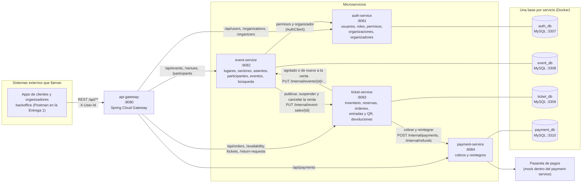
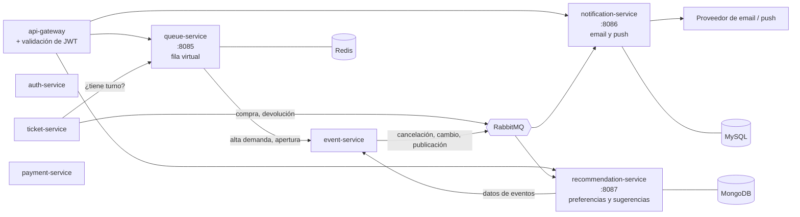

# Diagrama de módulos

> Consigna, *Arquitectura de microservicios*: *"diagrama de módulos de la arquitectura de solución"*. Las responsabilidades de cada servicio y por qué se separaron así están en [`microservices.md`](microservices.md).

## Entrega 1

**Cómo leerlo:**
- **Las flechas son llamadas HTTP síncronas** con clients `@HttpExchange` (ver *Comunicación entre microservicios* en `microservices.md`). Las que van a `/internal/**` son solo entre servicios: el gateway no las enruta.
- **Cada servicio es dueño de su base** y nadie más la lee. Lo que otro servicio necesita lo pide por API o lo guarda copiado (por ejemplo, el ticket-service copia los precios de cada sector en `event_sector_price`).
- **Las referencias entre servicios son por id, sin FK** ([RFC-004](../rfc/RFC-004-cross-service-relations.md)): `event.organization_id` apunta a auth, `ticket.event_id` apunta a event, `payment.order_id` apunta a ticket.

## Dependencias entre servicios

| Quién llama | A quién | Para qué | Si no responde |
|---|---|---|---|
| event-service | auth-service | Permisos del usuario de `X-User-Id` y organizador de cada evento | `503 service_unavailable`, con un reintento y timeouts (ver *Timeouts y reintentos* en `microservices.md`) |
| event-service | ticket-service | Sincronizar el estado y los sectores de la venta al publicar, suspender o cancelar | El evento no cambia de estado (`503`) |
| ticket-service | event-service | Avisar que el evento se agotó o volvió a tener lugar | Se reintenta hasta que se aplique, sin deshacer la compra |
| ticket-service | payment-service | Cobrar una orden y reintegrar entradas | La orden queda con el pago sin resultado y solo se reintenta ese intento |

**Ningún ciclo bloquea una operación.** Event y ticket se llaman en los dos sentidos, pero por motivos distintos: event avisa los cambios del catálogo y ticket avisa los cambios de disponibilidad. Ninguno espera al otro para responder la llamada que recibió.

## Entrega 2

Se suman los servicios que hoy son esqueletos, la mensajería y la seguridad:

El detalle de cada uno (base elegida, qué publica y qué consume) está en la tabla de servicios de [`microservices.md`](microservices.md).
