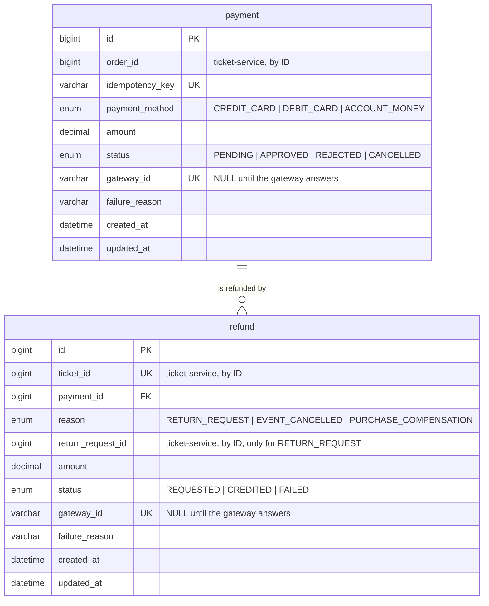

# payment-service: decisiones del modelo

> Épica 2 (#22). Tablas `payment` (🟠 *Sales and access*) y `refund` (🔴 *Post-sale and notifications*) de `ticketya_schema_en.drawio`.

Es el único servicio que habla con la pasarela de pagos: cobra las compras y devuelve el dinero. En la Entrega 1 la pasarela es un mock que vive como adaptador dentro del servicio, así después se reemplaza por la real sin tocar el resto (ver `microservices.md`).

## Diagrama

## Referencias a otros servicios

`refund → payment` es la única FK real, porque las dos tablas están en la misma base. El resto va por ID, sin FK física.

| Campo | Apunta a | Servicio |
|---|---|---|
| `payment.order_id` | `orders` | ticket-service |
| `refund.ticket_id` | `ticket` | ticket-service |
| `refund.return_request_id` | `return_request` | ticket-service |

**Datos solapados entre bases:**

| Dato | Copia de | Por qué se copia |
|---|---|---|
| `payment.amount` | `orders.total` | Es el monto que efectivamente se cobró. Si la orden cambiara, el pago tiene que seguir diciendo cuánto se le cobró al cliente |
| `refund.amount` | `ticket.price` | Lo mismo para la devolución: queda registrado cuánto se devolvió |

## Cambios respecto del diagrama original

| Cambio | Tabla |
|---|---|
| `idempotency_key` UNIQUE | `payment` |
| `ticket_id` UNIQUE | `refund` |
| `reason` (enum), en vez de deducir el motivo de que `return_request_id` sea NULL | `refund` |
| `gateway_id` UNIQUE | `refund` (en `payment` ya lo era) |
| `payment_method` como enum, no texto libre | `payment` |
| `failure_reason` | las dos |
| `created_at` y `updated_at` | las dos (`payment` solo tenía `created_at`) |

## Decisiones

### Idempotencia del cobro: `payment.idempotency_key`

Consigna 5: *"una entrada nunca puede venderse dos veces, aun cuando […] un cliente reintente el pago por un problema de conexión"*.

`gateway_id` es único, pero no alcanza: lo asigna la pasarela **después** de cobrar. Caso concreto:

1. El ticket-service le pide al payment-service que cobre la orden 10.
2. El payment-service cobra, pero la respuesta se pierde por un timeout.
3. El ticket-service reintenta.
4. Sin clave de idempotencia, el payment-service crea un segundo `payment` y **cobra dos veces**. Los dos `gateway_id` son distintos, así que el unique no lo frena.

Con `idempotency_key`:
- El cliente genera una clave por cada intento de pago y la repite en todos los reintentos de ese intento. El ticket-service se la pasa al payment-service. Probar con otra tarjeta es un intento nuevo, con otra clave.
- Si la clave ya existe, el payment-service devuelve el `payment` que ya tiene, sin volver a llamar a la pasarela. Si fue rechazado, vuelve a responder el mismo rechazo. Si dos reintentos llegan a la vez, el UNIQUE hace que solo uno inserte; el otro falla y lee el existente.
- La clave se reenvía a la pasarela, que también la usa para no cobrar dos veces (las pasarelas reales lo aceptan; Mercado Pago, por ejemplo, con el header `X-Idempotency-Key`). Así está cubierto incluso el caso de que el payment-service se caiga entre cobrar y guardar la respuesta.

La `orders.idempotency_key` del ticket-service no reemplaza a esta: protege la creación de la orden (que no se reserve dos veces), no el cobro.

### Varios pagos por orden, un solo aprobado

La relación `orders → payment` es de uno a muchos, así que `payment.order_id` no es UNIQUE. Si un pago se rechaza, la orden sigue `PENDING` y el cliente puede intentar con otro medio de pago, hasta 3 rechazos o hasta la hora de corte de la reserva (ver *Intentos de pago* en `ticket-service.md`). Cada intento es una fila.

La clave de idempotencia no alcanza para evitar un doble cobro entre intentos, porque dos tarjetas distintas tienen claves distintas. La protección principal es el bloqueo atómico de la orden en el ticket-service, que deja un solo intento sin resultado por orden. Como segunda barrera, antes de llamar a la pasarela el payment-service rechaza con 409 `data_conflict` una clave nueva si la orden ya tiene otro pago `PENDING` o `APPROVED`.

### Los pagos rechazados se guardan

La fila se inserta en `PENDING` antes de llamar a la pasarela, y el rechazo solo le cambia el estado. Se conserva porque:

- **Cuenta para el tope de 3 rechazos.** El 422 informa `rejectedAttempts` en `detail`, y el ticket-service decide con ese número. Un contador en `orders` sumaría de más cuando se repite una misma clave; contando filas, misma clave es misma fila. Se cuentan los rechazos de la orden hasta ese pago (`id` menor o igual), así un rechazo repetido devuelve el número original aunque después haya habido otros.
- **Permite repetir la respuesta** de una clave ya usada sin volver a llamar a la pasarela.
- **Registra el motivo** (`failure_reason`) para el cliente y para resolver reclamos.

Nunca se guardan datos de la tarjeta, solo el tipo de medio, el monto y el motivo.

### Un solo reintegro por entrada: `refund.ticket_id` UNIQUE

El diagrama ya decía que una entrada tiene como máximo un reintegro (0..1), pero nada lo hacía cumplir. Con el UNIQUE, si un pedido de reintegro llega dos veces (por ejemplo, la cancelación de un evento procesada dos veces o un mensaje de RabbitMQ repetido), se devuelve el reintegro existente en vez de devolver la plata dos veces.

Si un reintegro queda `FAILED`, el reintento se hace con la pasarela sobre la misma fila (vuelve a `REQUESTED`) y con los datos nuevos, para que un reintegro fallido por devolución no bloquee el de una cancelación posterior.

El reintegro es **por entrada** y no por orden porque la consigna 7 permite devolver una sola entrada de una compra de varias.

### Motivo explícito: `refund.reason`

El diagrama original distinguía los casos por `return_request_id`: con valor, devolución; NULL, evento cancelado. Pero hay un tercer caso que también tendría NULL:

| `reason` | Cuándo | `return_request_id` |
|---|---|---|
| `RETURN_REQUEST` | Un administrador aprueba una devolución (consigna 7) | Obligatorio |
| `EVENT_CANCELLED` | Se cancela el evento y todas sus entradas pasan a reintegro (consigna 7) | NULL |
| `PURCHASE_COMPENSATION` | Se cobró, pero la compra falló después (por ejemplo, al emitir las entradas) y la saga devuelve el dinero | NULL |

Con el motivo explícito, los reportes y el log no dependen de interpretar un NULL. Un `CHECK` en la tabla impide la combinación inválida: `return_request_id` es obligatorio si y solo si el motivo es `RETURN_REQUEST`.

### `PENDING` como estado de duda

Un pago queda `PENDING` mientras no hay respuesta de la pasarela, incluso si la llamada terminó en timeout. En ese caso no se sabe si se cobró, así que no se lo marca `REJECTED` ni se lo da por cancelado: se vuelve a consultar a la pasarela con la misma `idempotency_key` hasta tener una respuesta. Esto es lo que después usan los reintentos y el fallback de la Entrega 2.

La llamada es síncrona, pero con un tiempo máximo. Ese tiempo, sumando reintentos, tiene que ser menor al margen de la hora de corte de la reserva (1 minuto), para que el resultado llegue antes del vencimiento.

### Anular un intento sin resultado (Entrega 2)

Si la reserva vence y un intento sigue sin resultado, el ticket-service pide anularlo. El payment-service le pide la cancelación a la pasarela y solo marca el pago `CANCELLED` si ella la confirma. Responde con el estado final:

| Resultado | Qué hace el ticket-service |
|---|---|
| `CANCELLED` o `REJECTED` | Da el intento por cerrado |
| `APPROVED` | Pide el reintegro de cada `ticket` con motivo `PURCHASE_COMPENSATION` |
| `PENDING` (la pasarela no contesta) | Vuelve a preguntar en la siguiente corrida del job |

El reintegro lo pide el ticket-service porque es por entrada y porque el payment-service nunca lo llama.

### `failure_reason`

Guarda el motivo que devuelve la pasarela ("fondos insuficientes", "tarjeta vencida"). Sirve para mostrárselo al cliente y para depurar.

### `payment_method` como enum

Con texto libre aparecerían variantes del mismo medio ("tarjeta", "TC", "credit card"). El enum deja un conjunto cerrado, que además es lo que pide la consigna 4 (*"registrar […] el medio de pago"*). La consigna no fija cuántos medios hay; estos tres son decisión del grupo.

### Pasarela mock

La pasarela de pagos es el sistema externo que mueve el dinero, como Mercado Pago. No tiene relación con el `api-gateway`. El payment-service no cobra por su cuenta: le pide el cobro a la pasarela y guarda lo que ella responde.

El enunciado pide que en la Entrega 1 sea simulada, así que `MockPaymentGateway` hace de ese sistema externo. No mueve dinero ni se conecta a nada:

| Qué simula | Cómo |
|---|---|
| Aprobar un cobro | Devuelve `APPROVED` con un `gatewayId` |
| No cobrar dos veces con la misma clave | El `gatewayId` se deriva de la `idempotency_key`, así que repetirla da el mismo resultado |
| Rechazar un cobro | Decide por medio de pago, con una propiedad (`payment.mock.rejected-method: DEBIT_CARD`) |
| Lentitud y caída (Entrega 2) | Propiedades `payment.mock.delay-ms` y otra para la caída |

`PaymentService` solo conoce la interfaz `PaymentGateway` y recibe la respuesta como `ChargeResult`. Ahí quedan nuestras reglas, separadas de la simulación. Para conectar una pasarela real alcanza con otra implementación de la interfaz.

### Rutas internas

Cobrar, reintegrar y anular van en `/internal/**`, que el gateway no reenvía. La protección es por etapas:

- **Entrega 1:** `/internal/payments` a través del gateway responde 404, con un test que lo verifique.
- **Entrega 2:** el `docker-compose` general no publica el puerto de payment-service, y las llamadas entre servicios se autentican con una credencial de servicio (sin ella, 401). `GET /api/payments` exige rol administrador.

## Contrato con ticket-service

REST síncrono en la Entrega 1. **payment-service nunca llama a ticket-service**: la dependencia va en un solo sentido.

| Endpoint | Cuerpo o parámetro | Respuestas |
|---|---|---|
| `POST /internal/payments` | `orderId`, `amount`, `paymentMethod`, `idempotencyKey` | 201 aprobado; 422 `payment_rejected` con `reason` y `rejectedAttempts` en `detail`; 409 `data_conflict` si la clave ya existe con otros datos o si la orden ya tiene otro pago `PENDING` o `APPROVED`; 503 `payment_gateway_unavailable` |
| `POST /internal/payments/cancel` (Entrega 2) | `idempotencyKey` | 200 con el estado final del pago; 404 `payment_not_found` |
| `POST /internal/refunds` | `ticketId`, `orderId`, `amount`, `reason`, `returnRequestId` | 201 creado; 200 si ya existe y no falló; 404 `payment_not_found`; 409 `payment_not_refundable` (pago no aprobado o supera lo cobrado); 409 `data_conflict` si ya existe con otros datos y no falló; 502 `refund_failed` |
| `GET /internal/payments?orderId=` | | 200 con los pagos de la orden; 404 `payment_not_found` |
| `GET /api/payments?orderId=` | Solo administrador, por el gateway | 200 con los pagos de la orden; 404 `payment_not_found` |

- **Reintento de un cobro:** con la misma clave y los mismos datos responde con el mismo status y cuerpo que la primera vez. Si fue rechazado, vuelve a dar 422 `payment_rejected`, sin llamar a la pasarela. Si todavía no tiene resultado, responde 503 `payment_gateway_unavailable`, sin cobrar de nuevo.
- **Reintento de un reintegro:** si existe y no falló, se devuelve el existente. Si falló, se reintenta sobre la misma fila.
- **Errores:** los resuelve `GlobalExceptionHandler` de `common`: los 4xx se reenvían tal cual y los 5xx llegan a ticket como 503.

## Datos de prueba

El `PaymentSeeder` usa las órdenes que crea el `TicketSeeder`:

| Orden | Pagos |
|---|---|
| 1 (Campo del recital, pagada) | Un pago `APPROVED` con tarjeta de crédito |
| 2 (asientos de la obra, pagada) | Un pago `REJECTED` con débito por fondos insuficientes y un reintento `APPROVED` con dinero en cuenta |
| 3 (reserva en curso) | Un pago `PENDING`, sin respuesta de la pasarela |

No hay reintegros: la única devolución del `TicketSeeder` está pendiente, así que todavía no corresponde devolver dinero.

La clave del pago `PENDING` de la orden 3 es `seed-pending-order-3` y tiene que coincidir con `orders.payment_attempt_key` de esa orden en el `TicketSeeder`.

## Pendientes para la implementación

- Código nuevo `payment_not_refundable` en `PaymentErrorCode`.
- `CANCELLED` en el estado de `Payment` (Entrega 2).
