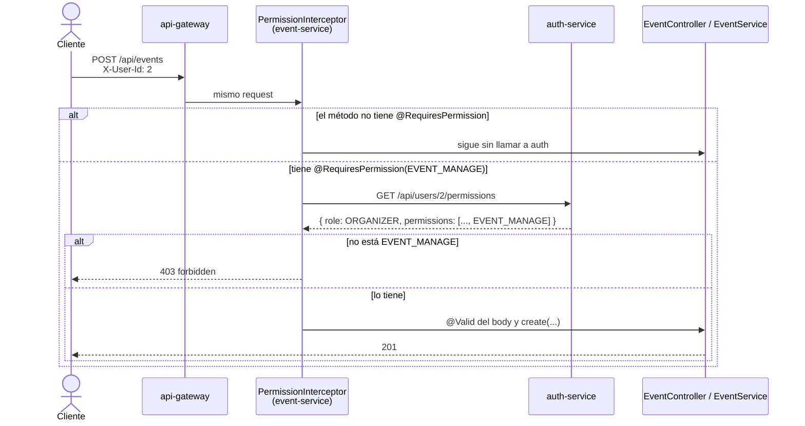

# Autorización por permisos

> **Hoy (Entrega 2):** el usuario y sus permisos llegan en los headers que pone el api-gateway a partir del JWT, y cada servicio los chequea con `@RequiresPermission` de `common`, sin llamar al auth-service (ver *Con JWT*). Las secciones *Flujo*, *Errores* y *Costo* describen cómo funcionaba en la Entrega 1.
>
> Cómo decide un servicio si el usuario que llama puede usar un endpoint. En la Entrega 1 no hay JWT: el usuario se identifica con el header `X-User-Id` (README, *Modalidad de entrega*: "el usuario se identifica por parámetro o encabezado") y el servicio le pregunta al auth-service qué puede hacer.

## Idea general

- **Se chequean permisos, no roles.** Un endpoint pide `EVENT_MANAGE`, no "ser `ORGANIZER`". Qué permisos tiene cada rol lo dice `role_permission` en el auth-service. Si mañana un rol gana o pierde un permiso, se cambia el seeder y el código queda igual.
- **Se confía en la identidad del header, no en lo que dice poder hacer.** El servicio no verifica que quien llama sea de verdad el usuario de `X-User-Id`: eso llega con el JWT (ver *Limitaciones*). Lo que sí confirma siempre el auth-service, que es el dueño del dato, es qué puede hacer ese usuario.
- **Cada endpoint declara lo que pide.** Con la anotación `@RequiresPermission` sobre el método del controller. Un endpoint sin anotación no chequea nada.

## Flujo



Paso a paso, para un `POST /api/events`:

1. El `DispatcherServlet` resuelve qué método del controller atiende el request, y antes de llamarlo corre `PermissionInterceptor.preHandle`.
2. Si el método no tiene `@RequiresPermission`, el interceptor deja pasar y no llama a nadie. Así los `GET` públicos no dependen del auth-service.
3. Si la tiene, lee `X-User-Id`. Si falta o no es un número, responde `400 invalid_parameter`.
4. Llama a `AuthClient.getPermissions(userId)`, que es `GET /api/users/{id}/permissions` en el auth-service.
5. Si el permiso no está en la lista, responde `403 forbidden`. Si está, sigue al controller: recién ahí corre `@Valid` y después el service.

## El endpoint del auth-service

```http
GET /api/users/2/permissions
→ 200 { "userId": 2, "role": "ORGANIZER",
        "permissions": ["EVENT_MANAGE", "EVENT_SEARCH", "REFUND_REQUEST", "REPORT_VIEW", "TICKET_PURCHASE"] }

GET /api/users/99/permissions
→ 404 { "error": "user_not_found", ... }
```

- **Usuario dado de baja:** `user.deleted_at` con fecha da `404 user_not_found`, igual que si no existiera. Así un usuario dado de baja no puede hacer nada en ningún servicio.
- **Una sola consulta:** `UserRepository.findWithRoleAndPermissionsById` trae el usuario, su rol y los permisos del rol con `@EntityGraph`. Los dos son lazy y sin el grafo serían dos consultas más.
- **Los permisos vuelven ordenados alfabéticamente,** para que la respuesta sea siempre la misma y se pueda comparar en tests y en Postman.

### Permisos y roles cargados por `AuthSeeder`

| Permiso | CLIENT | ORGANIZER | ADMIN | ACCESS_STAFF |
|---|:-:|:-:|:-:|:-:|
| `EVENT_SEARCH`, `TICKET_PURCHASE`, `REFUND_REQUEST` | ✅ | ✅ | ✅ | ✅ |
| `EVENT_MANAGE` | | ✅ | | |
| `REPORT_VIEW` | | ✅ | | |
| `EVENT_ADMIN`, `REFUND_RESOLVE`, `USER_MANAGE` | | | ✅ | |
| `TICKET_VALIDATE` | | | | ✅ |
| `VENUE_MANAGE` | | | ✅ | |
| `PARTICIPANT_MANAGE` | | ✅ | ✅ | |

Usuarios de prueba: `1` cliente, `2` organizador (org `1`), `3` admin, `4` personal de acceso (org `1`), `5` organizador (org `2`), `6` organizador (org `1`, sin eventos propios), `7` personal de acceso (org `2`).

## Endpoints protegidos hoy

| Servicio | Endpoint | Permiso |
|---|---|---|
| event-service | `POST /api/events` | `EVENT_MANAGE` |
| event-service | `PUT /api/events/{id}/participants` | `EVENT_MANAGE` |
| event-service | `PUT /api/events/{id}/sectors` | `EVENT_MANAGE` |
| event-service | `PUT /api/events/{id}`, `DELETE /api/events/{id}` | `EVENT_MANAGE` |
| event-service | `POST /api/events/{id}/publish` | `EVENT_MANAGE` |
| event-service | `POST /api/events/{id}/cancel`, `/suspend`, `/resume` | `EVENT_ADMIN` **o** `EVENT_MANAGE` (y el service exige que sea el organizador que creó el evento) |
| event-service | `POST`/`PUT`/`DELETE` de `/api/venues`, sus sectores (`/api/venues/{id}/sectors`) y sus asientos | `VENUE_MANAGE`: solo el admin. Un organizador es externo a TicketYa y podría cargar lugares que no existen |
| event-service | `POST`/`PUT`/`DELETE` de `/api/participants` | `PARTICIPANT_MANAGE`: organizadores y admin |
| auth-service | `POST /api/organizations/{id}/organizers`, `DELETE /api/organizations/{id}/organizers/{userId}` | `USER_MANAGE`: solo el admin promueve o quita organizadores |
| auth-service | `GET /api/users/{id}/permissions` | `USER_MANAGE`: solo el admin |
| ticket-service | `POST /api/orders`, `POST /api/orders/{id}/pay`, `/cancel`, `GET /api/orders` y `GET /api/orders/{id}` | `TICKET_PURCHASE` |
| ticket-service | `POST /api/tickets/{id}/return-requests` | `REFUND_REQUEST` |
| ticket-service | `GET /api/return-requests`, `POST /api/return-requests/{id}/approve` y `/reject` | `REFUND_RESOLVE`: solo el admin |

La disponibilidad del ticket-service (`GET /api/availability`) es pública. Todo lo demás de event-service es público: buscar y ver eventos, lugares, sectores, asientos y participantes. El detalle de un evento recibe un `Optional<Caller>`: un borrador solo lo ve un organizador de su organización.

### Qué test prueba cada endpoint

Es lo que pide la épica #9: *"pruebas que verifican que cada endpoint solo es accesible por los roles correspondientes"*. Cada test manda los headers que pone el gateway, sin token (401), con un rol que no corresponde (403) y con el que sí.

| Servicio | Endpoints | Test |
|---|---|---|
| event-service | Eventos: crear, editar, borrar, publicar, sectores, participantes de un evento | `EventControllerTest` |
| event-service | Suspender, reanudar y cancelar (admin, o el organizador que creó el evento) | `EventControllerTest`, `EventLifecycleServiceTest` |
| event-service | Lugares, sectores y asientos (`VENUE_MANAGE`); participantes (`PARTICIPANT_MANAGE`) | `CatalogPermissionsTest` |
| auth-service | Promover y quitar organizadores, permisos de un usuario (`USER_MANAGE`) | `UserManagementControllerTest` |
| auth-service | `dev-login` solo con el perfil `dev` | `DevAuthControllerWithoutDevProfileTest` |
| ticket-service | Compras (`TICKET_PURCHASE`), solicitar devoluciones (`REFUND_REQUEST`), resolverlas (`REFUND_RESOLVE`) y la disponibilidad pública | `TicketPermissionsTest` |
| `common` | El interceptor: 401, 403 antes que el 400 del body, varios permisos, `Optional<Caller>` | `PermissionInterceptorTest` |
| api-gateway | Token inválido o vencido → 401, sin JWKS → 503, borra los `X-User-*` del cliente, no expone `/internal/**` | `IdentityHeadersTest`, `JwksUnavailableTest`, `InternalRoutesTest` |

### Swagger

En `http://localhost:8080/swagger-ui.html` cada endpoint con `@RequiresPermission` muestra un candado y la línea *"Requiere el permiso `X`"*, con sus respuestas 401 y 403. Los públicos no tienen candado.

1. Pedir un token: `POST /api/auth/dev-login {"userId": 3}` (perfil `dev`) o entrar por `http://localhost:8081/login` con Google.
2. *Authorize*, pegar el `accessToken` (sin `Bearer`) y *Try it out*.

- **Lo arma `common`** (`PermissionOpenApiCustomizer`), leyendo la misma anotación que chequea el interceptor: la documentación no puede decir un permiso distinto del que se exige. Un endpoint nuevo queda documentado solo.
- **El servidor del OpenAPI es `/`, relativo a la página.** Desde el Swagger del gateway, *Try it out* va al 8080, y el gateway valida el token. Desde el Swagger propio de un servicio (por ejemplo `:8082/swagger-ui.html`) el token no sirve: el servicio no lo valida y espera los headers del gateway (ADR-003).

**La organización sale del token.** Al crear un evento, el organizador ya no la elige: es la de su token (`X-Organization-Id`, que pone el gateway). Al editar, publicar o suspender, se compara con la del evento, sin preguntarle al auth-service. El token solo la lleva si el organizador y su organización están activos.

## Errores

| Caso | Status | Código | Quién lo arma |
|---|---|---|---|
| Falta `X-User-Id` | 400 | `invalid_parameter` | El interceptor, con el mismo mensaje que da el `GlobalExceptionHandler` para un header faltante |
| `X-User-Id` no es un número | 400 | `invalid_parameter` | El interceptor |
| El usuario no existe o está dado de baja | 404 | `user_not_found` | El auth-service; el `GlobalExceptionHandler` lo reenvía tal cual |
| El rol no tiene el permiso | 403 | `forbidden` | El interceptor, con `CommonErrorCode.FORBIDDEN` |
| El auth-service no responde | 503 | `service_unavailable` | El `GlobalExceptionHandler` |

- **No hay un código nuevo.** `forbidden` ya existía en `CommonErrorCode`, así que el resto de los servicios lo puede usar sin tocar `common`. El mensaje dice qué permiso faltó: *"El usuario 1 no tiene el permiso EVENT_MANAGE"*.
- **El permiso se revisa antes que el body.** Un usuario sin permiso que manda un body inválido recibe `403`, no `400`. Es intencional: a quien no puede usar el endpoint no se le explica qué campos espera.
- **El permiso no reemplaza las reglas de negocio.** Responde "¿puede crear eventos?", no "¿este evento es de su organización?". Eso lo sigue validando el service: al crear, `organizer_not_in_organization`; al editar o publicar, comparar `event.organizationId` con el del organizador.

## Varios permisos y quién llama

- **`@RequiresPermission` acepta varios permisos, y alcanza con tener uno:** `@RequiresPermission({Permission.EVENT_ADMIN, Permission.EVENT_MANAGE})`. Si no tiene ninguno, el mensaje los lista: *"El usuario 1 no tiene ninguno de los permisos EVENT_ADMIN, EVENT_MANAGE"*.
- **El interceptor deja un `Caller` (`userId` y `permissions`) en el request**, en el atributo `PermissionInterceptor.CALLER_ATTRIBUTE`. El controller lo recibe con `@RequestAttribute` y se lo pasa al service, que así distingue a un admin de un organizador sin volver a consultar al auth-service. Con JWT, el `Caller` sale del token.
- **Ejemplo, suspender o cancelar:** el admin puede con cualquier evento. Un organizador, solo con los que creó (`event.createdBy`), y solo mientras siga siendo organizador de su organización. Otro organizador de la misma organización recibe `403 not_event_creator`. Así una sola cuenta no puede suspender, por error o a propósito, eventos que afectan a muchos compradores y artistas.

## Cómo proteger un endpoint nuevo

1. Si el permiso no existe, agregarlo al enum `org.group10.common.security.Permission` **y** al `AuthSeeder`, con el mismo nombre. `AuthSeederTest` falla si no coinciden.
2. Anotar el método del controller y recibir el `Caller`:
   ```java
   @PostMapping("/{id}/publish")
   @RequiresPermission(Permission.EVENT_MANAGE)
   public EventResponse publish(@PathVariable Long id, Caller caller) { ... }
   ```
3. Sumar el endpoint a la tabla de *Endpoints protegidos* y un caso a su test de permisos. Swagger lo marca solo.

**Tests de controller:** `@WebMvcTest` carga el interceptor de `common`. El usuario se simula con los headers del gateway: `X-User-Id`, `X-User-Permissions` (separados por coma) y, para un organizador, `X-Organization-Id`. No hace falta mockear al auth-service.

## Código

| Servicio | Clase | Qué hace |
|---|---|---|
| auth-service | `UserController`, `UserService` | `GET /api/users/{id}/permissions` |
| auth-service | `UserPermissionsResponse` | `userId`, `role` y `permissions` |
| ~~event-service~~ | ~~`security/*`, `config/WebConfig`, `client/AuthClient`~~ | Borrados en el #132: event usa los de `common` |
| `common` (Entrega 2) | `security/GatewayHeaders` | Los nombres de los headers que pone el gateway |
| `common` (Entrega 2) | `security/Permission`, `security/RequiresPermission` | El enum con los 11 permisos del `AuthSeeder` y la anotación. `AuthSeederTest` falla si el seeder y el enum no coinciden |
| `common` (Entrega 2) | `security/Caller` | Quién llama, armado con los headers del gateway |
| `common` (Entrega 2) | `security/PermissionInterceptor`, `security/CallerArgumentResolver` | El chequeo en `preHandle` y el `Caller` (o `Optional<Caller>`) como parámetro. Swagger no los muestra: los arma el servidor |
| `common` (Entrega 2) | `config/PermissionAutoConfiguration` | Registra los dos en `/api/**` de cada servicio |
| `common` (Entrega 2) | `config/PermissionOpenApiCustomizer` | El token (`bearerAuth`) y el candado con el permiso en Swagger, en cada servicio |

## Con JWT (Épica 9, Entrega 2)

La anotación y el interceptor se quedan, pero se mueven a `common` y **dejan de llamar al auth-service**: los permisos llegan del api-gateway, que es el único que valida el JWT ([ADR-003](../adr/ADR-003-jwt-validated-only-in-gateway.md)).

```
Cliente ── Bearer JWT ──▶ api-gateway ── X-User-Id, X-User-Role, X-User-Permissions, X-Organization-Id ──▶ servicio
                          · valida el token                                                   · PermissionInterceptor
                          · borra los X-User-* del cliente                                    · @RequiresPermission
```

1. Spring elige el método del controller.
2. `PermissionInterceptor.preHandle`, **antes de leer el body**:
    - sin `@RequiresPermission`, deja pasar: el endpoint es público;
    - arma el `Caller` con los headers del gateway. Sin `X-User-Id`, o con un id que no es número: `401 unauthorized`;
    - si el `Caller` no tiene ninguno de los permisos: `403 forbidden`.
3. Recién ahí Spring lee el body y corre `@Valid`: el `400` solo le llega a quien tiene el permiso.
4. El controller recibe el `Caller` como parámetro y se lo pasa al service, que aplica las reglas de negocio.

| Entrega 1 | Entrega 2 |
|---|---|
| `X-User-Id` lo manda el cliente y se confía en él | Lo pone el gateway a partir del `sub` del token, y borra el que mande el cliente |
| El interceptor pide los permisos al auth-service en cada request | Llegan en `X-User-Permissions`: no hay llamada |
| `RequiresPermission`, `Permission`, `Caller` y `PermissionInterceptor` en event-service | Los mismos en `org.group10.common.security`, para todos los servicios |
| `WebConfig` registra el interceptor | `PermissionAutoConfiguration` lo registra en cada servicio que depende de `common` |
| Falta `X-User-Id` → `400 invalid_parameter` | Falta `X-User-Id` → `401 unauthorized` |
| `@RequestAttribute` para recibir el `Caller` | `Caller caller` como parámetro (`CallerArgumentResolver`) |
| Un endpoint público que quiere saber quién llama lee `X-User-Id` opcional | `Optional<Caller> caller`: vacío si no hay usuario (por ejemplo, el detalle de un evento, donde un borrador solo lo ve su organizador) |

### Qué hace el api-gateway

`IdentityHeadersFilter` corre antes de rutear cada request:

| El request trae | El gateway |
|---|---|
| Sin `Authorization: Bearer` | Lo deja pasar sin identidad. Cada servicio decide: un endpoint con `@RequiresPermission` responde `401` |
| Un token válido | Pone `X-User-Id` (del `sub`), `X-User-Role`, `X-User-Permissions` (separados por coma) y `X-Organization-Id` (solo si el token lo trae) |
| Un token con firma inválida, vencido, de otro `iss` u otro `aud`, o `Bearer` sin token | `401 unauthorized`, sin llegar al servicio |
| Un token, pero el auth-service no responde y no se puede obtener la clave pública | `503 service_unavailable`: el token puede ser válido |

- **Siempre borra los `X-User-*` y `X-Organization-Id` que mande el cliente,** con o sin token y en cualquier combinación de mayúsculas. Un cliente que manda `X-User-Permissions: EVENT_ADMIN` no consigue nada.
- **La clave pública sale del JWKS del auth-service** (`ticketya.jwt.jwk-set-uri`, por defecto `${AUTH_SERVICE_URL}/.well-known/jwks.json`). Se descarga con el primer token y se vuelve a pedir si llega un `kid` desconocido, por ejemplo si el auth-service se reinició con otra clave efímera.
- **`X-Organization-Id` ahora sale del token.** En la Entrega 1 lo mandaba el cliente al crear un evento: con el gateway, ese valor se descarta.

**Por qué no `@PreAuthorize`:** Spring lo evalúa al invocar el método, después de leer el body y de `@Valid`. Un usuario sin permiso con un body inválido recibiría `400` en vez de `403`, en contra de la US-AUTH-02. `preHandle` corre antes: el `403` sale primero incluso con JSON roto. Además, como los servicios no validan el token, no necesitan Spring Security (ver *Decisiones de diseño tomadas* en el [RFC-001](../rfc/RFC-001-auth-modality.md)).

**Migración:** event-service (#132), auth-service (#133) y ticket-service (#137) usan la anotación de `common`; ninguno le pide los permisos al auth-service. Falta payment-service, en la US-PAY-14 (#88).

## Costo

Cada request a un endpoint protegido hace **una llamada más al auth-service**. Crear un evento hoy hace tres: permisos, organización y organizador. Para la Entrega 1 se acepta sin caché. Hay dos formas de bajarlo si hace falta:
- que la respuesta traiga también el `organizationId`, y así se ahorran las otras dos;
- cachear los permisos unos segundos.

## Qué cambia en la aplicación

- **Antes:** el event-service decidía solo con reglas de negocio: "¿es organizador de esta organización?".
- **Ahora:** primero pregunta si el usuario puede hacer la acción (el permiso) y después si puede hacerla sobre ese recurso (la regla de negocio). El auth-service decide qué puede hacer cada usuario en todos los servicios, como propone `microservices.md`.
- **Para el usuario, lo único que cambia es el error.** Con los datos de prueba, quien podía crear eventos sigue pudiendo y quien no podía sigue sin poder. Un cliente que intenta crear un evento recibe `403 forbidden` en vez de `404 organizer_not_found`.

## Limitaciones y riesgos

- ~~**No es seguridad real todavía.** Cualquiera puede mandar `X-User-Id: 2` y actuar como la organizadora.~~ Resuelto con el JWT: el gateway borra los `X-User-*` del cliente y los pone a partir del token. Queda el riesgo aceptado del [ADR-003](../adr/ADR-003-jwt-validated-only-in-gateway.md): quien llegue directo al puerto de un servicio puede mandarlos.
- **El permiso se compara por nombre.** Viaja en el token como texto: `AuthSeederTest` falla si el seeder y el enum de `common` no coinciden.

| Riesgo | Gravedad | Detalle |
|---|---|---|
| Contrato con el front | Baja | Cambiaron los errores de `POST /api/events` (`403 forbidden`, `404 user_not_found`). La colección de Postman ya está actualizada |

**Tests:**
- Ver *Qué test prueba cada endpoint*.

## Pendiente

| Tema | Detalle |
|---|---|
| Delegar la suspensión | Que el creador autorice a otro organizador de su organización a suspender o cancelar su evento. Necesita guardar quién autorizó a quién y cómo se revoca: se dejó afuera |
| payment-service | `GET /api/payments` solo para el admin y el secreto en `/internal/**`: US-PAY-14 (#88) |
| Participantes sin dueño | Con `PARTICIPANT_MANAGE`, un organizador puede editar un artista que cargó otra organización. Borrarlo está frenado si se usa en un evento (`participant_in_use`), editarlo no |
