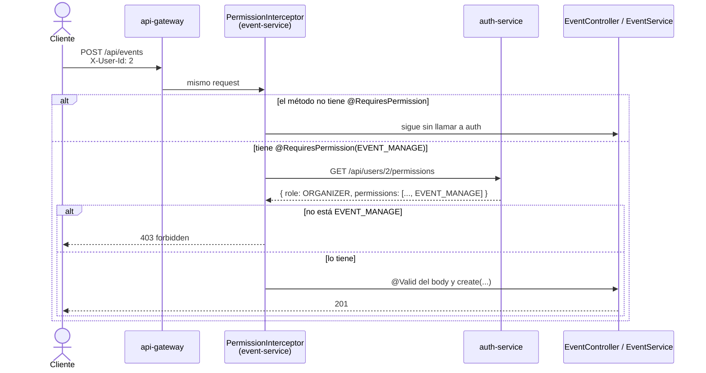

# Autorización por permisos

> Cómo decide un servicio si el usuario que llama puede usar un endpoint. En la Entrega 1 no hay JWT: el usuario se identifica con el header `X-User-Id` (README, *Modalidad de entrega*: "el usuario se identifica por parámetro o encabezado") y el servicio le pregunta al auth-service qué puede hacer.

## Idea general

- **Se chequean permisos, no roles.** Un endpoint pide `EVENT_MANAGE`, no "ser `ORGANIZER`". Qué permisos tiene cada rol lo dice `role_permission` en el auth-service. Si mañana un rol gana o pierde un permiso, se cambia el seeder y el código queda igual.
- **Se confía en la identidad del header, no en lo que dice poder hacer.** El servicio no verifica que quien llama sea de verdad el usuario de `X-User-Id`: eso llega con el JWT (ver *Limitaciones*). Lo que sí confirma siempre el auth-service, que es el dueño del dato, es qué puede hacer ese usuario.
- **Cada endpoint declara lo que pide.** Con la anotación `@RequiresPermission` sobre el método del controller. Un endpoint sin anotación no chequea nada.

## Flujo



Paso a paso, para un `POST /api/events`:

1. El `DispatcherServlet` resuelve qué método del controller atiende el request, y antes de llamarlo corre `PermissionInterceptor.preHandle`.
2. Si el método no tiene `@RequiresPermission`, el interceptor deja pasar y no llama a nadie. Así los `GET` públicos no dependen del auth-service.
3. Si la tiene, lee `X-User-Id`. Si falta o no es un número, responde `400 invalid_parameter`.
4. Llama a `AuthClient.getPermissions(userId)`, que es `GET /api/users/{id}/permissions` en el auth-service.
5. Si el permiso no está en la lista, responde `403 forbidden`. Si está, sigue al controller: recién ahí corre `@Valid` y después el service.

## El endpoint del auth-service

```http
GET /api/users/2/permissions
→ 200 { "userId": 2, "role": "ORGANIZER",
        "permissions": ["EVENT_MANAGE", "EVENT_SEARCH", "REFUND_REQUEST", "REPORT_VIEW", "TICKET_PURCHASE"] }

GET /api/users/99/permissions
→ 404 { "error": "user_not_found", ... }
```

- **Usuario dado de baja:** `user.deleted_at` con fecha da `404 user_not_found`, igual que si no existiera. Así un usuario dado de baja no puede hacer nada en ningún servicio.
- **Una sola consulta:** `UserRepository.findWithRoleAndPermissionsById` trae el usuario, su rol y los permisos del rol con `@EntityGraph`. Los dos son lazy y sin el grafo serían dos consultas más.
- **Los permisos vuelven ordenados alfabéticamente,** para que la respuesta sea siempre la misma y se pueda comparar en tests y en Postman.

### Permisos y roles cargados por `AuthSeeder`

| Permiso | CLIENT | ORGANIZER | ADMIN | ACCESS_STAFF |
|---|:-:|:-:|:-:|:-:|
| `EVENT_SEARCH`, `TICKET_PURCHASE`, `REFUND_REQUEST` | ✅ | ✅ | ✅ | ✅ |
| `EVENT_MANAGE` | | ✅ | | |
| `REPORT_VIEW` | | ✅ | | |
| `EVENT_ADMIN`, `REFUND_RESOLVE`, `USER_MANAGE` | | | ✅ | |
| `TICKET_VALIDATE` | | | | ✅ |

Usuarios de prueba: `1` cliente, `2` organizador (org `1`), `3` admin, `4` personal de acceso, `5` organizador (org `2`).

## Endpoints protegidos hoy

| Servicio | Endpoint | Permiso |
|---|---|---|
| event-service | `POST /api/events` | `EVENT_MANAGE` |
| event-service | `PUT /api/events/{id}/participants` | `EVENT_MANAGE` |

El resto todavía no tiene `@RequiresPermission`. Los `POST`/`PUT`/`DELETE` de `/api/venues` y de `/api/participants` quedan sin proteger hasta definir qué permiso los cubre: hoy no existe uno para administrar lugares (ver *Pendiente*).

## Errores

| Caso | Status | Código | Quién lo arma |
|---|---|---|---|
| Falta `X-User-Id` | 400 | `invalid_parameter` | El interceptor, con el mismo mensaje que da el `GlobalExceptionHandler` para un header faltante |
| `X-User-Id` no es un número | 400 | `invalid_parameter` | El interceptor |
| El usuario no existe o está dado de baja | 404 | `user_not_found` | El auth-service; el `GlobalExceptionHandler` lo reenvía tal cual |
| El rol no tiene el permiso | 403 | `forbidden` | El interceptor, con `CommonErrorCode.FORBIDDEN` |
| El auth-service no responde | 503 | `service_unavailable` | El `GlobalExceptionHandler` |

- **No hay un código nuevo.** `forbidden` ya existía en `CommonErrorCode`, así que el resto de los servicios lo puede usar sin tocar `common`. El mensaje dice qué permiso faltó: *"El usuario 1 no tiene el permiso EVENT_MANAGE"*.
- **El permiso se revisa antes que el body.** Un usuario sin permiso que manda un body inválido recibe `403`, no `400`. Es intencional: a quien no puede usar el endpoint no se le explica qué campos espera.
- **El permiso no reemplaza las reglas de negocio.** Responde "¿puede crear eventos?", no "¿este evento es de su organización?". Eso lo sigue validando el service: al crear, `organizer_not_in_organization`; al editar o publicar, comparar `event.organizationId` con el del organizador.

## Cómo proteger un endpoint nuevo

1. Si el permiso no está, agregarlo al enum `org.group10.event.security.Permission`. El nombre tiene que ser igual al de `AuthSeeder`, porque se compara por nombre.
2. Anotar el método del controller:
   ```java
   @PostMapping("/{id}/publish")
   @RequiresPermission(Permission.EVENT_MANAGE)
   public EventResponse publish(@PathVariable Long id, @RequestHeader(USER_HEADER) Long userId) { ... }
   ```
3. Documentar el `403 forbidden` en su `@ApiResponse` y sumar el endpoint a la tabla de *Endpoints protegidos*.

**En los tests de controller:** `@WebMvcTest` carga los interceptores, así que todo test de controller del event-service necesita `@MockitoBean AuthClient`. Si el endpoint está protegido, también tiene que mockear `getPermissions` con el permiso que corresponde.

## Código

| Servicio | Clase | Qué hace |
|---|---|---|
| auth-service | `UserController`, `UserService` | `GET /api/users/{id}/permissions` |
| auth-service | `UserPermissionsResponse` | `userId`, `role` y `permissions` |
| event-service | `security/Permission` | Enum con los permisos que usa este servicio |
| event-service | `security/RequiresPermission` | La anotación |
| event-service | `security/PermissionInterceptor` | Lee `X-User-Id`, llama a auth y corta con `403` |
| event-service | `config/WebConfig` | Registra el interceptor para `/api/**` |
| event-service | `client/AuthClient.getPermissions` | La llamada HTTP |

## Qué cambia con JWT (Épica 9, Entrega 2)

| Hoy | Con JWT |
|---|---|
| `X-User-Id` en cada request | El gateway valida el token y el usuario sale del `sub` |
| El interceptor pregunta los permisos al auth-service en cada request | Los permisos viajan en el token: no hay llamada |
| `@RequiresPermission(Permission.EVENT_MANAGE)` | `@PreAuthorize("hasAuthority('EVENT_MANAGE')")` de Spring Security |
| `PermissionInterceptor` y `WebConfig` | Se borran |

La respuesta de `/api/users/{id}/permissions` tiene la forma de los *claims* del token (usuario, rol y permisos), como pide `microservices.md`. Los services no cambian, porque nunca supieron de dónde salía el permiso.

## Costo

Cada request a un endpoint protegido hace **una llamada más al auth-service**. Crear un evento hoy hace tres: permisos, organización y organizador. Para la Entrega 1 se acepta sin caché. Hay dos formas de bajarlo si hace falta:
- que la respuesta traiga también el `organizationId`, y así se ahorran las otras dos;
- cachear los permisos unos segundos.

## Qué cambia en la aplicación

- **Antes:** el event-service decidía solo con reglas de negocio: "¿es organizador de esta organización?".
- **Ahora:** primero pregunta si el usuario puede hacer la acción (el permiso) y después si puede hacerla sobre ese recurso (la regla de negocio). El auth-service decide qué puede hacer cada usuario en todos los servicios, como propone `microservices.md`.
- **Para el usuario, lo único que cambia es el error.** Con los datos de prueba, quien podía crear eventos sigue pudiendo y quien no podía sigue sin poder. Un cliente que intenta crear un evento recibe `403 forbidden` en vez de `404 organizer_not_found`.

## Limitaciones y riesgos

- **No es seguridad real todavía.** Cualquiera puede mandar `X-User-Id: 2` y actuar como la organizadora. El chequeo es de autorización (qué puede hacer el usuario que dice ser), no de autenticación (si lo es). La consigna lo acepta para la Entrega 1, y el JWT lo resuelve.
- **El permiso se compara por nombre entre servicios.** Si alguien renombra un permiso en `AuthSeeder`, todos los requests a ese endpoint dan `403`. Ningún test lo detecta, porque los tests del event-service mockean al auth-service. Antes de renombrar un permiso, buscar sus usos en el enum `Permission` de cada servicio.

| Riesgo | Gravedad | Detalle |
|---|---|---|
| Sin timeouts en `AuthClient` | Media | Si el auth-service se cuelga, el request queda esperando. Si se cae del todo, en cambio, da `503`. Ya pasaba antes del chequeo de permisos, pero ahora crear un evento hace tres llamadas seguidas a auth |
| `/api/users/{id}/permissions` expuesto en el gateway | Baja | No tiene protección, así que cualquiera puede ver el rol de un id o saber si el usuario existe (`200` o `404`) |
| Contrato con el front | Baja | Cambiaron los errores de `POST /api/events` (`403 forbidden`, `404 user_not_found`). La colección de Postman ya está actualizada |

**Tests:**
- `AuthServiceApplicationTests` levanta el MySQL de `compose.yaml` con `ddl-auto: create-drop`, así que correr `mvn test` en auth-service **borra la base local de auth**. El seeder vuelve a cargarla al arrancar el servicio.
- `SectorController` y `SeatController` no tienen tests. Si se les agrega un `@WebMvcTest`, necesita `@MockitoBean AuthClient`.

## Pendiente

| Tema | Detalle |
|---|---|
| Lugares | `POST`/`PUT`/`DELETE` de `/api/venues` no están protegidos. Hace falta decidir qué permiso los cubre (p. ej. un `VENUE_MANAGE` para el admin) |
| Otros servicios | ticket-service y los demás no tienen interceptor. Si lo necesitan, se puede mover `RequiresPermission` y `PermissionInterceptor` a `common` |
| Timeouts | Configurar timeouts (y quizá un reintento) en el grupo `auth-service` de los clients HTTP |
| `organizationId` en la respuesta | Ahorraría dos llamadas al crear eventos y permitiría sacar `X-Organization-Id` (ver `event-creation-pending.md`) |
