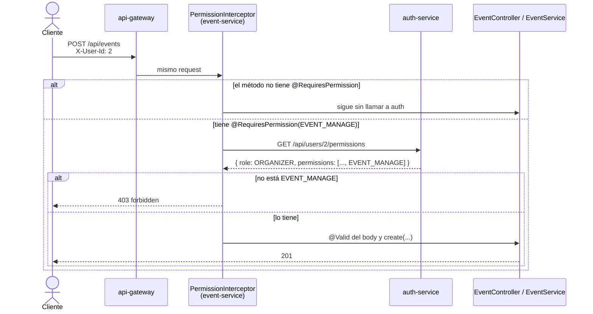

# Autorización por permisos

> Cómo decide un servicio si el usuario que llama puede usar un endpoint. En la Entrega 1 no hay JWT: el usuario se identifica con el header `X-User-Id` (README, *Modalidad de entrega*: "el usuario se identifica por parámetro o encabezado") y el servicio le pregunta al auth-service qué puede hacer.

## Idea general

- **Se chequean permisos, no roles.** Un endpoint pide `EVENT_MANAGE`, no "ser `ORGANIZER`". Qué permisos tiene cada rol lo dice `role_permission` en el auth-service. Si mañana un rol gana o pierde un permiso, se cambia el seeder y el código queda igual.
- **Se confía en la identidad del header, no en lo que dice poder hacer.** El servicio no verifica que quien llama sea de verdad el usuario de `X-User-Id`: eso llega con el JWT (ver *Limitaciones*). Lo que sí confirma siempre el auth-service, que es el dueño del dato, es qué puede hacer ese usuario.
- **Cada endpoint declara lo que pide.** Con la anotación `@RequiresPermission` sobre el método del controller. Un endpoint sin anotación no chequea nada.

## Flujo



Paso a paso, para un `POST /api/events`:

1. El `DispatcherServlet` resuelve qué método del controller atiende el request, y antes de llamarlo corre `PermissionInterceptor.preHandle`.
2. Si el método no tiene `@RequiresPermission`, el interceptor deja pasar y no llama a nadie. Así los `GET` públicos no dependen del auth-service.
3. Si la tiene, lee `X-User-Id`. Si falta o no es un número, responde `400 invalid_parameter`.
4. Llama a `AuthClient.getPermissions(userId)`, que es `GET /api/users/{id}/permissions` en el auth-service.
5. Si el permiso no está en la lista, responde `403 forbidden`. Si está, sigue al controller: recién ahí corre `@Valid` y después el service.

## El endpoint del auth-service

```http
GET /api/users/2/permissions
→ 200 { "userId": 2, "role": "ORGANIZER",
        "permissions": ["EVENT_MANAGE", "EVENT_SEARCH", "REFUND_REQUEST", "REPORT_VIEW", "TICKET_PURCHASE"] }

GET /api/users/99/permissions
→ 404 { "error": "user_not_found", ... }
```

- **Usuario dado de baja:** `user.deleted_at` con fecha da `404 user_not_found`, igual que si no existiera. Así un usuario dado de baja no puede hacer nada en ningún servicio.
- **Una sola consulta:** `UserRepository.findWithRoleAndPermissionsById` trae el usuario, su rol y los permisos del rol con `@EntityGraph`. Los dos son lazy y sin el grafo serían dos consultas más.
- **Los permisos vuelven ordenados alfabéticamente,** para que la respuesta sea siempre la misma y se pueda comparar en tests y en Postman.

### Permisos y roles cargados por `AuthSeeder`

| Permiso | CLIENT | ORGANIZER | ADMIN | ACCESS_STAFF |
|---|:-:|:-:|:-:|:-:|
| `EVENT_SEARCH`, `TICKET_PURCHASE`, `REFUND_REQUEST` | ✅ | ✅ | ✅ | ✅ |
| `EVENT_MANAGE` | | ✅ | | |
| `REPORT_VIEW` | | ✅ | | |
| `EVENT_ADMIN`, `REFUND_RESOLVE`, `USER_MANAGE` | | | ✅ | |
| `TICKET_VALIDATE` | | | | ✅ |

Usuarios de prueba: `1` cliente, `2` organizador (org `1`), `3` admin, `4` personal de acceso, `5` organizador (org `2`), `6` organizador (org `1`, sin eventos propios).

## Endpoints protegidos hoy

| Servicio | Endpoint | Permiso |
|---|---|---|
| event-service | `POST /api/events` | `EVENT_MANAGE` |
| event-service | `PUT /api/events/{id}/participants` | `EVENT_MANAGE` |
| event-service | `PUT /api/events/{id}/sectors` | `EVENT_MANAGE` |
| event-service | `PUT /api/events/{id}`, `DELETE /api/events/{id}` | `EVENT_MANAGE` |
| event-service | `POST /api/events/{id}/publish` | `EVENT_MANAGE` |
| event-service | `POST /api/events/{id}/cancel`, `/suspend`, `/resume` | `EVENT_ADMIN` **o** `EVENT_MANAGE` (y el service exige que sea el organizador que creó el evento) |

El resto todavía no tiene `@RequiresPermission`. Los `POST`/`PUT`/`DELETE` de `/api/venues` y de `/api/participants` quedan sin proteger hasta definir qué permiso los cubre: hoy no existe uno para administrar lugares (ver *Pendiente*).

## Errores

| Caso | Status | Código | Quién lo arma |
|---|---|---|---|
| Falta `X-User-Id` | 400 | `invalid_parameter` | El interceptor, con el mismo mensaje que da el `GlobalExceptionHandler` para un header faltante |
| `X-User-Id` no es un número | 400 | `invalid_parameter` | El interceptor |
| El usuario no existe o está dado de baja | 404 | `user_not_found` | El auth-service; el `GlobalExceptionHandler` lo reenvía tal cual |
| El rol no tiene el permiso | 403 | `forbidden` | El interceptor, con `CommonErrorCode.FORBIDDEN` |
| El auth-service no responde | 503 | `service_unavailable` | El `GlobalExceptionHandler` |

- **No hay un código nuevo.** `forbidden` ya existía en `CommonErrorCode`, así que el resto de los servicios lo puede usar sin tocar `common`. El mensaje dice qué permiso faltó: *"El usuario 1 no tiene el permiso EVENT_MANAGE"*.
- **El permiso se revisa antes que el body.** Un usuario sin permiso que manda un body inválido recibe `403`, no `400`. Es intencional: a quien no puede usar el endpoint no se le explica qué campos espera.
- **El permiso no reemplaza las reglas de negocio.** Responde "¿puede crear eventos?", no "¿este evento es de su organización?". Eso lo sigue validando el service: al crear, `organizer_not_in_organization`; al editar o publicar, comparar `event.organizationId` con el del organizador.

## Varios permisos y quién llama

- **`@RequiresPermission` acepta varios permisos, y alcanza con tener uno:** `@RequiresPermission({Permission.EVENT_ADMIN, Permission.EVENT_MANAGE})`. Si no tiene ninguno, el mensaje los lista: *"El usuario 1 no tiene ninguno de los permisos EVENT_ADMIN, EVENT_MANAGE"*.
- **El interceptor deja un `Caller` (`userId` y `permissions`) en el request**, en el atributo `PermissionInterceptor.CALLER_ATTRIBUTE`. El controller lo recibe con `@RequestAttribute` y se lo pasa al service, que así distingue a un admin de un organizador sin volver a consultar al auth-service. Con JWT, el `Caller` sale del token.
- **Ejemplo, suspender o cancelar:** el admin puede con cualquier evento. Un organizador, solo con los que creó (`event.createdBy`), y solo mientras siga siendo organizador de su organización. Otro organizador de la misma organización recibe `403 not_event_creator`. Así una sola cuenta no puede suspender, por error o a propósito, eventos que afectan a muchos compradores y artistas.

## Cómo proteger un endpoint nuevo

1. Si el permiso no está, agregarlo al enum `org.group10.event.security.Permission`. El nombre tiene que ser igual al de `AuthSeeder`, porque se compara por nombre.
2. Anotar el método del controller:
   ```java
   @PostMapping("/{id}/publish")
   @RequiresPermission(Permission.EVENT_MANAGE)
   public EventResponse publish(@PathVariable Long id, @RequestHeader(USER_HEADER) Long userId) { ... }
   ```
3. Documentar el `403 forbidden` en su `@ApiResponse` y sumar el endpoint a la tabla de *Endpoints protegidos*.

**Si se agrega un test de controller:** `@WebMvcTest` carga los interceptores, así que todo test de controller del event-service necesita `@MockitoBean AuthClient`. Si el endpoint está protegido, también tiene que mockear `getPermissions` con el permiso que corresponde.

## Código

| Servicio | Clase | Qué hace |
|---|---|---|
| auth-service | `UserController`, `UserService` | `GET /api/users/{id}/permissions` |
| auth-service | `UserPermissionsResponse` | `userId`, `role` y `permissions` |
| event-service | `security/Permission` | Enum con los permisos que usa este servicio |
| event-service | `security/RequiresPermission` | La anotación |
| event-service | `security/PermissionInterceptor` | Lee `X-User-Id`, llama a auth y corta con `403` |
| event-service | `config/WebConfig` | Registra el interceptor para `/api/**` |
| event-service | `client/AuthClient.getPermissions` | La llamada HTTP |
| `common` (Entrega 2) | `security/GatewayHeaders` | Los nombres de los headers que pone el gateway |
| `common` (Entrega 2) | `security/Permission`, `security/RequiresPermission` | El enum con los 9 permisos del `AuthSeeder` y la anotación |
| `common` (Entrega 2) | `security/Caller` | Quién llama, armado con los headers del gateway |
| `common` (Entrega 2) | `security/PermissionInterceptor`, `security/CallerArgumentResolver` | El chequeo en `preHandle` y el `Caller` como parámetro |
| `common` (Entrega 2) | `config/PermissionAutoConfiguration` | Registra los dos en `/api/**` de cada servicio |

## Con JWT (Épica 9, Entrega 2)

La anotación y el interceptor se quedan, pero se mueven a `common` y **dejan de llamar al auth-service**: los permisos llegan del api-gateway, que es el único que valida el JWT ([ADR-003](../adr/ADR-003-jwt-validated-only-in-gateway.md)).

```
Cliente ── Bearer JWT ──▶ api-gateway ── X-User-Id, X-User-Role, X-User-Permissions, X-Organization-Id ──▶ servicio
                          · valida el token                                                   · PermissionInterceptor
                          · borra los X-User-* del cliente                                    · @RequiresPermission
```

1. Spring elige el método del controller.
2. `PermissionInterceptor.preHandle`, **antes de leer el body**:
    - sin `@RequiresPermission`, deja pasar: el endpoint es público;
    - arma el `Caller` con los headers del gateway. Sin `X-User-Id`, o con un id que no es número: `401 unauthorized`;
    - si el `Caller` no tiene ninguno de los permisos: `403 forbidden`.
3. Recién ahí Spring lee el body y corre `@Valid`: el `400` solo le llega a quien tiene el permiso.
4. El controller recibe el `Caller` como parámetro y se lo pasa al service, que aplica las reglas de negocio.

| Entrega 1 | Entrega 2 |
|---|---|
| `X-User-Id` lo manda el cliente y se confía en él | Lo pone el gateway a partir del `sub` del token, y borra el que mande el cliente |
| El interceptor pide los permisos al auth-service en cada request | Llegan en `X-User-Permissions`: no hay llamada |
| `RequiresPermission`, `Permission`, `Caller` y `PermissionInterceptor` en event-service | Los mismos en `org.group10.common.security`, para todos los servicios |
| `WebConfig` registra el interceptor | `PermissionAutoConfiguration` lo registra en cada servicio que depende de `common` |
| Falta `X-User-Id` → `400 invalid_parameter` | Falta `X-User-Id` → `401 unauthorized` |
| `@RequestAttribute` para recibir el `Caller` | `Caller caller` como parámetro (`CallerArgumentResolver`) |

**Por qué no `@PreAuthorize`:** Spring lo evalúa al invocar el método, después de leer el body y de `@Valid`. Un usuario sin permiso con un body inválido recibiría `400` en vez de `403`, en contra de la US-AUTH-02. `preHandle` corre antes: el `403` sale primero incluso con JSON roto. Además, como los servicios no validan el token, no necesitan Spring Security (ver *Decisiones de diseño tomadas* en el [RFC-001](../rfc/RFC-001-auth-modality.md)).

**Migración:** cada servicio pasa a la anotación de `common` en su PR de roles. Hasta entonces, event-service sigue con su interceptor propio. Los dos conviven: el de `common` no es un bean, así no choca con el `permissionInterceptor` de event-service, y cada uno solo mira su propia anotación.

## Costo

Cada request a un endpoint protegido hace **una llamada más al auth-service**. Crear un evento hoy hace tres: permisos, organización y organizador. Para la Entrega 1 se acepta sin caché. Hay dos formas de bajarlo si hace falta:
- que la respuesta traiga también el `organizationId`, y así se ahorran las otras dos;
- cachear los permisos unos segundos.

## Qué cambia en la aplicación

- **Antes:** el event-service decidía solo con reglas de negocio: "¿es organizador de esta organización?".
- **Ahora:** primero pregunta si el usuario puede hacer la acción (el permiso) y después si puede hacerla sobre ese recurso (la regla de negocio). El auth-service decide qué puede hacer cada usuario en todos los servicios, como propone `microservices.md`.
- **Para el usuario, lo único que cambia es el error.** Con los datos de prueba, quien podía crear eventos sigue pudiendo y quien no podía sigue sin poder. Un cliente que intenta crear un evento recibe `403 forbidden` en vez de `404 organizer_not_found`.

## Limitaciones y riesgos

- **No es seguridad real todavía.** Cualquiera puede mandar `X-User-Id: 2` y actuar como la organizadora. El chequeo es de autorización (qué puede hacer el usuario que dice ser), no de autenticación (si lo es). La consigna lo acepta para la Entrega 1, y el JWT lo resuelve.
- **El permiso se compara por nombre entre servicios.** Si alguien renombra un permiso en `AuthSeeder`, todos los requests a ese endpoint dan `403`. Ningún test lo detecta, porque los tests del event-service mockean al auth-service. Antes de renombrar un permiso, buscar sus usos en el enum `Permission` de cada servicio.

| Riesgo | Gravedad | Detalle |
|---|---|---|
| Sin timeouts en `AuthClient` | Media | Si el auth-service se cuelga, el request queda esperando. Si se cae del todo, en cambio, da `503`. Ya pasaba antes del chequeo de permisos, pero ahora crear un evento hace tres llamadas seguidas a auth |
| `/api/users/{id}/permissions` expuesto en el gateway | Baja | No tiene protección, así que cualquiera puede ver el rol de un id o saber si el usuario existe (`200` o `404`) |
| Contrato con el front | Baja | Cambiaron los errores de `POST /api/events` (`403 forbidden`, `404 user_not_found`). La colección de Postman ya está actualizada |

**Tests:**
- El auth-service no tiene tests: la consulta de permisos se prueba a mano con Postman.
- Los controllers no tienen tests. Si se les agrega un `@WebMvcTest`, necesita `@MockitoBean AuthClient`.

## Pendiente

| Tema | Detalle |
|---|---|
| Lugares | `POST`/`PUT`/`DELETE` de `/api/venues` no están protegidos. Hace falta decidir qué permiso los cubre (p. ej. un `VENUE_MANAGE` para el admin) |
| Delegar la suspensión | Que el creador autorice a otro organizador de su organización a suspender o cancelar su evento. Necesita guardar quién autorizó a quién y cómo se revoca: se dejó afuera |
| Otros servicios | `RequiresPermission` y `PermissionInterceptor` ya están en `common` (Entrega 2). Falta que cada servicio anote sus endpoints, en su PR de roles |
| Timeouts | Configurar timeouts (y quizá un reintento) en el grupo `auth-service` de los clients HTTP |
| `organizationId` en la respuesta | Ahorraría dos llamadas al crear eventos y permitiría sacar `X-Organization-Id` (ver `event-creation-pending.md`) |
