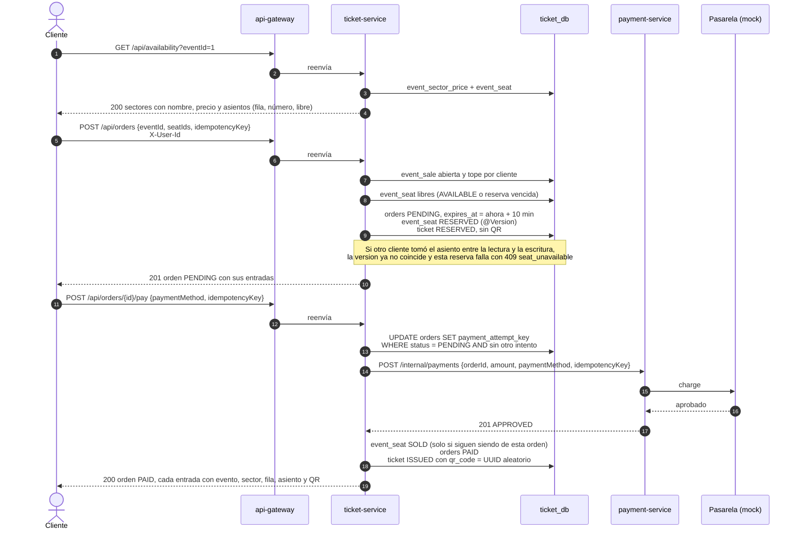
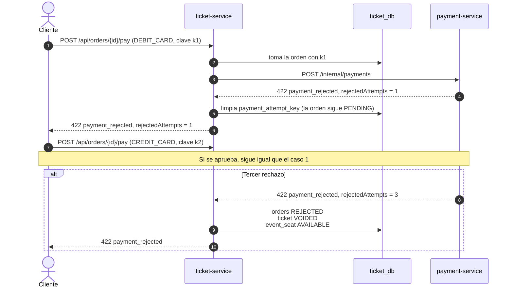
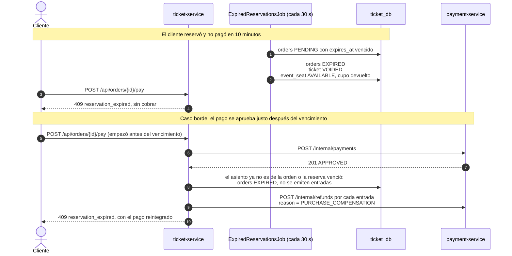

# Compra de una entrada numerada

> Diagrama de secuencia que pide la Entrega 1: compra de asientos numerados, con lo que pasa si el pago se rechaza o la reserva vence. Las reglas y su porqué están en [`ticket-service.md`](ticket-service.md) y [`payment-service.md`](payment-service.md).

Participantes: el cliente (app o Postman), el `api-gateway`, el `ticket-service` con su base (`ticket_db`), el `payment-service` y la pasarela simulada (`MockPaymentGateway`). El event-service no participa durante la compra: al publicar el evento ya le copió al ticket-service el inventario, los precios y los datos que se imprimen en la entrada.

## 1. Reserva y pago aprobado

## 2. Pago rechazado

La orden sigue `PENDING` y el cliente puede probar otro medio mientras no venza la reserva. Al tercer rechazo, la orden se cierra y los asientos se liberan.

## 3. La reserva vence

## Qué garantiza cada paso

| Riesgo | Mecanismo | Dónde se prueba |
|---|---|---|
| Dos clientes por el mismo asiento | `@Version` en `event_seat` | `ReservationMySqlIntegrationTest.reserve_manyCustomersForTheSameSeats_onlyOneGetsThem` |
| Dos clientes por el último lugar de un sector | `UPDATE event_sector_stock ... WHERE taken + :n <= capacity` | `reserve_moreCustomersThanPlaces_neverSellsMoreThanTheCapacity` |
| La app reintenta la reserva por un corte | `orders.idempotency_key` única | `reserve_sameKeyAtTheSameTime_createsASingleOrder` |
| Dos pagos a la vez con tarjetas distintas | `payment_attempt_key` tomada con `UPDATE` condicional | `OrderPaymentMySqlIntegrationTest.pay_differentAttemptsAtTheSameTime_chargesOnlyOnce` |
| Pago aprobado con la reserva vencida | Compensación con reintegro | `pay_reservationExpiresWhileCharging_refundsEveryTicketAndIssuesNothing` |
