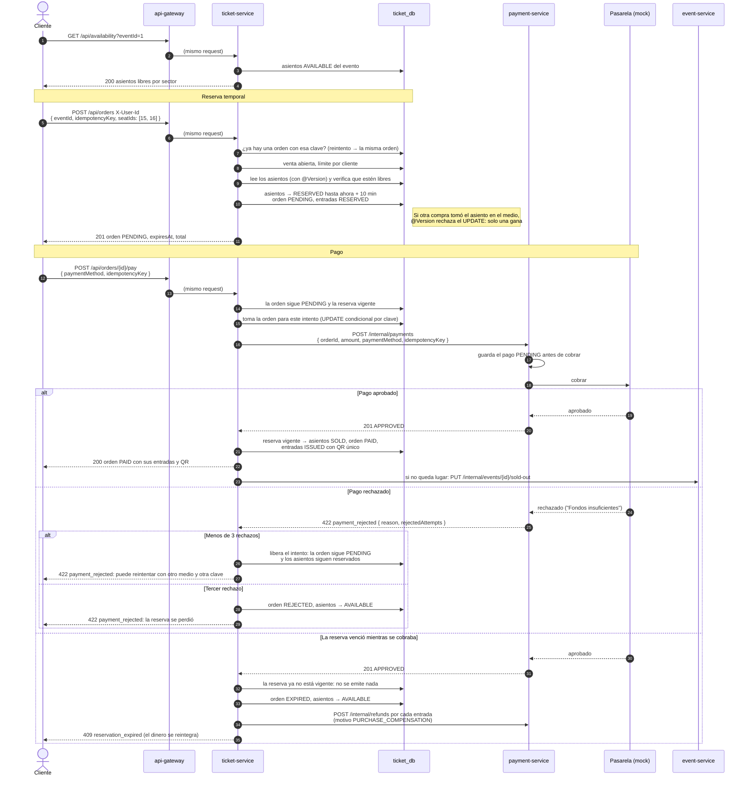
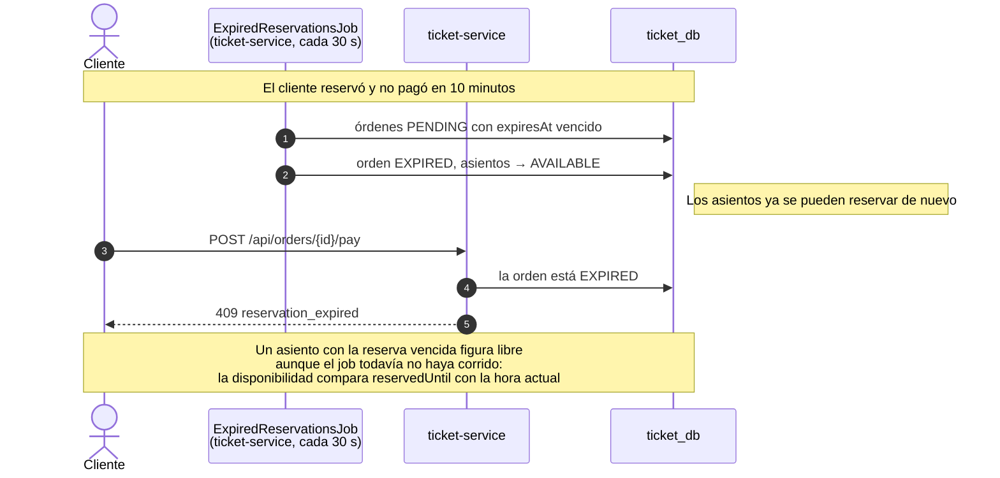

# Compra de una entrada numerada

> Consigna, *Arquitectura de microservicios*: *"diagrama de secuencia del flujo de compra de una entrada numerada, incluyendo qué ocurre si el pago es rechazado o la reserva vence"*. Describe lo que hace el código de `ReservationService`, `OrderPaymentService` y `ExpiredReservationsJob` (ticket-service) y de `PaymentService` (payment-service).

## Reglas que aparecen en el diagrama

| Regla | Valor | Dónde se configura |
|---|---|---|
| La reserva retiene los asientos | 10 minutos | `ticketya.reservation.hold` |
| No se aceptan intentos de pago nuevos en el último tramo | 1 minuto antes del vencimiento | `ticketya.reservation.payment-margin` |
| Rechazos hasta liberar los asientos | 3 | `ticketya.reservation.max-rejected-payments` |
| El job de vencimiento corre cada | 30 segundos | `ticketya.reservation.expiration-check` |
| La pasarela simulada rechaza | `DEBIT_CARD` | `payment.mock.rejected-method` (payment-service) |

## Camino feliz y las tres alternativas

## Si la reserva vence antes de pagar

## Qué garantiza cada paso

| Paso | Qué pasaría sin él | Cómo se evita |
|---|---|---|
| Reserva | Dos clientes compran el mismo asiento | `@Version` en `event_seat`: de dos transacciones sobre el mismo asiento, solo una confirma. Funciona con varias instancias, porque lo decide la base ([`concurrency-and-idempotency.md`](../quality-attributes/concurrency-and-idempotency.md)) |
| Reintento de la reserva | Un doble clic reserva dos veces | `idempotencyKey` de la orden: la misma clave devuelve la misma orden |
| Toma del intento de pago | Dos pagos simultáneos de la misma orden cobran dos veces | `UPDATE` condicional sobre la orden: solo un intento la toma, el otro recibe `409 payment_in_progress` |
| Cobro | Un reintento por un corte de conexión cobra dos veces | `idempotencyKey` del pago: la misma clave devuelve el resultado guardado, sin volver a llamar a la pasarela |
| Emisión | Se emite una entrada de una reserva vencida | Solo se emite si la reserva sigue vigente y los asientos pasan de `RESERVED` a `SOLD` en la misma transacción |
| Compensación | Se cobra una compra que no se concretó | Reintegro automático de cada entrada |

**Lo que el cliente nunca ve:** el reintento del job que avisa *agotado* al event-service si este no responde (no deshace la compra), y los reintegros que fallan, que quedan en el log para reintentarse (US-PAY-13, Entrega 2).

## Errores que puede recibir el cliente

| Momento | Código | Qué significa |
|---|---|---|
| Reservar | `409 seat_unavailable` | Otro cliente tomó alguno de los asientos |
| Reservar | `409 data_conflict` | Otro cliente reservó el mismo asiento en el mismo instante y ganó (`@Version`) |
| Reservar | `409 ticket_limit_exceeded` | Supera el máximo de entradas por cliente del evento |
| Reservar | `409 event_not_on_sale` / `sale_not_started` | El evento no está a la venta, o la venta todavía no abrió |
| Pagar | `422 payment_rejected` | La pasarela rechazó el cobro; `detail` trae el motivo y cuántos rechazos van |
| Pagar | `409 payment_in_progress` | Hay otro intento de pago en curso para esa orden |
| Pagar | `409 payment_window_closed` | Falta menos de 1 minuto para que venza la reserva |
| Pagar | `409 reservation_expired` | La reserva venció |
| Pagar | `503 service_unavailable` | El payment-service no respondió: solo se puede repetir ese mismo intento |

Todos los códigos están en [`error-handling.md`](error-handling.md).
