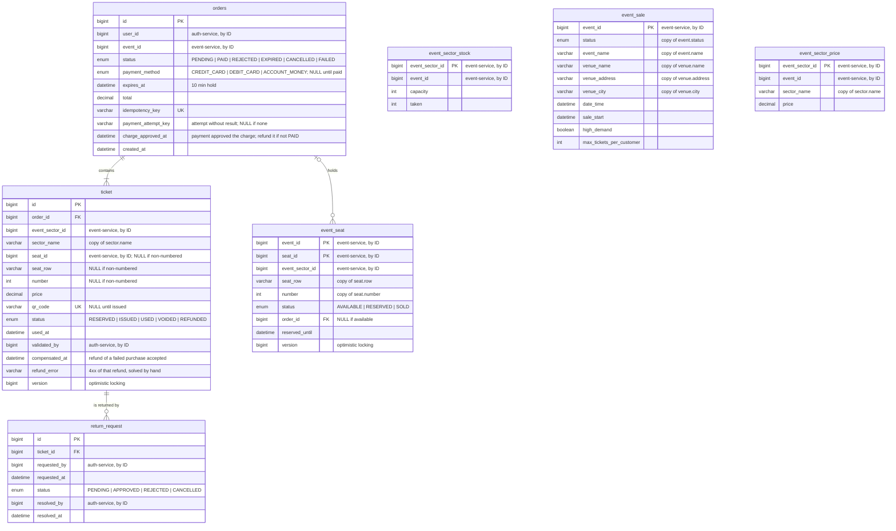

# ticket-service: decisiones del modelo

> Épica 2 (#21). Tablas 🟠 *Sales and access* y 🔴 `return_request` de `ticketya_schema_en.drawio`, más `event_sector_stock`, que se agregó en esta etapa.

Es el núcleo transaccional: reserva, compra, emisión de QR, no doble venta, devoluciones e ingreso al evento.

## Diagrama



## Referencias a otros servicios

Todas van por ID, sin FK física, porque cada servicio tiene su propia base.

| Campo | Apunta a | Servicio |
|---|---|---|
| `orders.user_id`, `return_request.requested_by`, `return_request.resolved_by` | `user` | auth-service |
| `ticket.validated_by` | `access_staff` | auth-service |
| `orders.event_id`, `event_seat.event_id`, `event_sector_stock.event_id`, `event_sale.event_id`, `event_sector_price.event_id` | `event` | event-service |
| `event_seat.seat_id`, `ticket.seat_id` | `seat` | event-service |
| `ticket.event_sector_id`, `event_seat.event_sector_id`, `event_sector_stock.event_sector_id`, `event_sector_price.event_sector_id` | `event_sector` | event-service |

**Datos solapados entre bases** (copias que se guardan a propósito):

| Dato | Copia de | Por qué se copia |
|---|---|---|
| `ticket.price` | `event_sector.price` | El precio que pagó el cliente no puede cambiar si el organizador cambia el precio después. También es la base de la recaudación (consigna 12) |
| `orders.total` | Suma de `ticket.price` | Es el monto que se le pide cobrar al payment-service |
| `event_sector_stock.capacity` | `sector.capacity` | Controlar el cupo sin llamar al event-service en cada compra |
| Filas de `event_seat` | Los `seat` de los sectores habilitados | Cada asiento necesita su propio estado y su `version` en esta base |
| `event_sale` | `event` | Reservar sin llamar al event-service en cada compra |
| `event_sector_price.price` | `event_sector.price` | Lo mismo para el precio que se copia en cada `ticket` |
| `orders.payment_method` | `payment.payment_method` | Listar las compras sin depender del payment-service |
| `event_sale.event_name`, `venue_name`, `venue_address`, `venue_city` | `event.name`, `venue` | Mostrar la entrada sin llamar al event-service |
| `event_sector_price.sector_name`, `ticket.sector_name` | `sector.name` | Lo mismo para el sector de la entrada y de la disponibilidad |
| `event_seat.seat_row`, `event_seat.number`, `ticket.seat_row`, `ticket.number` | `seat.row`, `seat.number` | Lo mismo para la fila y el número del asiento |

## Trazabilidad

Todos los servicios servlet, salvo el api-gateway, reciben `X-Correlation-ID` mediante la autoconfiguración de `common` ([ADR 0008](../adr/0008-trazabilidad-de-pagos-con-x-correlation-id.md)). Si falta o no cumple el formato (`[A-Za-z0-9._:-]`, de 1 a 128 caracteres), generan un UUID, lo devuelven en la respuesta y lo guardan en el MDC durante el request. Los clientes HTTP propagan el header; los publishers RabbitMQ lo agregan a las propiedades del mensaje y los listeners lo restauran en el MDC. Fuera de un request, como en los jobs, se usa un id nuevo por llamada sin escribirlo en el MDC del hilo.

Cada request registra método, endpoint, usuario, status HTTP y duración. Las operaciones críticas registran `operation`, `status`, identificadores del recurso y `correlationId`. No se registran códigos QR, cuerpos de request ni datos de la pasarela; el medio de pago puede aparecer solo como tipo.

## Decisiones

### No doble venta en sectores numerados: `event_seat` con `version`

Consigna 5: *"una entrada nunca puede venderse dos veces, aun cuando muchos clientes intenten comprar el mismo asiento al mismo tiempo"*.

Hay una fila por asiento y evento, con `@Version`. Reservar es leer la fila, verificar que esté libre y actualizarla. Si dos compras leen la misma fila al mismo tiempo, la primera que escribe incrementa `version` y la segunda falla con `OptimisticLockException`, porque la `version` que leyó ya no existe. El control lo hace la base, así que funciona aunque haya varias instancias del ticket-service.

| Alternativa | Por qué no |
|---|---|
| Lock pesimista (`SELECT … FOR UPDATE`) | También funciona, pero bloquea la fila mientras dura la transacción; con miles de compras en el mismo evento, las transacciones se encolan. El optimista no bloquea: el que pierde falla enseguida |
| Lock en memoria (`synchronized`) | No funciona con varias instancias, que es justo lo que pide el enunciado |
| Redis | Agrega otra tecnología al núcleo de la compra sin necesidad; la base relacional ya garantiza la consistencia |

### No doble venta en sectores no numerados: `event_sector_stock`

Consigna 5: *"o el último lugar de una zona"*. En un sector no numerado no hay asientos que bloquear, solo un cupo. El diagrama original lo tenía como `event_sector.occupied` en el event-service; se movió acá por dos motivos:

- **Las dos protecciones contra la doble venta quedan en el mismo servicio y en la misma base.** El event-service se cachea y puede pasar a MongoDB, que es lo opuesto a lo que necesita un contador de cupo.
- **La reserva es un único `UPDATE` atómico**, sin `version` ni locks en Java:

```sql
UPDATE event_sector_stock
SET taken = taken + :quantity
WHERE event_sector_id = :id AND taken + :quantity <= capacity
```

Si actualiza 0 filas, no hay lugar. La base ejecuta el `UPDATE` de a una fila por vez, así que dos compras del último lugar nunca pasan las dos. Además, un `CHECK (taken >= 0 AND taken <= capacity)` impide que el contador quede inconsistente aunque haya un bug en el código.

**Costo:** a diferencia de `event_seat`, el contador no se libera solo cuando una reserva vence. Hace falta un job programado que pase a `EXPIRED` las órdenes vencidas y le reste al contador las entradas de esas órdenes. El mismo job limpia `event_seat` y corre cada 30 segundos, así un cupo vencido se libera a más tardar 1 minuto después. Hasta entonces, ese cupo figura ocupado y no se puede comprar.

### El inventario se crea al publicar el evento

`event_seat` y `event_sector_stock` se crean cuando el evento pasa a `PUBLISHED`: el event-service le pasa al ticket-service los asientos de los sectores numerados y la capacidad de los no numerados que tienen fila en `event_sector`. Así hay un solo momento de sincronización entre los dos servicios, y durante la venta el ticket-service no necesita consultar al event-service para saber qué hay disponible.

Publicar y cancelar usan el mismo endpoint interno, `PUT /internal/event-sales/{eventId}`, que recibe la foto completa de la venta. Es idempotente: actualiza estado, fechas y precios, y crea solo los lugares que faltan, sin tocar los ya vendidos o reservados. El event-service llama antes de cambiar su propio estado y sin una transacción abierta. Si la llamada falla, el evento queda como estaba y se puede reintentar.

### La `ticket` existe desde la reserva

Cuando el cliente reserva, se crean la `orders` (`PENDING`) y sus `ticket` en `RESERVED`, sin QR. Cuando el pago se aprueba, pasan a `ISSUED` con su `qr_code`. Si la orden se rechaza, vence o se cancela, pasan a `VOIDED`.

Así el detalle de la compra (qué sector, qué asiento, a qué precio) queda registrado antes de cobrar, como pide la consigna 4. Además, si algo falla después de cobrar, la saga tiene las entradas para compensar con un reintegro.

### `version` en `ticket`

Protege dos casos de la consigna 8 y la 7:
- Dos lectores escanean el mismo QR en el mismo segundo: el segundo falla en vez de marcarla como usada dos veces (*"un QR no puede ingresar dos veces"*).
- Se aprueba una devolución mientras alguien entra con esa entrada: solo una de las dos operaciones se aplica.

### Ingreso con QR

`POST /api/tickets/check-in` recibe el evento donde está el personal y el QR escaneado (US-TKT-19).

- **Primero, la asignación.** Antes de mirar el QR, `CheckInController` le pregunta al auth-service (`AuthClient`, `GET /internal/access-staff/{staffId}/events/{eventId}`) si el usuario del token está asignado a ese evento (US-AUTH-04). Si no lo está, el `403 staff_not_assigned` del auth-service se reenvía tal cual y no se busca el QR, así que tampoco se revela si existe. Si el auth-service no responde (1 s para conectar, 2 s para leer) o da un 5xx, el ingreso responde `503 service_unavailable` y la entrada no se toca. La llamada va en el controller y no en `CheckInService`: así queda fuera de la transacción que marca la entrada.

- **El QR va en el body, no en la URL.** Es la credencial de entrada, y las URLs quedan en los logs del gateway y de cada servicio.
- **Un QR de otro evento da `invalid_qr`, igual que uno que no existe o una entrada anulada, reintegrada o sin pagar.** Así no se puede averiguar a qué evento pertenece un QR ajeno. Solo una entrada ya usada tiene su propio error: `ticket_already_used`.
- **Un QR entra una sola vez.** Se lee la entrada para validar el evento y el estado, y después se marca con un `update` condicional: `status = USED` solo `where status = ISSUED`, subiendo `version`. Si dos lectores la escanean a la vez, uno actualiza la fila y el otro recibe 0 filas y `ticket_already_used`. Es el mismo patrón que el reintegro y no depende de cuántas instancias haya. Lo prueba `CheckInMySqlIntegrationTest` con 16 escaneos simultáneos.

### `qr_code` aleatorio

Se genera con un UUID, no a partir del ID de la entrada. Si fuera predecible, alguien podría generar QR válidos de entradas ajenas.

El QR solo lleva ese UUID. Es la credencial de acceso: el lector lo escanea y el backend busca la entrada por ese código para validar que exista, que sea de ese evento y que no se haya usado (consigna 8). No lleva datos del evento ni del asiento: no hacen falta para validar, y si viajaran sin firmar alguien podría armar un QR falso con otros datos.

La app genera la imagen del QR a partir de ese texto, así que el backend no devuelve imágenes.

### Datos que se imprimen en la entrada

Al lado del QR, la entrada muestra el evento, la fecha, el lugar con su dirección, el sector y, si es numerado, la fila y el número. Salen todos de la respuesta de la orden, sin que la app tenga que llamar al event-service:

```json
{
  "id": 4, "eventId": 13, "status": "PAID",
  "event": {"name": "Los Serranos en vivo", "dateTime": "2026-12-13T21:00:00",
            "venueName": "Estadio del Sur", "venueAddress": "Av. del Estadio 1000", "venueCity": "Buenos Aires"},
  "tickets": [
    {"id": 6, "eventSectorId": 19, "sectorName": "Platea", "seatId": 1, "row": "A", "number": 1,
     "price": 20000.00, "status": "ISSUED", "qrCode": "a7e54682-2c34-4d1f-af9c-65c1dcac4d8e"},
    {"id": 8, "eventSectorId": 18, "sectorName": "Campo", "seatId": null, "row": null, "number": null,
     "price": 10000.00, "status": "ISSUED", "qrCode": "cbc7fcc3-6c95-41c2-8b1d-c2db3f43331d"}
  ]
}
```

- **Sector no numerado** (p. ej. "Campo"): la entrada lleva solo el sector, con `seatId`, `row` y `number` en `null`. Cada lugar es una entrada distinta con su propio QR: comprar 3 lugares en el Campo da 3 entradas y 3 QR, y cada uno entra una sola vez.
- **Copias.** El event-service manda esos datos en `PUT /internal/event-sales/{eventId}` al publicar, como ya hacía con precios y estado.
- **Dónde se guardan.** El sector, la fila y el número se copian en cada `ticket` al reservar, porque no cambian después de publicar. Los datos del evento se leen de `event_sale` en cada respuesta, para que una reprogramación (`resume` con fecha nueva) se vea en las entradas ya vendidas.
- La disponibilidad (`GET /api/availability`) también devuelve `sectorName` y la fila y el número de cada asiento, para que la app arme el mapa de la sala.

### Idempotencia de la orden

`orders.idempotency_key` es única y la genera el cliente para cada intento de compra. Si la app reintenta la misma compra por un problema de conexión (consigna 5), el ticket-service encuentra la orden existente y la devuelve en vez de crear otra y reservar dos veces. La idempotencia del cobro se resuelve en el payment-service.

Si una reserva falla, antes de responder el error se vuelve a buscar la clave. Dos pedidos del mismo intento pueden correr a la vez, y el que pierde ve los lugares ya tomados por su propia orden: tiene que recibir esa orden, no `seat_unavailable`.

### `reserved_until` repite `orders.expires_at`

Se deja a propósito: permite saber si un asiento está libre mirando solo `event_seat`. Un asiento `RESERVED` con `reserved_until` vencido se trata como libre al reservar, aunque el job todavía no lo haya limpiado.

### Tabla `orders`

`ORDER` es palabra reservada en MySQL, así que la tabla se llama `orders`. La entidad sigue siendo `Order`.

### `return_request` separada del reintegro

La devolución es la solicitud del cliente y la resolución del administrador (consigna 7); el reintegro es el movimiento de dinero con la pasarela. Por eso la devolución vive acá, junto a la entrada que libera, y el reintegro en el payment-service.

### Copia de los datos de venta

Reservar necesita precio, estado, fecha, `sale_start`, `high_demand` y `max_tickets_per_customer`, que son del event-service. Consultarlos en cada reserva pondría a ese servicio en el camino crítico de la compra: en una apertura masiva, cada reserva le pegaría, y si se cachearan, un `SUSPENDED` podría verse tarde.

Por eso se copian a `event_sale` y `event_sector_price` junto con el inventario, y el event-service avisa cualquier cambio de esos datos. `event_seat` también guarda su `event_sector_id`, para validar el sector y completar el `ticket` sin otra llamada.

**Costo:** el event-service tiene que avisar cada cambio. Si un aviso falla, ese cambio de estado no debe darse por aplicado, porque el ticket-service seguiría vendiendo con el dato anterior.

### Exigir turno en eventos de alta demanda

`POST /api/orders` lee `event_sale.high_demand` y, si está activado, exige `X-Queue-Token`. El ticket-service valida localmente RS256, `iss`, `aud`, `sub`, `eventId`, `enabledUntil` y `jti` contra el JWKS del queue-service; nunca comparte la clave privada ni agrega una llamada por reserva. Nimbus mantiene en caché las claves descargadas. Configurar `QUEUE_SERVICE_URL` con la URL base del queue-service (por defecto `http://localhost:8085`), y `QUEUE_JWT_ISSUER`/`QUEUE_JWT_AUDIENCE` si se cambian los valores por defecto `ticketya-queue`/`ticket-service`.

La validación ocurre antes de resolver la clave de idempotencia o tocar inventario. Si falta o no es válido el turno, responde 403 `invalid_queue_token`; si no se puede obtener una clave y no hay una válida en caché, responde 503 `service_unavailable`, sin permitir la reserva. En eventos comunes se ignora el header. El turno no se consume: se puede reservar de nuevo mientras siga vigente, respetando el límite de entradas existente. Pagar o cancelar una reserva no vuelve a validar el turno; la orden mantiene su vencimiento habitual de 10 minutos.

### Aprobar una devolución: primero payment

No hay una transacción que abarque las dos bases, así que aprobar se hace en tres pasos:

1. Se verifica, en una transacción, que la solicitud siga `PENDING` y la entrada `ISSUED`.
2. Se pide el reintegro al payment-service, sin ninguna transacción abierta, para no retener conexiones ni bloqueos durante la llamada.
3. Si lo aceptó, se confirma en una transacción: solicitud `APPROVED`, entrada `REFUNDED` y lugar liberado.

Si el payment-service no responde, la solicitud sigue `PENDING` y el administrador reintenta. Ante un timeout no se sabe si el reintegro se procesó, por eso el reintento tiene que ser seguro: para el mismo `ticket_id`, el payment-service devuelve el reintegro existente. El mismo reintento completa el paso 3 si el ticket-service se cayó después del paso 2.

El paso 3 usa `UPDATE` condicionales, y solo libera el lugar quien efectivamente pasó la entrada de `ISSUED` a `REFUNDED`, así dos aprobaciones simultáneas no lo liberan dos veces. Si la solicitud se resolvió por otro camino mientras se pedía el reintegro, la entrada igual queda `REFUNDED`, porque el dinero ya se devolvió, y el administrador recibe 409 `refund_not_allowed`.

### Una sola transición desde `PENDING`

Una orden en `PENDING` puede terminar por varios caminos a la vez: se confirma el pago, llega al tope de rechazos, vence, el cliente la abandona o se cancela el evento. Cada salida se aplica con un `UPDATE orders SET status = :next WHERE id = :id AND status = 'PENDING'`. La base ejecuta esa operación de a una por fila, así que solo una actualiza la fila. Las demás ven 0 filas afectadas y no modifican nada. `orders` no tiene `@Version` porque este `UPDATE` condicional alcanza.

Si el pago se aprobó y la orden ya no puede pasar a `PAID`, no se emiten entradas y se pide el reintegro de cada `ticket` con motivo `PURCHASE_COMPENSATION`.

### Compensar una compra que falla después de cobrar (US-TKT-22)

Apenas payment-service aprueba el cobro, `orders.charge_approved_at` se guarda en una transacción corta, antes de emitir. Es la marca de que hay dinero cobrado: si la orden no termina `PAID`, hay que devolverlo.

| Qué pasa después del cobro | Orden | Respuesta al cliente |
|---|---|---|
| Se emiten las entradas | `PAID` | 200 con las entradas |
| La reserva venció o se perdió un asiento mientras se cobraba | `EXPIRED` | 409 `reservation_expired` |
| El evento se canceló mientras se cobraba | Sigue `CANCELLED` | 409 `order_not_payable` |
| La emisión falla por cualquier otro motivo (una excepción, la base) | `FAILED` | 409 `purchase_failed` |

En los tres últimos casos los lugares se liberan, las entradas quedan `VOIDED` y se pide en el momento un reintegro por entrada con motivo `PURCHASE_COMPENSATION` (`PurchaseCompensationService`). Pagar de nuevo una orden `FAILED` responde 409 `order_not_payable`, sin cobrar.

- **Reintentos hasta tener respuesta.** `PurchaseCompensationJob` corre cada 30 segundos (`ticketya.compensation.refund-check`). Busca entradas `VOIDED` sin `compensated_at` ni `refund_error` de órdenes con `charge_approved_at`, y vuelve a pedir su reintegro. Pedirlo dos veces es seguro, porque payment-service reintegra una sola vez por `ticket_id`.
- **La entrada sigue `VOIDED`,** con `ticket.compensated_at` cuando payment acepta el reintegro. No pasa a `REFUNDED`, porque el reporte de organizadores cuenta las `REFUNDED` como devoluciones y estas entradas nunca se vendieron.
- **Un 4xx de payment no se reintenta:** reintentar no lo arregla. Se guarda en `ticket.refund_error` y queda en el log como `ERROR`, con la orden y la entrada, para resolverlo a mano. Los timeouts, los 5xx y el 502 `refund_failed` se reintentan en la siguiente corrida.
- **Si el servicio se cae entre cobrar y emitir,** la orden queda `PENDING` con la marca. El job de vencimiento la pasa a `EXPIRED` y el de compensación la reintegra.
- **Si se pierde la respuesta de payment,** no hay marca. Eso lo resuelve la anulación del intento (US-TKT-23), descrita en *Manda la reserva*: si el intento resulta aprobado, pone la marca y pide los reintegros.

### Aviso de compra confirmada (`purchase.confirmed`)

Cuando la transacción que deja la orden `PAID` se confirma, el ticket-service publica en el exchange `ticketya.events`, con la clave `purchase.confirmed` (ADR 0004):

```json
{ "messageId": "uuid", "occurredAt": "2026-11-21T18:00:00Z", "orderId": 42, "userId": 7, "eventId": 3 }
```

- **Cuándo.** Dentro de esa transacción se dispara el evento de Spring `PurchaseConfirmed`, y `PurchaseConfirmedPublisher` lo manda con `@TransactionalEventListener(AFTER_COMMIT)`. Si la transacción vuelve atrás, porque se perdieron los lugares o venció la reserva mientras se cobraba, no se avisa nada. El aviso no sale al aprobarse el cobro porque la compra todavía puede terminar en un reintegro.
- **Una sola vez.** Solo publica el intento que pasó la orden de `PENDING` a `PAID`. Un pago repetido o concurrente que la encuentra `PAID` no publica.
- **Contenido.** Solo ids: los datos de la orden y del usuario los pide quien consume. `occurredAt` es el momento en que la orden pasó a `PAID`. `messageId` es un UUID nuevo por compra, con el que el consumidor descarta las reentregas.
- **Si RabbitMQ falla.** El pago responde igual (200 con la orden `PAID`) y el error queda en el log con el id de la orden. Sin outbox, ese aviso se pierde. Se publica en el mismo hilo: con el broker caído, la respuesta tarda hasta el `connection-timeout` (2 s) más, y durante ese tiempo el pago sigue ocupando su conexión a la base: Spring corre `AFTER_COMMIT` antes de devolverla al pool.

### Intentos de pago: la orden `PENDING` es la reserva

La orden nace `PENDING` al reservar y es la reserva misma. No se puede crear recién al aprobar: hace falta antes para saber cuánto cupo devolver, a qué compra pertenece cada asiento y cuánto cobrar. Solo una orden `PAID` cuenta como compra, y es la única con entradas `ISSUED`.

Una orden admite varios pagos. El cliente genera una clave por intento, y `orders.payment_attempt_key` guarda la del intento sin resultado. Antes de llamar al payment-service se toma la orden, sin ninguna transacción abierta durante la llamada:

```sql
UPDATE orders
SET payment_attempt_key = :key
WHERE id = :id AND status = 'PENDING'
  AND (payment_attempt_key IS NULL OR payment_attempt_key = :key)
```

Si actualiza 0 filas, hay otro intento sin resultado y responde 409 `payment_in_progress`. Así, dos intentos con tarjetas distintas nunca viajan a la vez, que es lo que la idempotencia sola no evita porque sus claves son distintas.

| Resultado del intento | Qué pasa |
|---|---|
| Aprobado | La orden pasa a `PAID` y se emiten las entradas |
| Rechazado, con menos de 3 rechazos | Se limpia la clave, la orden sigue `PENDING` y el cliente puede usar otro medio |
| Rechazado por tercera vez | La orden pasa a `REJECTED`, las entradas a `VOIDED` y los lugares se liberan |
| Sin resultado (corte, timeout, caída) | La clave queda cargada. Solo se puede reintentar ese mismo intento, nunca asumirlo cancelado |

La cantidad de rechazos sale del `rejectedAttempts` que informa el payment-service, porque contar filas no suma de más al repetir una clave.

### Manda la reserva

La reserva dura 10 minutos y nunca se extiende. Un intento nuevo solo se acepta hasta 1 minuto antes del vencimiento; después responde 409 `payment_window_closed`. Reintentar el mismo intento se permite hasta el vencimiento, porque no es un cobro nuevo. El tiempo máximo de espera al payment-service, sumando reintentos, tiene que ser menor a ese margen, así el resultado llega antes de que venza.

La duración, el margen y el tope de rechazos son configurables.

**Cuánto se espera a payment (US-TKT-23).** Cada llamada de cobro tiene `connect-timeout` de 1 s y `read-timeout` de 12 s, por encima del peor caso de payment con sus reintentos a la pasarela (unos 10 s, ADR 0007). Si no hay respuesta (timeout o conexión caída, `ResourceAccessException`), se repite la llamada con la misma clave hasta `ticketya.reservation.payment-call-attempts` (2) veces. Un 5xx no se repite: payment ya agotó sus reintentos o tiene el circuito abierto. Peor caso: 2 × (1 s + 12 s) = 26 s, menos que el margen de 1 minuto. Un test lo verifica con la configuración real, así que cambiar un timeout o los intentos sin recalcularlo lo rompe. Es un bucle en `OrderPaymentService`, sin librería: no hacía falta un circuit breaker de este lado, porque ya está en payment.

Si se agotan los intentos, el cliente recibe 503 `service_unavailable`, la orden sigue `PENDING` con la clave y sus lugares siguen reservados. Puede repetir ese mismo intento hasta el vencimiento sin riesgo de doble cobro: payment consulta la pasarela en vez de cobrar de nuevo (US-PAY-12).

**Anular el intento de una orden cerrada.** Si se llega al vencimiento sin resultado, la orden pasa igual a `EXPIRED` y los lugares se liberan. `PaymentAttemptResolutionJob` corre cada 30 s (`ticketya.payment-attempt.resolution-check`), busca las órdenes `EXPIRED` o `CANCELLED` con la clave cargada y sin `charge_approved_at`, y llama a `POST /internal/payments/cancel`:

| Respuesta de payment | Qué hace |
|---|---|
| `APPROVED` | Marca `charge_approved_at`, limpia la clave y pide el reintegro de cada entrada con motivo `PURCHASE_COMPENSATION`. Las entradas siguen `VOIDED`, nunca se emiten. Si un reintegro falla, lo retoma `PurchaseCompensationJob` por la marca |
| `CANCELLED` o `REJECTED` | Limpia la clave: no hubo cobro |
| 404 `payment_not_found` | Limpia la clave: el cobro nunca llegó a payment |
| `PENDING`, 5xx o sin respuesta | No toca nada y vuelve a preguntar en la siguiente corrida |
| Otro 4xx | Queda en el log como `ERROR` y se vuelve a preguntar |

Limpiar la clave es un `UPDATE` condicional por orden y clave, que nunca toca una orden `PENDING`.

### Abandonar una reserva

El cliente puede abandonar su orden `PENDING`. La confirmación ("¿Estás seguro?") es del front; el back recibe una sola llamada, `POST /api/orders/{id}/cancel`. En una transacción, la orden pasa a `CANCELLED`, las entradas a `VOIDED` y los lugares se liberan sin esperar al job. No se llama al payment-service, porque una orden `PENDING` sin intento en curso no tiene nada cobrado.

La salida es un `UPDATE` condicional que además exige `payment_attempt_key IS NULL`: con un pago en curso responde 409 `payment_in_progress`. Solo libera lugares quien efectivamente cambió el estado, así que repetir el pedido no descuenta el cupo dos veces.

### Verificar el asiento antes de emitir

Un `event_seat` con `reserved_until` vencido se trata como libre, así que otro cliente puede tomarlo aunque el job todavía no haya expirado la orden original. Antes de pasar a `PAID` se verifica que cada asiento siga asociado a esa orden. Si alguno ya no lo está, la orden pasa a `EXPIRED` y se compensa el pago como en el caso anterior.

### Evento agotado

Después de emitir, y en otra transacción para ver las compras simultáneas ya confirmadas, se revisa si queda algún lugar libre o reservado. Si no queda, `event_sale` pasa a `SOLD_OUT` y se anota el aviso pendiente. El job lo envía al event-service con `PUT /internal/events/{id}/sold-out` y lo reintenta hasta que se aplique, sin deshacer la compra. Si el event-service lo rechaza con un 4xx, se deja de reintentar.

Aprobar una devolución libera un lugar, así que en esa misma transacción `event_sale` vuelve de `SOLD_OUT` a `PUBLISHED` y se anota el aviso. El job manda el estado que tiene la venta en ese momento, con `PUT /internal/events/{id}/sold-out` o `PUT /internal/events/{id}/back-on-sale`. El aviso solo se limpia si la venta sigue en el estado que se avisó: si cambió mientras tanto, la siguiente corrida avisa el estado nuevo.

### Cancelación de un evento

El event-service avisa la cancelación con `PUT /internal/event-sales/{eventId}` y estado `CANCELLED`. En esa misma transacción las órdenes `PENDING` pasan a `CANCELLED`, sus entradas a `VOIDED`, sus lugares se liberan y las solicitudes de devolución `PENDING` pasan a `CANCELLED`.

Los reintegros no se piden dentro de ese aviso, porque un evento con muchas entradas superaría el timeout del event-service. Los pide un job cada 30 segundos, uno por entrada `ISSUED` o `USED` de un evento `CANCELLED`, con motivo `EVENT_CANCELLED`. Cada entrada pasa a `REFUNDED` cuando el payment-service acepta su reintegro. Si uno falla, se siguen procesando los demás y el siguiente ciclo reintenta solo los que faltan, sin duplicados porque el reintegro es único por entrada.

Si la orden se cancela mientras se confirma su pago, no se emiten entradas y el pago se reintegra con motivo `PURCHASE_COMPENSATION`, por el mismo camino que una reserva vencida.

### Una sola solicitud pendiente por entrada

`return_request.pending_ticket_id` es una columna generada que vale `ticket_id` mientras la solicitud está `PENDING` y `NULL` si no, con UNIQUE. Es el mismo recurso que `payment.active_order_id`: dos pedidos simultáneos no pueden crear dos solicitudes pendientes, y después de un rechazo se puede volver a solicitar.

## Limitaciones conocidas

**Límite de entradas por cliente.** Se controla contando las entradas del usuario para el evento (`orders.user_id` + `orders.event_id`) contra `event_sale.max_tickets_per_customer`. Si el mismo usuario lanza dos compras exactamente al mismo tiempo, las dos pueden pasar el control. Resolverlo requiere un lock por usuario y evento; para la Entrega 1 se valida en el service y queda anotado. No afecta la no doble venta: cada lugar sigue vendiéndose una sola vez.

**Ingreso durante la aprobación de una devolución.** Si alguien entra con una entrada justo entre el pedido de reintegro y la confirmación local, el reintegro ya se pidió y la entrada queda `USED`. Es muy improbable y se registra en el log para resolverlo a mano. Si la entrada ya estaba usada al aprobar, no se pide el reintegro.

**Reintegro rechazado de un evento cancelado.** Si el payment-service rechaza el reintegro con un 4xx, por ejemplo porque la entrada ya tenía un reintegro acreditado con otros datos, la entrada sigue sin pasar a `REFUNDED`, el job la reintenta y cada intento queda en el log para resolverlo a mano.

## Datos de prueba

El `TicketSeeder` usa los IDs, fechas y nombres que generan los seeders del auth-service y del event-service. Carga cada venta con `EventSaleService.synchronizeEventSale`, el mismo método que usa la publicación real:

| Evento (`event`) | Estado | Sectores (`event_sector`) | Asientos |
|---|---|---|---|
| 1 Los Serranos en vivo | `PUBLISHED`, alta demanda | 1 Campo, 2 Platea | 1–80 |
| 2 La casa de las sierras | `PUBLISHED` | 3 Platea, 4 Pullman | 81–154 |
| 4 Festival de Verano | `PUBLISHED`, venta futura | 6 Campo, 7 Platea Baja | 155–199 |
| 5 Central vs. Unión | `PUBLISHED` | 8 Popular, 9 Platea | 200–239 |
| 6 Jazz en el puerto | `SOLD_OUT`, cupo completo | 10 Sala | — |
| 7 Los Serranos en Rosario | `SUSPENDED` | 11 Popular, 12 Platea | 200–239 |
| 8 Recital acústico | `CANCELLED` | 13 Platea Baja | 155–199 |
| 9 Jornada de arquitectura | `FINISHED` | 14 Sala | — |
| 11 Peña folklórica serrana | `PUBLISHED`, Platea agotada | 15 Platea, 16 Pullman | 81–154 |
| 13 a 42, la cartelera | `PUBLISHED`, venta abierta, hasta 4 por persona | 18 a 47, uno por evento | Platea 81–130, Pullman 131–154 |
| 43 Noche grande en la Ribera | `PUBLISHED`, Platea alta agotada | 48 Campo, 49 Platea baja, 50 Platea alta, 51 Palco VIP | 240–419 |
| 44 Clásico de la Ribera | `PUBLISHED`, Campo agotado | 52 Campo, 53 Platea baja, 54 Platea alta, 55 Palco VIP | 240–419 |
| 45 Festival de la Costanera | `PUBLISHED`, queda 1 lugar en Campo | 56 Campo, 57 Platea baja, 58 Platea alta, 59 Palco VIP | 240–419 |
| 46 Final de la Copa Ribera | `PUBLISHED`, queda 1 asiento | 60 Platea baja, 61 Palco VIP | 240–351, 408–419 |

Los eventos en `DRAFT` (3, 10 y 12) no tienen venta. Si se cambia el orden de los datos en el `EventSeeder`, hay que actualizar el `TicketSeeder`.

Además carga, a nombre del cliente `user` 1, una compra pagada en el Campo del recital, una pagada con asientos en la obra (con una devolución pendiente) y una reserva en curso en la Platea del recital. En la peña (evento 11) vende todos los asientos de la Platea y deja libre la Pullman: es el evento a la venta con el primer sector agotado.

Los casos de venta (43 a 46) cargan, sin órdenes, lo que ya está vendido, para ver en el front el paso de disponible a agotado:

- **43:** uno de cada tres asientos de la Platea baja (los de `seatId` múltiplo de 3) y toda la Platea alta.
- **44:** todo el Campo.
- **45:** el Campo, menos un lugar.
- **46:** toda la Platea baja salvo D7 (asiento 288), y todo el Palco VIP.

## User stories

Las historias y sus criterios de aceptación están en [`user-stories.md`](../user-stories.md), con el prefijo `US-TKT`. Acá quedan las decisiones de negocio que definen y lo que necesitan de otros servicios.

### Decisiones de negocio

| Tema | Regla | Por qué |
|---|---|---|
| Pago rechazado | La orden sigue `PENDING` y el cliente puede usar otro medio, hasta 3 rechazos o la hora de corte. Al tercero, se liberan los lugares | La consigna 4 no define si "rechazado" es un intento o el pago completo. Se interpreta como lo segundo: perder el lugar por una tarjeta rechazada es injusto, y reintentar no retiene los lugares más de los 10 minutos originales |
| Pago sin resultado | Solo se reintenta el mismo intento, y nunca se lo asume cancelado | El primer cobro pudo haberse aprobado; otra tarjeta podría generar un doble cobro |
| Vencimiento con un pago sin resultado | La orden vence igual, y si el pago resulta aprobado se reintegra | La reserva manda: los lugares no quedan trabados si la pasarela está caída |
| Devolución con evento `SUSPENDED` | Se acepta, con la regla de 72 horas. Solo se bloquea la venta | El cliente no queda atrapado si la nueva fecha no le sirve |
| ~~Identidad en la Entrega 1~~ | ~~Header `X-User-Id`, sin validar roles~~ | ~~El enunciado no pide autenticación en esta entrega~~ |
| Identidad en la Entrega 2 (US-TKT-26) | El usuario sale del token: `Caller` con los headers que pone el gateway, y `@RequiresPermission` en cada endpoint | El ticket-service ya no le pregunta los permisos al auth-service |
| Disponibilidad sin token | `GET /api/availability` sigue pública, aunque la US-TKT-26 la lista entre las del cliente | Es como buscar eventos: el front la muestra antes de iniciar sesión, y no tiene datos de nadie |
| Órdenes y solicitudes pendientes al cancelar | Pasan a `CANCELLED` | Es una causa distinta de `EXPIRED` y de `REJECTED`, y el cliente no debe ver "rechazada" cuando le devuelven el dinero |
| Abandono voluntario de una reserva | La orden también pasa a `CANCELLED`, salvo con un pago en curso | Para el cliente es lo mismo que una cancelación, y la causa queda en el log de operaciones |
| Entradas `USED` al cancelar | También se reintegran | La consigna 7 dice "todas sus entradas vendidas" |
| Aprobar una devolución si el payment-service no responde | La solicitud sigue `PENDING` y el administrador reintenta | La entrada no se marca como devuelta hasta que payment acepte el reintegro |
| Compra que falla después de cobrar | La orden termina en `FAILED` y el cliente recibe 409 `purchase_failed` | El pago sí se aprobó, así que el cliente no debe ver "rechazado" |
| Compensación por vencimiento durante el pago | Va en la Entrega 1, en su forma simple | El caso puede ocurrir desde la primera entrega y la llamada de reintegro ya existe. La US-TKT-22 agrega los reintentos y los demás fallos |
| Entradas de una compra compensada | Quedan `VOIDED`, con `compensated_at` | Nunca se vendieron: como `REFUNDED`, el reporte las contaría como devoluciones |
| Reintegro de compensación rechazado con un 4xx | Se guarda el error y no se reintenta | Reintentar no lo arregla; queda en el log para resolverlo a mano. Lo que no tuvo respuesta sí se reintenta |

### Endpoints

| Método y ruta | Qué hace | Errores |
|---|---|---|
| `PUT /internal/event-sales/{eventId}` | Sincroniza la venta, el inventario y los datos que se imprimen en la entrada (nombre del evento, lugar, sectores, filas y números). Con estado `CANCELLED` cierra las compras abiertas y deja los reintegros al job. Solo entre servicios; el gateway no la expone | 400 `validation_error` |
| `GET /internal/orders/{id}` | Una orden `PAID` con los datos del evento y el QR de cada entrada `ISSUED`, la misma forma que `GET /api/orders/{id}`. La usa el notification-service para el mail de la compra (US-NOT-01). No filtra por cliente; solo entre servicios, con `X-Internal-Secret` | 401 `unauthorized`, 404 `order_not_found`, 409 `order_not_paid` |
| `GET /internal/events/{eventId}/buyers` | Los `userId` distintos de las órdenes `PAID` del evento que no tienen todas sus entradas con una devolución aprobada, ordenados; vacío si no hay. No filtra por el estado de la entrada porque al cancelar el evento el job de reintegros también las pasa a `REFUNDED`. La usa el notification-service para avisar que el evento se canceló, se suspendió o se reprogramó (US-NOT-02). Solo entre servicios, con `X-Internal-Secret` | 400 `validation_error`, 401 `unauthorized` |
| `GET /api/availability?eventId=` | Disponibilidad por sector | 404 `resource_not_found` |
| `GET /api/events/{eventId}/report` | Reporte por sector y total del evento. `REPORT_VIEW`; el organizador solo puede consultar eventos de su organización | 400 `validation_error`, 401 `unauthorized`, 403 `forbidden`, 404 `event_not_found`, 503 `service_unavailable` |
| `POST /api/orders` | Reserva asientos (`seatIds`) o lugares (`eventSectorId` y `quantity`). En alta demanda requiere el JWT del header `X-Queue-Token`. `TICKET_PURCHASE` | 400 `validation_error`, 403 `invalid_queue_token`, 404 `resource_not_found`, 409 `seat_unavailable`, `sector_sold_out`, `ticket_limit_exceeded`, `event_not_on_sale`, `sale_not_started`, `data_conflict`, 503 `service_unavailable` si el JWKS no puede verificarse |
| `POST /api/orders/{id}/cancel` | Abandona una reserva. Repetirlo responde 200. `TICKET_PURCHASE` | 404 `order_not_found`, 409 `payment_in_progress`, `reservation_expired`, `order_not_cancellable` |
| `POST /api/tickets/{ticketId}/return-requests` | Solicita la devolución de una entrada. `REFUND_REQUEST` | 404 `ticket_not_found`, 409 `refund_not_allowed`, `return_request_already_pending` |
| `POST /api/tickets/check-in` | Valida el QR en el ingreso: body `{eventId, qrCode}`. La entrada pasa a `USED` con quién la validó y cuándo. `TICKET_VALIDATE` (personal de acceso asignado al evento) | 400 `validation_error`, `invalid_qr`, 403 `forbidden`, `staff_not_assigned`, 409 `ticket_already_used`, 503 `service_unavailable` |
| `GET /api/return-requests?status=&page=&size=` | Lista paginada, primero las más antiguas. Por defecto, `PENDING`. `REFUND_RESOLVE` (administrador) | 400 si un parámetro es inválido, 403 `forbidden` |
| `POST /api/return-requests/{id}/approve` | Pide el reintegro, marca la entrada `REFUNDED` y libera el lugar. `REFUND_RESOLVE` (administrador) | 403 `forbidden`, 404 `return_request_not_found`, 409 `refund_not_allowed`, `ticket_already_used`, 503 `service_unavailable` |
| `POST /api/return-requests/{id}/reject` | Rechaza la solicitud y la entrada sigue vigente. `REFUND_RESOLVE` (administrador) | 403 `forbidden`, 404 `return_request_not_found`, 409 `refund_not_allowed` |

**Quién puede hacer qué (US-TKT-26).** Cada endpoint de `/api` pide su permiso con `@RequiresPermission`, y el usuario sale del token (`Caller`): sin token, 401; sin el permiso, 403, antes de leer el body. Como el `userId` es el del token, un cliente no puede operar en nombre de otro: una orden o una entrada ajena da 404. Resolver una devolución ya no le pregunta nada al auth-service. En el seeder del auth-service, el usuario 3 es el administrador y el 4 y el 7 son personal de acceso de las organizaciones 1 y 2. Para validar, el organizador primero tiene que asignarlos al evento. Validar el QR (US-TKT-19) pide `TICKET_VALIDATE` y el reporte (US-TKT-20), `REPORT_VIEW`.

**Reporte de un evento.** El ticket-service agrupa las entradas por `event_sector_id`. Cuenta `ISSUED` y `USED` como vendidas, `REFUNDED` como devueltas, y excluye `RESERVED` y `VOIDED`. La recaudación suma el precio de las entradas vendidas. La capacidad y la organización se obtienen del detalle del evento en event-service; el sector se relaciona con la copia local por su nombre, único dentro del lugar. Para consultar el reporte se requiere `REPORT_VIEW` y que la organización del caller coincida con la del evento. La ocupación total se calcula sobre la capacidad total (no como promedio de porcentajes sectoriales).

La respuesta incluye `eventId`, una lista `sectors` con capacidad, ventas, devoluciones, ocupación y recaudación por sector, y `total` con esas mismas métricas sumadas para el evento.

**Eventos que ya empezaron.** Además del estado de la copia, reservar exige que la fecha del evento no haya pasado (`event_not_on_sale`). Así no se vende entre que el evento ocurre y el job del event-service lo pasa a `FINISHED` (ver `event-state-machine.md`).

### Dependencias con otros servicios

| Servicio | Qué se necesita | Historias |
|---|---|---|
| event-service → ticket-service | Avisar la publicación con asientos, capacidades y datos de venta; avisar cualquier cambio de esos datos y la cancelación | US-TKT-01, 07, 18 |
| ticket-service → event-service | Pedir `SOLD_OUT` y su reversa; capacidad y organización para los reportes | US-TKT-13, 20 |
| ticket-service → payment-service | Cobrar por `order_id` con el monto de `orders.total` y la clave del intento; anular un intento sin resultado; reintegrar por `ticket_id`. Contrato en `payment-service.md` | US-TKT-09 a 11, 16, 18, 22, 23 |
| ticket-service → auth-service | Confirmar la asignación del personal de acceso y la organización del organizador (`GET /internal/access-staff/{staffId}/events/{eventId}`, con `AUTH_SERVICE_URL`) | US-TKT-19, 20 |
| ticket-service → RabbitMQ (`ticketya.events`) | Avisar `purchase.confirmed` cuando una orden queda `PAID`. Lo consumen notification-service y recommendation-service | US-TKT-24 |
| notification-service → ticket-service | Los compradores de un evento que cambió. Las cancelaciones no las publica el ticket-service: las publica el event-service | US-NOT-02 |
| recommendation-service → ticket-service | Historial de compras | US-TKT-25 |
