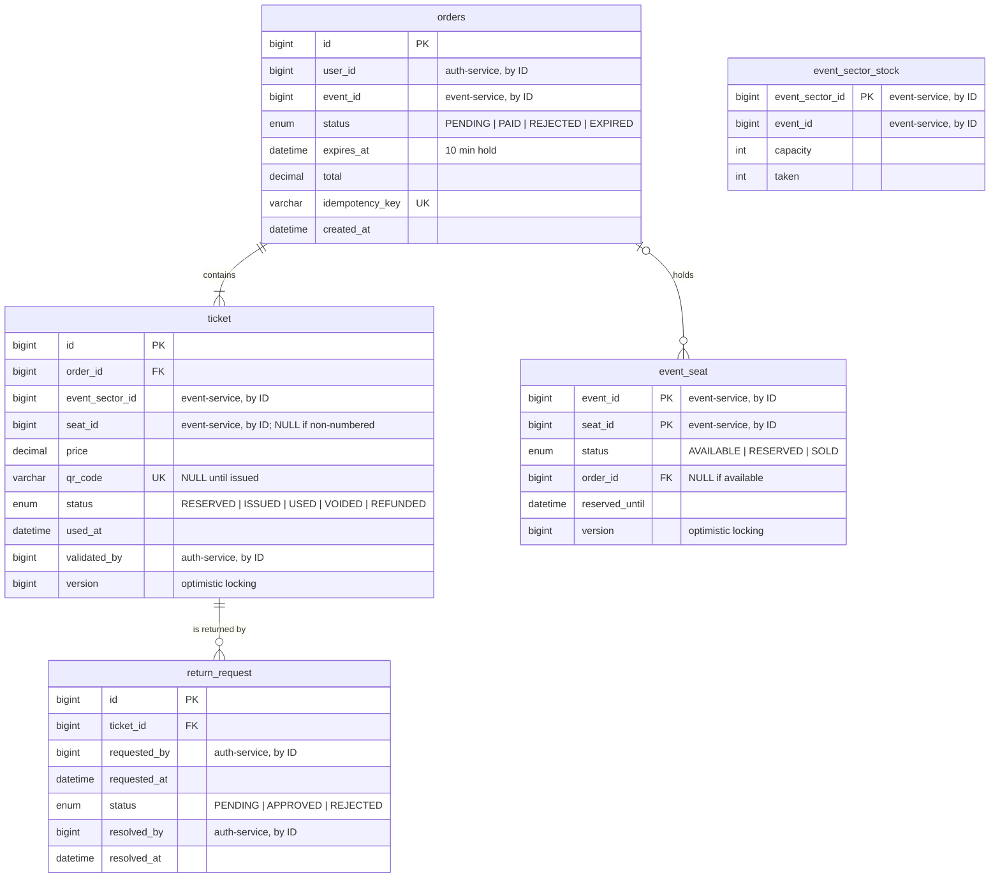

# ticket-service: decisiones del modelo

> Épica 2 (#21). Tablas 🟠 *Sales and access* y 🔴 `return_request` de `ticketya_schema_en.drawio`, más `event_sector_stock`, que se agregó en esta etapa.

Es el núcleo transaccional: reserva, compra, emisión de QR, no doble venta, devoluciones e ingreso al evento.

## Diagrama



## Referencias a otros servicios

Todas van por ID, sin FK física, porque cada servicio tiene su propia base.

| Campo | Apunta a | Servicio |
|---|---|---|
| `orders.user_id`, `return_request.requested_by`, `return_request.resolved_by` | `user` | auth-service |
| `ticket.validated_by` | `access_staff` | auth-service |
| `orders.event_id`, `event_seat.event_id`, `event_sector_stock.event_id` | `event` | event-service |
| `event_seat.seat_id`, `ticket.seat_id` | `seat` | event-service |
| `ticket.event_sector_id`, `event_sector_stock.event_sector_id` | `event_sector` | event-service |

**Datos solapados entre bases** (copias que se guardan a propósito):

| Dato | Copia de | Por qué se copia |
|---|---|---|
| `ticket.price` | `event_sector.price` | El precio que pagó el cliente no puede cambiar si el organizador cambia el precio después. También es la base de la recaudación (consigna 12) |
| `orders.total` | Suma de `ticket.price` | Es el monto que se le pide cobrar al payment-service |
| `event_sector_stock.capacity` | `sector.capacity` | Controlar el cupo sin llamar al event-service en cada compra |
| Filas de `event_seat` | Los `seat` de los sectores habilitados | Cada asiento necesita su propio estado y su `version` en esta base |

## Decisiones

### No doble venta en sectores numerados: `event_seat` con `version`

Consigna 5: *"una entrada nunca puede venderse dos veces, aun cuando muchos clientes intenten comprar el mismo asiento al mismo tiempo"*.

Hay una fila por asiento y evento, con `@Version`. Reservar es leer la fila, verificar que esté libre y actualizarla. Si dos compras leen la misma fila al mismo tiempo, la primera que escribe incrementa `version` y la segunda falla con `OptimisticLockException`, porque la `version` que leyó ya no existe. El control lo hace la base, así que funciona aunque haya varias instancias del ticket-service.

| Alternativa | Por qué no |
|---|---|
| Lock pesimista (`SELECT … FOR UPDATE`) | También funciona, pero bloquea la fila mientras dura la transacción; con miles de compras en el mismo evento, las transacciones se encolan. El optimista no bloquea: el que pierde falla enseguida |
| Lock en memoria (`synchronized`) | No funciona con varias instancias, que es justo lo que pide el enunciado |
| Redis | Agrega otra tecnología al núcleo de la compra sin necesidad; la base relacional ya garantiza la consistencia |

### No doble venta en sectores no numerados: `event_sector_stock`

Consigna 5: *"o el último lugar de una zona"*. En un sector no numerado no hay asientos que bloquear, solo un cupo. El diagrama original lo tenía como `event_sector.occupied` en el event-service; se movió acá por dos motivos:

- **Las dos protecciones contra la doble venta quedan en el mismo servicio y en la misma base.** El event-service se cachea y puede pasar a MongoDB, que es lo opuesto a lo que necesita un contador de cupo.
- **La reserva es un único `UPDATE` atómico**, sin `version` ni locks en Java:

```sql
UPDATE event_sector_stock
SET taken = taken + :quantity
WHERE event_sector_id = :id AND taken + :quantity <= capacity
```

Si actualiza 0 filas, no hay lugar. La base ejecuta el `UPDATE` de a una fila por vez, así que dos compras del último lugar nunca pasan las dos. Además, un `CHECK (taken >= 0 AND taken <= capacity)` impide que el contador quede inconsistente aunque haya un bug en el código.

**Costo:** a diferencia de `event_seat`, el contador no se libera solo cuando una reserva vence. Hace falta un job programado que pase a `EXPIRED` las órdenes vencidas y le reste al contador las entradas de esas órdenes. El mismo job limpia `event_seat`.

### El inventario se crea al publicar el evento

`event_seat` y `event_sector_stock` se crean cuando el evento pasa a `PUBLISHED`: el event-service le pasa al ticket-service los asientos de los sectores numerados y la capacidad de los no numerados que tienen fila en `event_sector`. Así hay un solo momento de sincronización entre los dos servicios, y durante la venta el ticket-service no necesita consultar al event-service para saber qué hay disponible. Se implementa en la épica de publicación o de compra.

### La `ticket` existe desde la reserva

Cuando el cliente reserva, se crean la `orders` (`PENDING`) y sus `ticket` en `RESERVED`, sin QR. Cuando el pago se aprueba, pasan a `ISSUED` con su `qr_code`. Si se rechaza o vence, pasan a `VOIDED`.

Así el detalle de la compra (qué sector, qué asiento, a qué precio) queda registrado antes de cobrar, como pide la consigna 4. Además, si algo falla después de cobrar, la saga tiene las entradas para compensar con un reintegro.

### `version` en `ticket`

Protege dos casos de la consigna 8 y la 7:
- Dos lectores escanean el mismo QR en el mismo segundo: el segundo falla en vez de marcarla como usada dos veces (*"un QR no puede ingresar dos veces"*).
- Se aprueba una devolución mientras alguien entra con esa entrada: solo una de las dos operaciones se aplica.

### `qr_code` aleatorio

Se genera con un UUID, no a partir del ID de la entrada. Si fuera predecible, alguien podría generar QR válidos de entradas ajenas.

### Idempotencia de la orden

`orders.idempotency_key` es única y la genera el cliente para cada intento de compra. Si la app reintenta la misma compra por un problema de conexión (consigna 5), el ticket-service encuentra la orden existente y la devuelve en vez de crear otra y reservar dos veces. La idempotencia del cobro se resuelve en el payment-service.

### `reserved_until` repite `orders.expires_at`

Se deja a propósito: permite saber si un asiento está libre mirando solo `event_seat`. Un asiento `RESERVED` con `reserved_until` vencido se trata como libre al reservar, aunque el job todavía no lo haya limpiado.

### Tabla `orders`

`ORDER` es palabra reservada en MySQL, así que la tabla se llama `orders`. La entidad sigue siendo `Order`.

### `return_request` separada del reintegro

La devolución es la solicitud del cliente y la resolución del administrador (consigna 7); el reintegro es el movimiento de dinero con la pasarela. Por eso la devolución vive acá, junto a la entrada que libera, y el reintegro en el payment-service.

## Limitaciones conocidas

**Límite de entradas por cliente.** Se controla contando las entradas del usuario para el evento (`orders.user_id` + `orders.event_id`) contra `event.max_tickets_per_customer`. Si el mismo usuario lanza dos compras exactamente al mismo tiempo, las dos pueden pasar el control. Resolverlo requiere un lock por usuario y evento; para la Entrega 1 se valida en el service y queda anotado. No afecta la no doble venta: cada lugar sigue vendiéndose una sola vez.

## Datos de prueba

El `TicketSeeder` usa los IDs que generan los seeders del auth-service y del event-service:

| Dato | ID | Origen |
|---|---|---|
| Cliente | `user` 1 | auth-service |
| Recital (alta demanda) | `event` 1, sectores `event_sector` 1 (Campo) y 2 (Platea), asientos 1–80 | event-service |
| Obra de teatro | `event` 2, sectores `event_sector` 3 (Platea) y 4 (Pullman), asientos 81–154 | event-service |

Carga el inventario de los dos eventos publicados, una compra pagada en el Campo, una pagada con asientos en la obra (con una devolución pendiente) y una reserva en curso en la Platea del recital.
