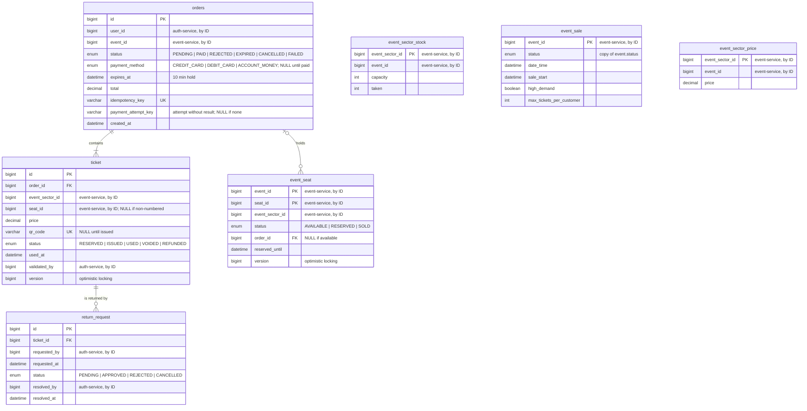

# ticket-service: decisiones del modelo

> Épica 2 (#21). Tablas 🟠 *Sales and access* y 🔴 `return_request` de `ticketya_schema_en.drawio`, más `event_sector_stock`, que se agregó en esta etapa.

Es el núcleo transaccional: reserva, compra, emisión de QR, no doble venta, devoluciones e ingreso al evento.

## Diagrama



## Referencias a otros servicios

Todas van por ID, sin FK física, porque cada servicio tiene su propia base.

| Campo | Apunta a | Servicio |
|---|---|---|
| `orders.user_id`, `return_request.requested_by`, `return_request.resolved_by` | `user` | auth-service |
| `ticket.validated_by` | `access_staff` | auth-service |
| `orders.event_id`, `event_seat.event_id`, `event_sector_stock.event_id`, `event_sale.event_id`, `event_sector_price.event_id` | `event` | event-service |
| `event_seat.seat_id`, `ticket.seat_id` | `seat` | event-service |
| `ticket.event_sector_id`, `event_seat.event_sector_id`, `event_sector_stock.event_sector_id`, `event_sector_price.event_sector_id` | `event_sector` | event-service |

**Datos solapados entre bases** (copias que se guardan a propósito):

| Dato | Copia de | Por qué se copia |
|---|---|---|
| `ticket.price` | `event_sector.price` | El precio que pagó el cliente no puede cambiar si el organizador cambia el precio después. También es la base de la recaudación (consigna 12) |
| `orders.total` | Suma de `ticket.price` | Es el monto que se le pide cobrar al payment-service |
| `event_sector_stock.capacity` | `sector.capacity` | Controlar el cupo sin llamar al event-service en cada compra |
| Filas de `event_seat` | Los `seat` de los sectores habilitados | Cada asiento necesita su propio estado y su `version` en esta base |
| `event_sale` | `event` | Reservar sin llamar al event-service en cada compra |
| `event_sector_price.price` | `event_sector.price` | Lo mismo para el precio que se copia en cada `ticket` |
| `orders.payment_method` | `payment.payment_method` | Listar las compras sin depender del payment-service |

## Decisiones

### No doble venta en sectores numerados: `event_seat` con `version`

Consigna 5: *"una entrada nunca puede venderse dos veces, aun cuando muchos clientes intenten comprar el mismo asiento al mismo tiempo"*.

Hay una fila por asiento y evento, con `@Version`. Reservar es leer la fila, verificar que esté libre y actualizarla. Si dos compras leen la misma fila al mismo tiempo, la primera que escribe incrementa `version` y la segunda falla con `OptimisticLockException`, porque la `version` que leyó ya no existe. El control lo hace la base, así que funciona aunque haya varias instancias del ticket-service.

| Alternativa | Por qué no |
|---|---|
| Lock pesimista (`SELECT … FOR UPDATE`) | También funciona, pero bloquea la fila mientras dura la transacción; con miles de compras en el mismo evento, las transacciones se encolan. El optimista no bloquea: el que pierde falla enseguida |
| Lock en memoria (`synchronized`) | No funciona con varias instancias, que es justo lo que pide el enunciado |
| Redis | Agrega otra tecnología al núcleo de la compra sin necesidad; la base relacional ya garantiza la consistencia |

### No doble venta en sectores no numerados: `event_sector_stock`

Consigna 5: *"o el último lugar de una zona"*. En un sector no numerado no hay asientos que bloquear, solo un cupo. El diagrama original lo tenía como `event_sector.occupied` en el event-service; se movió acá por dos motivos:

- **Las dos protecciones contra la doble venta quedan en el mismo servicio y en la misma base.** El event-service se cachea y puede pasar a MongoDB, que es lo opuesto a lo que necesita un contador de cupo.
- **La reserva es un único `UPDATE` atómico**, sin `version` ni locks en Java:

```sql
UPDATE event_sector_stock
SET taken = taken + :quantity
WHERE event_sector_id = :id AND taken + :quantity <= capacity
```

Si actualiza 0 filas, no hay lugar. La base ejecuta el `UPDATE` de a una fila por vez, así que dos compras del último lugar nunca pasan las dos. Además, un `CHECK (taken >= 0 AND taken <= capacity)` impide que el contador quede inconsistente aunque haya un bug en el código.

**Costo:** a diferencia de `event_seat`, el contador no se libera solo cuando una reserva vence. Hace falta un job programado que pase a `EXPIRED` las órdenes vencidas y le reste al contador las entradas de esas órdenes. El mismo job limpia `event_seat` y corre cada 30 segundos, así un cupo vencido se libera a más tardar 1 minuto después. Hasta entonces, ese cupo figura ocupado y no se puede comprar.

### El inventario se crea al publicar el evento

`event_seat` y `event_sector_stock` se crean cuando el evento pasa a `PUBLISHED`: el event-service le pasa al ticket-service los asientos de los sectores numerados y la capacidad de los no numerados que tienen fila en `event_sector`. Así hay un solo momento de sincronización entre los dos servicios, y durante la venta el ticket-service no necesita consultar al event-service para saber qué hay disponible.

Publicar y cancelar usan el mismo endpoint interno, `PUT /internal/event-sales/{eventId}`, que recibe la foto completa de la venta. Es idempotente: actualiza estado, fechas y precios, y crea solo los lugares que faltan, sin tocar los ya vendidos o reservados. El event-service llama antes de cambiar su propio estado y sin una transacción abierta. Si la llamada falla, el evento queda como estaba y se puede reintentar.

### La `ticket` existe desde la reserva

Cuando el cliente reserva, se crean la `orders` (`PENDING`) y sus `ticket` en `RESERVED`, sin QR. Cuando el pago se aprueba, pasan a `ISSUED` con su `qr_code`. Si la orden se rechaza, vence o se cancela, pasan a `VOIDED`.

Así el detalle de la compra (qué sector, qué asiento, a qué precio) queda registrado antes de cobrar, como pide la consigna 4. Además, si algo falla después de cobrar, la saga tiene las entradas para compensar con un reintegro.

### `version` en `ticket`

Protege dos casos de la consigna 8 y la 7:
- Dos lectores escanean el mismo QR en el mismo segundo: el segundo falla en vez de marcarla como usada dos veces (*"un QR no puede ingresar dos veces"*).
- Se aprueba una devolución mientras alguien entra con esa entrada: solo una de las dos operaciones se aplica.

### `qr_code` aleatorio

Se genera con un UUID, no a partir del ID de la entrada. Si fuera predecible, alguien podría generar QR válidos de entradas ajenas.

### Idempotencia de la orden

`orders.idempotency_key` es única y la genera el cliente para cada intento de compra. Si la app reintenta la misma compra por un problema de conexión (consigna 5), el ticket-service encuentra la orden existente y la devuelve en vez de crear otra y reservar dos veces. La idempotencia del cobro se resuelve en el payment-service.

Si una reserva falla, antes de responder el error se vuelve a buscar la clave. Dos pedidos del mismo intento pueden correr a la vez, y el que pierde ve los lugares ya tomados por su propia orden: tiene que recibir esa orden, no `seat_unavailable`.

### `reserved_until` repite `orders.expires_at`

Se deja a propósito: permite saber si un asiento está libre mirando solo `event_seat`. Un asiento `RESERVED` con `reserved_until` vencido se trata como libre al reservar, aunque el job todavía no lo haya limpiado.

### Tabla `orders`

`ORDER` es palabra reservada en MySQL, así que la tabla se llama `orders`. La entidad sigue siendo `Order`.

### `return_request` separada del reintegro

La devolución es la solicitud del cliente y la resolución del administrador (consigna 7); el reintegro es el movimiento de dinero con la pasarela. Por eso la devolución vive acá, junto a la entrada que libera, y el reintegro en el payment-service.

### Copia de los datos de venta

Reservar necesita precio, estado, fecha, `sale_start`, `high_demand` y `max_tickets_per_customer`, que son del event-service. Consultarlos en cada reserva pondría a ese servicio en el camino crítico de la compra: en una apertura masiva, cada reserva le pegaría, y si se cachearan, un `SUSPENDED` podría verse tarde.

Por eso se copian a `event_sale` y `event_sector_price` junto con el inventario, y el event-service avisa cualquier cambio de esos datos. `event_seat` también guarda su `event_sector_id`, para validar el sector y completar el `ticket` sin otra llamada.

**Costo:** el event-service tiene que avisar cada cambio. Si un aviso falla, ese cambio de estado no debe darse por aplicado, porque el ticket-service seguiría vendiendo con el dato anterior.

### Aprobar una devolución: primero payment

No hay una transacción que abarque las dos bases, así que aprobar se hace en tres pasos:

1. Se verifica, en una transacción, que la solicitud siga `PENDING` y la entrada `ISSUED`.
2. Se pide el reintegro al payment-service, sin ninguna transacción abierta, para no retener conexiones ni bloqueos durante la llamada.
3. Si lo aceptó, se confirma en una transacción: solicitud `APPROVED`, entrada `REFUNDED` y lugar liberado.

Si el payment-service no responde, la solicitud sigue `PENDING` y el administrador reintenta. Ante un timeout no se sabe si el reintegro se procesó, por eso el reintento tiene que ser seguro: para el mismo `ticket_id`, el payment-service devuelve el reintegro existente. El mismo reintento completa el paso 3 si el ticket-service se cayó después del paso 2.

El paso 3 usa `UPDATE` condicionales, y solo libera el lugar quien efectivamente pasó la entrada de `ISSUED` a `REFUNDED`, así dos aprobaciones simultáneas no lo liberan dos veces. Si la solicitud se resolvió por otro camino mientras se pedía el reintegro, la entrada igual queda `REFUNDED`, porque el dinero ya se devolvió, y el administrador recibe 409 `refund_not_allowed`.

### Una sola transición desde `PENDING`

Una orden en `PENDING` puede terminar por varios caminos a la vez: se confirma el pago, llega al tope de rechazos, vence, el cliente la abandona o se cancela el evento. Cada salida se aplica con un `UPDATE orders SET status = :next WHERE id = :id AND status = 'PENDING'`. La base ejecuta esa operación de a una por fila, así que solo una actualiza la fila. Las demás ven 0 filas afectadas y no modifican nada. `orders` no tiene `@Version` porque este `UPDATE` condicional alcanza.

Si el pago se aprobó y la orden ya no puede pasar a `PAID`, no se emiten entradas y se pide el reintegro de cada `ticket` con motivo `PURCHASE_COMPENSATION`.

### Intentos de pago: la orden `PENDING` es la reserva

La orden nace `PENDING` al reservar y es la reserva misma. No se puede crear recién al aprobar: hace falta antes para saber cuánto cupo devolver, a qué compra pertenece cada asiento y cuánto cobrar. Solo una orden `PAID` cuenta como compra, y es la única con entradas `ISSUED`.

Una orden admite varios pagos. El cliente genera una clave por intento, y `orders.payment_attempt_key` guarda la del intento sin resultado. Antes de llamar al payment-service se toma la orden, sin ninguna transacción abierta durante la llamada:

```sql
UPDATE orders
SET payment_attempt_key = :key
WHERE id = :id AND status = 'PENDING'
  AND (payment_attempt_key IS NULL OR payment_attempt_key = :key)
```

Si actualiza 0 filas, hay otro intento sin resultado y responde 409 `payment_in_progress`. Así, dos intentos con tarjetas distintas nunca viajan a la vez, que es lo que la idempotencia sola no evita porque sus claves son distintas.

| Resultado del intento | Qué pasa |
|---|---|
| Aprobado | La orden pasa a `PAID` y se emiten las entradas |
| Rechazado, con menos de 3 rechazos | Se limpia la clave, la orden sigue `PENDING` y el cliente puede usar otro medio |
| Rechazado por tercera vez | La orden pasa a `REJECTED`, las entradas a `VOIDED` y los lugares se liberan |
| Sin resultado (corte, timeout, caída) | La clave queda cargada. Solo se puede reintentar ese mismo intento, nunca asumirlo cancelado |

La cantidad de rechazos sale del `rejectedAttempts` que informa el payment-service, porque contar filas no suma de más al repetir una clave.

### Manda la reserva

La reserva dura 10 minutos y nunca se extiende. Un intento nuevo solo se acepta hasta 1 minuto antes del vencimiento; después responde 409 `payment_window_closed`. Reintentar el mismo intento se permite hasta el vencimiento, porque no es un cobro nuevo. El tiempo máximo de espera al payment-service, sumando reintentos, tiene que ser menor a ese margen, así el resultado llega antes de que venza.

La duración, el margen y el tope de rechazos son configurables.

Si se pierde la respuesta y se llega al vencimiento sin resultado, la orden pasa igual a `EXPIRED` y los lugares se liberan. En la Entrega 2, el job busca las órdenes `EXPIRED` o `CANCELLED` con la clave cargada y le pide al payment-service anular el intento. Si resulta aprobado, pide el reintegro de cada entrada con motivo `PURCHASE_COMPENSATION`. Si sigue sin resultado, vuelve a preguntar en la siguiente corrida.

### Abandonar una reserva

El cliente puede abandonar su orden `PENDING`. La confirmación ("¿Estás seguro?") es del front; el back recibe una sola llamada, `POST /api/orders/{id}/cancel`. En una transacción, la orden pasa a `CANCELLED`, las entradas a `VOIDED` y los lugares se liberan sin esperar al job. No se llama al payment-service, porque una orden `PENDING` sin intento en curso no tiene nada cobrado.

La salida es un `UPDATE` condicional que además exige `payment_attempt_key IS NULL`: con un pago en curso responde 409 `payment_in_progress`. Solo libera lugares quien efectivamente cambió el estado, así que repetir el pedido no descuenta el cupo dos veces.

### Verificar el asiento antes de emitir

Un `event_seat` con `reserved_until` vencido se trata como libre, así que otro cliente puede tomarlo aunque el job todavía no haya expirado la orden original. Antes de pasar a `PAID` se verifica que cada asiento siga asociado a esa orden. Si alguno ya no lo está, la orden pasa a `EXPIRED` y se compensa el pago como en el caso anterior.

### Evento agotado

Después de emitir, y en otra transacción para ver las compras simultáneas ya confirmadas, se revisa si queda algún lugar libre o reservado. Si no queda, `event_sale` pasa a `SOLD_OUT` y se anota el aviso pendiente. El job lo envía al event-service con `PUT /internal/events/{id}/sold-out` y lo reintenta hasta que se aplique, sin deshacer la compra. Si el event-service lo rechaza con un 4xx, se deja de reintentar.

Aprobar una devolución libera un lugar, así que en esa misma transacción `event_sale` vuelve de `SOLD_OUT` a `PUBLISHED` y se anota el aviso. El job manda el estado que tiene la venta en ese momento, con `PUT /internal/events/{id}/sold-out` o `PUT /internal/events/{id}/back-on-sale`. El aviso solo se limpia si la venta sigue en el estado que se avisó: si cambió mientras tanto, la siguiente corrida avisa el estado nuevo.

### Cancelación de un evento

El event-service avisa la cancelación con `PUT /internal/event-sales/{eventId}` y estado `CANCELLED`. En esa misma transacción las órdenes `PENDING` pasan a `CANCELLED`, sus entradas a `VOIDED`, sus lugares se liberan y las solicitudes de devolución `PENDING` pasan a `CANCELLED`.

Los reintegros no se piden dentro de ese aviso, porque un evento con muchas entradas superaría el timeout del event-service. Los pide un job cada 30 segundos, uno por entrada `ISSUED` o `USED` de un evento `CANCELLED`, con motivo `EVENT_CANCELLED`. Cada entrada pasa a `REFUNDED` cuando el payment-service acepta su reintegro. Si uno falla, se siguen procesando los demás y el siguiente ciclo reintenta solo los que faltan, sin duplicados porque el reintegro es único por entrada.

Si la orden se cancela mientras se confirma su pago, no se emiten entradas y el pago se reintegra con motivo `PURCHASE_COMPENSATION`, por el mismo camino que una reserva vencida.

### Una sola solicitud pendiente por entrada

`return_request.pending_ticket_id` es una columna generada que vale `ticket_id` mientras la solicitud está `PENDING` y `NULL` si no, con UNIQUE. Es el mismo recurso que `payment.active_order_id`: dos pedidos simultáneos no pueden crear dos solicitudes pendientes, y después de un rechazo se puede volver a solicitar.

## Limitaciones conocidas

**Límite de entradas por cliente.** Se controla contando las entradas del usuario para el evento (`orders.user_id` + `orders.event_id`) contra `event_sale.max_tickets_per_customer`. Si el mismo usuario lanza dos compras exactamente al mismo tiempo, las dos pueden pasar el control. Resolverlo requiere un lock por usuario y evento; para la Entrega 1 se valida en el service y queda anotado. No afecta la no doble venta: cada lugar sigue vendiéndose una sola vez.

**Ingreso durante la aprobación de una devolución.** Si alguien entra con una entrada justo entre el pedido de reintegro y la confirmación local, el reintegro ya se pidió y la entrada queda `USED`. Es muy improbable y se registra en el log para resolverlo a mano. Si la entrada ya estaba usada al aprobar, no se pide el reintegro.

**Reintegro rechazado de un evento cancelado.** Si el payment-service rechaza el reintegro con un 4xx, por ejemplo porque la entrada ya tenía un reintegro acreditado con otros datos, la entrada sigue sin pasar a `REFUNDED`, el job la reintenta y cada intento queda en el log para resolverlo a mano.

## Datos de prueba

El `TicketSeeder` usa los IDs que generan los seeders del auth-service y del event-service:

| Dato | ID | Origen |
|---|---|---|
| Cliente | `user` 1 | auth-service |
| Recital (alta demanda) | `event` 1, sectores `event_sector` 1 (Campo) y 2 (Platea), asientos 1–80 | event-service |
| Obra de teatro | `event` 2, sectores `event_sector` 3 (Platea) y 4 (Pullman), asientos 81–154 | event-service |

Carga el inventario de los dos eventos publicados, una compra pagada en el Campo, una pagada con asientos en la obra (con una devolución pendiente) y una reserva en curso en la Platea del recital.

## User stories

Las historias y sus criterios de aceptación están en [`user-stories.md`](../user-stories.md), con el prefijo `US-TKT`. Acá quedan las decisiones de negocio que definen y lo que necesitan de otros servicios.

### Decisiones de negocio

| Tema | Regla | Por qué |
|---|---|---|
| Pago rechazado | La orden sigue `PENDING` y el cliente puede usar otro medio, hasta 3 rechazos o la hora de corte. Al tercero, se liberan los lugares | La consigna 4 no define si "rechazado" es un intento o el pago completo. Se interpreta como lo segundo: perder el lugar por una tarjeta rechazada es injusto, y reintentar no retiene los lugares más de los 10 minutos originales |
| Pago sin resultado | Solo se reintenta el mismo intento, y nunca se lo asume cancelado | El primer cobro pudo haberse aprobado; otra tarjeta podría generar un doble cobro |
| Vencimiento con un pago sin resultado | La orden vence igual, y si el pago resulta aprobado se reintegra | La reserva manda: los lugares no quedan trabados si la pasarela está caída |
| Devolución con evento `SUSPENDED` | Se acepta, con la regla de 72 horas. Solo se bloquea la venta | El cliente no queda atrapado si la nueva fecha no le sirve |
| Identidad en la Entrega 1 | Header `X-User-Id`, sin validar roles | El enunciado no pide autenticación en esta entrega |
| Órdenes y solicitudes pendientes al cancelar | Pasan a `CANCELLED` | Es una causa distinta de `EXPIRED` y de `REJECTED`, y el cliente no debe ver "rechazada" cuando le devuelven el dinero |
| Abandono voluntario de una reserva | La orden también pasa a `CANCELLED`, salvo con un pago en curso | Para el cliente es lo mismo que una cancelación, y la causa queda en el log de operaciones |
| Entradas `USED` al cancelar | También se reintegran | La consigna 7 dice "todas sus entradas vendidas" |
| Aprobar una devolución si el payment-service no responde | La solicitud sigue `PENDING` y el administrador reintenta | La entrada no se marca como devuelta hasta que payment acepte el reintegro |
| Compra que falla después de cobrar | La orden termina en `FAILED` | El pago sí se aprobó, así que el cliente no debe ver "rechazado" |
| Compensación por vencimiento durante el pago | Va en la Entrega 1, en su forma simple | El caso puede ocurrir desde la primera entrega y la llamada de reintegro ya existe. La US-TKT-22 agrega los reintentos y los demás fallos |

### Pendientes para la implementación

- **Códigos nuevos en `TicketErrorCode`:** `invalid_queue_token`.

### Endpoints

| Método y ruta | Qué hace | Errores |
|---|---|---|
| `PUT /internal/event-sales/{eventId}` | Sincroniza la venta y el inventario. Con estado `CANCELLED` cierra las compras abiertas y deja los reintegros al job. Solo entre servicios; el gateway no la expone | 400 `validation_error` |
| `GET /api/availability?eventId=` | Disponibilidad por sector | 404 `resource_not_found` |
| `POST /api/orders` | Reserva asientos (`seatIds`) o lugares (`eventSectorId` y `quantity`). Header `X-User-Id` | 400 `validation_error`, 404 `resource_not_found`, 409 `seat_unavailable`, `sector_sold_out`, `ticket_limit_exceeded`, `event_not_on_sale`, `sale_not_started`, `data_conflict` |
| `POST /api/orders/{id}/cancel` | Abandona una reserva. Repetirlo responde 200. Header `X-User-Id` | 404 `order_not_found`, 409 `payment_in_progress`, `reservation_expired`, `order_not_cancellable` |
| `POST /api/tickets/{ticketId}/return-requests` | Solicita la devolución de una entrada. Header `X-User-Id` | 404 `ticket_not_found`, 409 `refund_not_allowed`, `return_request_already_pending` |
| `GET /api/return-requests?status=&page=&size=` | Lista paginada, primero las más antiguas. Por defecto, `PENDING` | 400 si un parámetro es inválido |
| `POST /api/return-requests/{id}/approve` | Pide el reintegro, marca la entrada `REFUNDED` y libera el lugar. Header `X-User-Id` | 404 `return_request_not_found`, 409 `refund_not_allowed`, `ticket_already_used`, 503 `service_unavailable` |
| `POST /api/return-requests/{id}/reject` | Rechaza la solicitud y la entrada sigue vigente. Header `X-User-Id` | 404 `return_request_not_found`, 409 `refund_not_allowed` |

### Dependencias con otros servicios

| Servicio | Qué se necesita | Historias |
|---|---|---|
| event-service → ticket-service | Avisar la publicación con asientos, capacidades y datos de venta; avisar cualquier cambio de esos datos y la cancelación | US-TKT-01, 07, 18 |
| ticket-service → event-service | Pedir `SOLD_OUT` y su reversa; capacidad y organización para los reportes | US-TKT-13, 20 |
| ticket-service → payment-service | Cobrar por `order_id` con el monto de `orders.total` y la clave del intento; anular un intento sin resultado; reintegrar por `ticket_id`. Contrato en `payment-service.md` | US-TKT-09 a 11, 16, 18, 22, 23 |
| ticket-service → auth-service | Confirmar la asignación del personal de acceso y la organización del organizador | US-TKT-19, 20 |
| recommendation-service → ticket-service | Historial de compras | US-TKT-25 |
