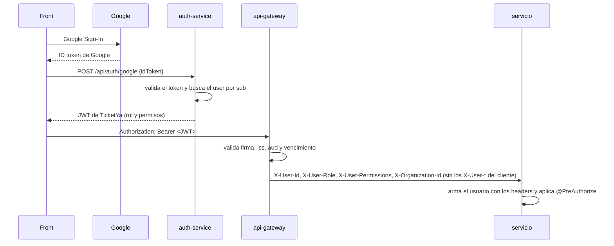

# RFC-001: Modalidad de autenticación

- **Estado:** Abierto — a decidir antes de la Épica 9 (Seguridad JWT)
- **Relacionado:** #9, tabla `user` del `auth-service` (campo `idp_subject`)

## Contexto

El enunciado pide explícitamente un login externo (OAuth); como referencia se toma el de Google.

El diagrama de contexto del enunciado incluye un **"Proveedor de identidad (autenticación externa)"**, y el modelo de datos tiene en `user` el campo `idp_subject`: el identificador del usuario en ese proveedor (el claim `sub` del JWT que emite). Por eso `user` no tiene columna de contraseña.

Flujo previsto con IdP externo:

1. El usuario se loguea en el IdP (Keycloak, Auth0, Google, etc.), no en TicketYa.
2. El IdP le entrega un JWT con el claim `sub` (ID único y estable de la persona en el IdP).
3. El backend lee el `sub`, busca el `User` con ese `idp_subject` y obtiene su rol y sus datos.

No se usa el email como vínculo porque puede cambiar o no venir en el token; el `sub` es estable y único.

Para la Entrega 1 no hace falta resolverlo: el enunciado pide "sin autenticación (el usuario se identifica por parámetro o encabezado)". Mientras tanto `idp_subject` queda en `null`.

## Opciones

| Opción | Qué implica |
|---|---|
| **IdP externo** (lo que dice el diagrama) | Se usa `idp_subject`; los servicios validan el JWT como *resource server*. Más realista, pero hay que levantar algo como Keycloak en Docker |
| **Login propio en el auth-service** | El auth-service emite el JWT. Se saca `idp_subject` y se agrega `password_hash`. Más simple de armar |

## Posible funcionamiento con Google

> Propuesta, no decidida. Las dudas de *Dudas abiertas* siguen sin resolver.

El ID token de Google dice **quién es** la persona (`sub`, email), pero no trae su rol ni sus permisos en TicketYa. Por eso el auth-service lo **canjea** por un JWT propio:

1. El front hace Google Sign-In y recibe un ID token de Google.
2. `POST /api/auth/google {idToken}`: el auth-service lo valida contra las claves públicas de Google (`iss=accounts.google.com`, `aud=<client id>`, `exp`, `email_verified`).
3. Busca el `User` por `idp_subject = sub`. Si no existe, aplica la regla del primer login (ver *Dudas abiertas*).
4. Emite el JWT de TicketYa (RS256, con la clave privada del auth-service): `sub`=userId, `role`, `permissions`, `organizationId`, `exp` de alrededor de 1 h. Responde `{accessToken, expiresIn}`.
5. El gateway valida **solo** el JWT de TicketYa, con la clave pública. Nunca recibe el de Google.

### Qué hay en cada servicio

| Servicio | Clase | Qué hace |
|---|---|---|
| auth-service | `GoogleIdTokenVerifier` | `NimbusJwtDecoder` contra el JWKS de Google, con validadores de issuer y audience |
| auth-service | `JwtTokenService` | Arma los claims a partir de `User` y `Role` y firma con el `JwtEncoder` de Spring |
| auth-service | `AuthController`, `AuthService` | `POST /api/auth/google`. `401 invalid_credentials` si el token de Google es inválido o está vencido |
| api-gateway | `SecurityConfig` | `oauth2ResourceServer().jwt()` con la clave pública. El filtro que valida ya lo trae Spring Security (`BearerTokenAuthenticationFilter`), así que no se escribe uno propio |
| api-gateway | Handlers de 401 y 403 | Responden `unauthorized` y `forbidden` con `ErrorDto` |
| api-gateway | `IdentityHeadersFilter` | Borra los `X-User-*` que mande el cliente y pone `X-User-Id`, `X-User-Role`, `X-User-Permissions` y `X-Organization-Id` sacados del token |
| `common` | Filtro de headers y configuración de seguridad | Convierte los `X-User-*` en el usuario de Spring Security (los permisos pasan a ser authorities) y activa `@PreAuthorize`. No valida el token: eso lo hace solo el gateway ([ADR-003](../adr/ADR-003-jwt-validated-only-in-gateway.md)) |
| event-service y demás | `@PreAuthorize` | Reemplaza al `PermissionInterceptor`: los permisos llegan en `X-User-Permissions`, sin llamar al auth-service |

- **Token opcional en el gateway:** si viene, tiene que ser válido; si no viene, el request pasa sin identidad y cada servicio responde `401` en sus endpoints protegidos.
- **Rutas públicas:** `POST /api/auth/google`, `POST /api/auth/dev-login` (solo en `dev`), los `GET` del catálogo (eventos, lugares y participantes), `/docs/**`, swagger y health. Son públicas porque sus endpoints no tienen `@PreAuthorize`, no porque figuren en una lista del gateway.
- **Configuración:** `GOOGLE_CLIENT_ID` y la clave privada van por variable de entorno, nunca en el repo.

### Riesgos

| Riesgo | Mitigación |
|---|---|
| Si los servicios exponen su propio puerto, se puede saltear el gateway y mandar headers falsos | Publicar solo el puerto del gateway en compose |
| Si cambian el rol de un usuario o lo dan de baja, sus permisos siguen en el token hasta que vence | `exp` corto |
| Los usuarios del seeder tienen `idp_subject = null` | Vincularlos por email verificado en el primer login |

### Cómo se probaría

- **auth-service:** ID token válido, vencido o con otra audience (con el decoder de Google mockeado), usuario nuevo y usuario dado de baja.
- **api-gateway** (como `InternalRoutesTest`):
  - sin token, `401`;
  - con un token adulterado o vencido, `401`;
  - con uno válido, el request llega con los headers;
  - el `X-User-Id` que mande el cliente se descarta.
- **Postman:** un request de login que guarde el token en una variable de la colección.

## Decisiones de diseño tomadas

Acordadas el 17/11/2026, antes de implementar. La sección *Decisión* queda pendiente hasta cerrarla con el equipo.

| Tema | Decisión | Por qué |
|---|---|---|
| Dónde se valida el JWT | **Solo en el gateway**; los servicios confían en sus headers. ~~En el gateway y en cada servicio~~ (revertida el mismo día) | Un solo lugar con la clave y los validadores, sin distribuir la clave pública a cada servicio. El riesgo de headers falsos por la red interna se acepta y se mitiga: ver el [ADR-003](../adr/ADR-003-jwt-validated-only-in-gateway.md) |
| Permisos en los servicios | `@PreAuthorize`, en vez del `PermissionInterceptor` | Es lo que pide la US-AUTH-03. Los permisos llegan del gateway en `X-User-Permissions` |
| Llamadas entre servicios | Secreto compartido en un header, por variable de entorno | Lo propone la US-PAY-14 y sirve para los jobs, que corren sin usuario. Un JWT de servicio queda como alternativa futura. **Falta definir** si va solo en payment o en todos los `/internal` |
| Cambios de rol o bajas | Se acepta que el token viejo valga hasta que vence, con un `exp` corto | Consultar a auth en cada request obliga a cambiar el código de todos los servicios y vuelve a acoplarlos |
| Rutas públicas | Las de la lista de arriba, definidas por cada servicio (sin `@PreAuthorize`); el token es opcional en el gateway | El catálogo es lo primero que ve alguien que todavía no se registró. Así la lista no se repite en el gateway |
| Criterio de la US-AUTH-03 | `invalid_credentials` pasa a significar un ID token de Google inválido, vencido, de otra audiencia o sin email verificado | No hay contraseña |
| `userId` en rutas y bodies | Se mantienen y se comparan con el del token: si no coinciden, `403 forbidden` | No cambia los contratos ni las colecciones de Postman |
| Perfil de Docker | El compose corre con `dev`, con `dev-login` activo | Ver el ADR-001 |

## Decisión

Pendiente. Cuando se decida, registrar la decisión y su porqué como ADR y actualizar el modelo de `user` si corresponde.

## Dudas abiertas

### ¿El primer login crea la cuenta directamente como cliente?

Si el `sub` de Google no está en `user`, la opción más segura es darlo de alta como `CLIENT`: nadie puede elegirse el rol.

- **Problema:** un organizador que entra antes de que lo carguen queda como cliente.
- **Endpoints separados por rol** (p. ej. uno para organizadores): no sirven, porque cualquiera con una cuenta de Google podría llamarlo y darse ese rol.
- **Alternativa:** un solo endpoint, y el rol sale de la base.
  - Si un admin precargó el email, se vincula por email verificado y conserva su rol.
  - Si ya había entrado como cliente, el admin lo asciende en la misma cuenta.
  - `ORGANIZER` ya incluye los permisos de comprador.
- **Costo:** el cambio de rol se aplica en el próximo token.

#### El primer administrador

Los usuarios del seeder tienen emails ficticios, así que nadie entra a ellos con Google. Para que exista un admin real, que después asciende a los demás:

- La variable `BOOTSTRAP_ADMIN_EMAIL` indica qué email es admin. En el primer login con ese email **verificado**, el usuario se crea o se vincula como `ADMIN`.
- No tiene valor por defecto. Sin la variable, nadie se vuelve admin por este camino.
- El email real no va en el repo: se carga por variable de entorno.
- **Riesgo:** si la variable queda mal cargada, esa persona es admin. Se mitiga con el email verificado y sin un valor por defecto.

#### Cómo se obtiene el ID token sin front

No hay front, y el ID token de Google se obtiene con un navegador. Se arma una **página mínima** con el botón de Google Sign-In:

- Muestra el botón, recibe el ID token y llama a `POST /api/auth/google`.
- Muestra el JWT de TicketYa, para copiarlo en Postman o Swagger.
- Necesita un client id de OAuth de un proyecto de Google Cloud. No es secreto, así que va en la configuración.
- **A definir:** dónde vive la página (`static/` del auth-service o `docs/`) y quién del equipo crea el proyecto de Google Cloud.

### ¿Cómo se prueba sin pasar por el login de Google?

Postman y los tests no pueden hacer Google Sign-In.

| Opción | Qué implica |
|---|---|
| **Endpoint solo en perfil `dev`** (`POST /api/auth/dev-login {userId}`) | Emite el JWT de TicketYa para un usuario del seeder. Riesgo: que quede activo en producción; se cubre con un test |
| **Solo Google real** | `id_token` del OAuth Playground pegado en Postman. Es lo más fiel, pero vence en 1 h y el equipo necesita un client id |
